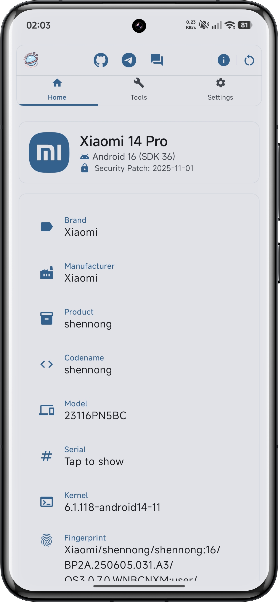
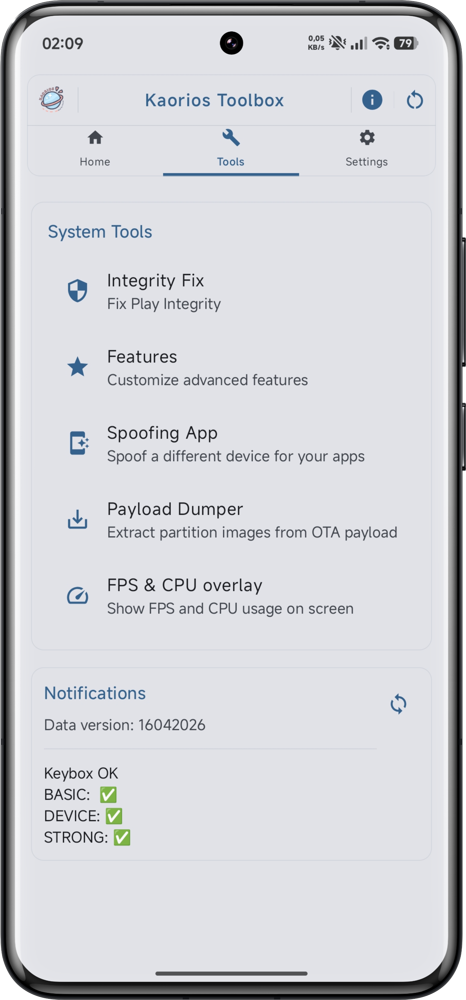

# Kaorios Toolbox

Starting with **version 2.0.4+**, Kousei is no longer involved in the development or decision-making of Kaorios Toolbox.

📢 [**Original announcement**](https://t.me/KariosToolboxDiscussion/124662)

### Previous Versions

For **version 2.0.4.0 and below**, see the legacy repository:
[Wuang26/Kaorios-Toolbox](https://github.com/Wuang26/Kaorios-Toolbox)

---

## ✨ Features

- ✅ **Play Integrity Fix:** Advanced fingerprint, build, and hardware attestation spoofing.
- 🧩 **Pixel & Properties Spoofing:** Per-model build properties and attestation fields.
- 🙈 **Hide Installed Applications:** Package visibility filtering and HMA template integration.
- 🛠️ **Hide Developer Options & ADB Status:** Surgical `Settings$NameValueCache` entry guard for reporting `"0"` without breaking developer workflow.
- 🔓 **Disable `FLAG_SECURE`:** Unblock screenshots and screen recording in secure apps.
- 📦 **CorePatch Smali Recipes:** Disable package signature verification, signature mismatch enforcement, and downgrade restrictions at the OS level.
- ☁️ **Google Photos Unlimited Backup:** Device spoofing for unlimited original-quality photo backup.
- 🎮 **High-FPS Game Profiles:** Unlock 90/120 FPS modes in supported game titles.
- 🦀 **Standalone Native Rust Engine:** Pure-Rust `kaorios-toolbox` CLI and interactive TUI dashboard.
- ⚡ **Early Boot Property Override:** `init.kaorios.rc` service configuration and `kaorihelper` (`resetprop-rs`) integration.
- 🧰 **Payload Dumper Integration:** Inspect and dump OTA `payload.bin` partitions directly on-device.

---

## 🖼️ Screenshots

  
  

  <a href="https://github.com/hzzmonetvn/Kaorios-Toolbox/tree/main/Toolbox-screenshots">🔍 See more screenshots →</a>

---

## 🚀 Documentation & Usage Guide

### 1. Framework & Services Patching (Android 13–17)

Surgical smali bytecode patching applied to copies of `framework.jar` and `services.jar`:

- **Manual Patch Guide:** Complete step-by-step instructions for class location, register allocation, hook placement, and payload DEX importation:
  - [English](Toolbox-docs/2.0.6+/Patch_Guide_2.0.6.1.md)
  - [Tiếng Việt](Toolbox-docs/2.0.6+/Patch_Guide_2.0.6.1_VI.md)
- **Automatic Patcher Guide:** Command-line usage for `kaorios_patcher.py`, modes 1–3, and toolchain constraints:
  - [English](Toolbox-docs/2.0.6+/Patcher_Guide_2.0.6.1.md)
  - [Tiếng Việt](Toolbox-docs/2.0.6+/Patcher_Guide_2.0.6.1_VI.md)
- **Developer Tooling Reference:** Architecture, sibling dependency graph, CLI options, invariants, and test suite:
  - [`script/README.md`](script/README.md)

### 2. Optional Framework Modifications

- **CorePatch (Signature & Downgrade Verification Bypass):**
  Disable package signature checking, sharedUserId mismatch, and version downgrade locks:
  - [English Guide](Toolbox-docs/2.0.6+/CorePatch.md)
  - [Hướng Dẫn Tiếng Việt](Toolbox-docs/2.0.6+/CorePatch_VI.md)
- **Disable Secure Flag:**
  Unblock screenshot capture and screen recording in apps enforcing `FLAG_SECURE`:
  - [English Guide](Toolbox-docs/2.0.6+/Disable_Secure_Flag.md)
  - [Hướng Dẫn Tiếng Việt](Toolbox-docs/2.0.6+/Disable_Secure_Flag_VI.md)

### 3. Standalone Native Rust CLI & TUI Dashboard

Operate Play Integrity, Keybox profiles, and framework features in headless or shell environments without the Android application:

- **Rust CLI & TUI Guide:**
  - [English Guide](Toolbox-docs/2.0.6+/Rust_CLI_Guide.md)
  - [Hướng Dẫn Tiếng Việt](Toolbox-docs/2.0.6+/Rust_CLI_Guide_VI.md)
- **Binary Documentation & Deployment:**
  - [`bin/kaorios-toolbox/README.md`](bin/kaorios-toolbox/README.md)

### 4. Init & Early-Boot System Property Configuration

Spoof bootloader lock states, AVB/vbmeta properties, and build security flags before the Zygote process and Android framework initialize:

- **Init Configuration (`init.kaorios.rc`):** [`bin/init/README.md`](bin/init/README.md)
- **Property Override Reference:** [`bin/init/resetprop.md`](bin/init/resetprop.md)
- **`kaorihelper` Binary Reference:** [`bin/resetprop/README.md`](bin/resetprop/README.md)
- **Native PIF libc Hook Libraries:** [`bin/lib/README.md`](bin/lib/README.md)

### 5. Root Helper Zygisk Module (Alternative to ROM Patching)

For rooted users who prefer not to modify ROM system JARs, the companion Zygisk module provides runtime hook injection:
- [KaoriosHelper GitHub Repository](https://github.com/hzzmonetvn/KaoriosHelper)

> [!WARNING]
> Do not enable the KaoriosHelper Zygisk module simultaneously with ROM-patched framework/services hooks for the same features.

---

## 🔒 Scope & Evidence Boundaries

- **Host-Side Verification:** Regression tests, smali verification scripts, and packaging checks operate strictly on the development host. Passing host checks confirms bytecode syntax, descriptor matching, and file structure; it does not constitute proof that a modified ROM will boot or that Play Integrity verdicts will pass on physical hardware.
- **Historical Asset Identifiers:** Release hashes and file sizes referenced in documentation (e.g. historical v2.0.6.1 payload snapshots) serve as historical evidentiary benchmarks, not guarantees of current availability on GitHub release endpoints. Always compute and verify SHA-256 digests for local artifacts.

---

## 👉 Community & Discussion

- **Channel:** [KaoriosToolbox-Channel](https://t.me/KaoriosToolbox)
- **Discussion Group:** [KaoriosToolbox-Discussion](https://t.me/KariosToolboxDiscussion)

---

## 🙏 Credits

- **Payload Dumper** — [rcmiku](https://github.com/rcmiku/Payload-Dumper-Compose)
- **AOSP Framework** — Android Open Source Project
- **TrickyStore** — Target attestation research
- **resetprop-rs (`kaorihelper`)** — [Enginex0](https://github.com/Enginex0/resetprop-rs)
