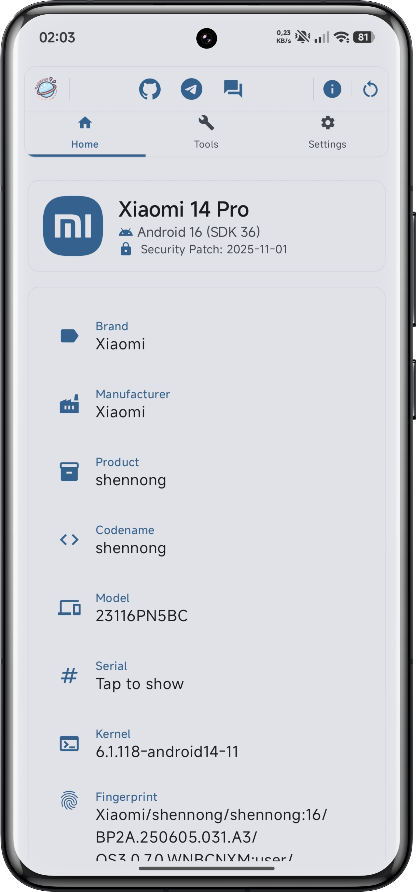
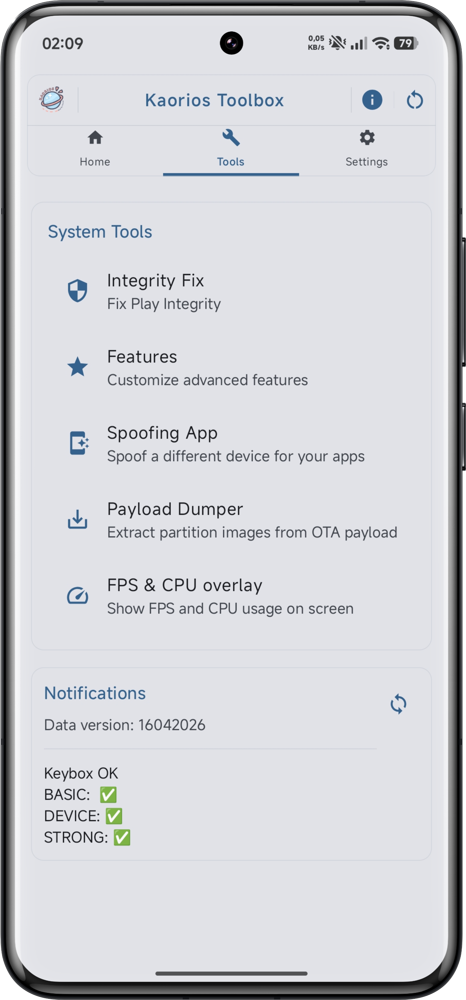

# Kaorios Toolbox

Starting with **version 2.0.4+**, Kousei is no longer involved in the development or decision-making of Kaorios Toolbox.

📢 [**Original announcement**](https://t.me/KariosToolboxDiscussion/124662)

### Previous Versions

For **version 2.0.4.0 and below**, see the legacy repository:
[Wuang26/Kaorios-Toolbox](https://github.com/Wuang26/Kaorios-Toolbox)

---

## ✨ Features

- ✅ **Play Integrity Fix:** Advanced fingerprint, build, and hardware attestation spoofing.
- 🧩 **Pixel & Properties Spoofing:** Per-model build properties and attestation fields.
- 🙈 **Hide Installed Applications:** Package visibility filtering and HMA template integration.
- 🛠️ **Hide Developer Options & ADB Status:** Surgical `Settings$NameValueCache` entry guard for reporting `"0"` without breaking developer workflow.
- 🔓 **Disable `FLAG_SECURE`:** Unblock screenshots and screen recording in secure apps.
- 📦 **CorePatch Smali Recipes:** Disable package signature verification, signature mismatch enforcement, and downgrade restrictions at the OS level.
- ☁️ **Google Photos Unlimited Backup:** Device spoofing for unlimited original-quality photo backup.
- 🎮 **High-FPS Game Profiles:** Unlock 90/120 FPS modes in supported game titles.
- 🦀 **Standalone Native Rust Engine:** Pure-Rust `kaorios-toolbox` CLI and interactive TUI dashboard.
- 🧰 **Payload Dumper Integration:** Inspect and dump OTA `payload.bin` partitions directly on-device.

---

## 🖼️ Screenshots

  
  

  <a href="https://github.com/hzzmonetvn/Kaorios-Toolbox/tree/main/Toolbox-screenshots">🔍 See more screenshots →</a>

---

## 🚀 Documentation & Usage Guide

### 1. Framework & Services Patching (Android 13–17, Clean Stock)

Surgical smali bytecode patching applied to clean stock copies of `framework.jar`, `services.jar`, and optionally `SettingsProvider.apk`:

- **Patch Guide (Automated & Manual):** Complete clean-stock instructions for unified patching (`script/kaorios_patcher.py`), register safety, hook placement, payload DEX import, and SELinux deployment:
  - [English](Toolbox-docs/2.0.6+/Patch_Guide_2.0.6.2.md) | [Tiếng Việt](Toolbox-docs/2.0.6+/Patch_Guide_2.0.6.2_VI.md)
- **OEM ROM Patch Guide & Annotated Smali Templates (HyperOS, One UI, ColorOS/OxygenOS/Realme UI, OriginOS/FuntouchOS, HarmonyOS/MagicOS):**
  - [English](Toolbox-docs/2.0.6+/OEM_ROM_Patch_Guide.md) | [Tiếng Việt](Toolbox-docs/2.0.6+/OEM_ROM_Patch_Guide_VI.md)
  - Ready-to-inspect clean-stock smali templates: [`Toolbox-docs/2.0.6+/Template/`](Toolbox-docs/2.0.6+/Template/)
- **Unified Python Patcher CLI & Verification Reference:** [`script/README.md`](script/README.md)

### 2. Optional Framework Modifications

- **Disable Secure Flag (`WindowState.isSecureLocked`):**
  - [English](Toolbox-docs/2.0.6+/Disable_Secure_Flag.md) | [Tiếng Việt](Toolbox-docs/2.0.6+/Disable_Secure_Flag_VI.md)
- **CorePatch (Signature & Downgrade Verification Bypass):**
  - [English](Toolbox-docs/2.0.6+/CorePatch.md) | [Tiếng Việt](Toolbox-docs/2.0.6+/CorePatch_VI.md)

### 3. Cross-Platform Patcher Application Specification

Architecture, Rust Core (`kaorios_core`) FFI/API contracts, OEM compatibility matrix, and UI/UX specification for the Kaorios Patcher App:

- **Patcher App Specification:**
  - [English](Toolbox-docs/2.0.6+/Patcher_App_Specification.md) | [Tiếng Việt](Toolbox-docs/2.0.6+/Patcher_App_Specification_VI.md)

### 4. Standalone Native Rust CLI & TUI Dashboard

Operate Play Integrity, Keybox profiles, and framework features in headless or shell environments without the Android application:

- **Binary Documentation & Deployment:**
  - [`bin/kaorios-toolbox/README.md`](bin/kaorios-toolbox/README.md)

### 5. Init & Early-Boot System Property Configuration

Spoof bootloader lock states, AVB/vbmeta properties, and build security flags before the Zygote process and Android framework initialize:

- **Init Configuration (`init.kaorios.rc`):** [`bin/init/README.md`](bin/init/README.md)
- **Property Override Reference:** [`bin/init/resetprop.md`](bin/init/resetprop.md)
- **`kaorihelper` Binary Reference:** [`bin/resetprop/README.md`](bin/resetprop/README.md)
- **Native PIF libc Hook Libraries:** [`bin/lib/README.md`](bin/lib/README.md)

### 6. Root Helper Zygisk Module (Alternative to ROM Patching)

For rooted users who prefer not to modify ROM system JARs, the companion Zygisk module provides runtime hook injection:
- [KaoriosHelper GitHub Repository](https://github.com/hzzmonetvn/KaoriosHelper)

> [!WARNING]
> Do not enable the KaoriosHelper Zygisk module simultaneously with ROM-patched framework/services hooks for the same features.

---

## 👉 Community & Discussion

- **Channel:** [KaoriosToolbox-Channel](https://t.me/KaoriosToolbox)
- **Discussion Group:** [KaoriosToolbox-Discussion](https://t.me/KariosToolboxDiscussion)

---

## 🙏 Credits

- **Payload Dumper** — [rcmiku](https://github.com/rcmiku/Payload-Dumper-Compose)
- **AOSP Framework** — Android Open Source Project
- **TrickyStore** — Target attestation research
- **resetprop-rs (`kaorihelper`)** — [Enginex0](https://github.com/Enginex0/resetprop-rs)

---

## 📄 License

This project is licensed under the **GNU General Public License v3.0 (GPL-3.0)** — see the [LICENSE](LICENSE) file for details.
