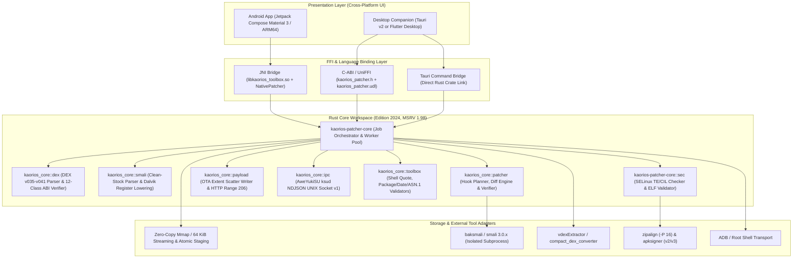
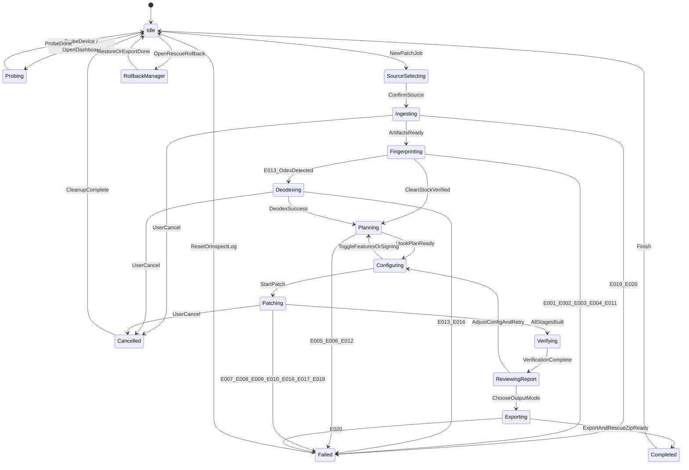

# Engineering Specification & Developer Blueprint: Standalone Kaorios Patcher App

> **Document Version:** `1.0` — aligned 1:1 with **Kaorios Toolbox / Framework `v2.0.6.2`** (`kaorios_core` `v2.0.6`, `script/kaorios_hook_spec.py`, `framework/proguard-rules.pro`)
> **Target Scope:** Android 13–17 (API 33–37) • On-Device Rooted Android App (ARM64) & Cross-Platform Desktop Companion (Linux / Windows / macOS)
> **Core Engine:** Rust Edition 2024 (MSRV `1.98`) • 12-Class R8-Kept ABI Contract • Fail-Closed & Clean-Stock Invariants

---

## Table of Contents

1. [Product Scope & Target Personas](#1-product-scope--target-personas)
2. [High-Level Architecture & Rust Core FFI Design](#2-high-level-architecture--rust-core-ffi-design)
3. [OEM ROM Fingerprinting & Pre-Flight Ingestion Pipeline](#3-oem-rom-fingerprinting--pre-flight-ingestion-pipeline)
4. [Binary DEX & Smali Patching Engine Specification](#4-binary-dex--smali-patching-engine-specification)
5. [SELinux, Native Libraries & APK Re-Signing Pipeline](#5-selinux-native-libraries--apk-re-signing-pipeline)
6. [Complete Data Models, Rust API Contracts & JSON Job Manifest](#6-complete-data-models-rust-api-contracts--json-job-manifest)
7. [UI/UX Screen-by-Screen & State Machine Blueprint](#7-uiux-screen-by-screen--state-machine-blueprint)
8. [Error Taxonomy (`E001`–`E020`), Safety Guardrails & Bootloop Recovery](#8-error-taxonomy-e001e020-safety-guardrails--bootloop-recovery)
9. [Verification, Fuzzing & Release Engineering Matrix](#9-verification-fuzzing--release-engineering-matrix)

---

## 1. Product Scope & Target Personas

### 1.1 Product Vision & Problem Statement

Integrating **Kaorios Framework (`v2.0.6.2`)** into stock Android 13–17 ROMs currently requires manual, error-prone manipulation of critical boot artifacts: extracting `framework.jar`, `services.jar`, and optional `SettingsProvider.apk`; resolving odex/vdex/cdex packaging; validating the R8-minified payload `classes.dex`; injecting Smali hooks (F1–F7, S1–S6, SP1) without violating Dalvik's 4-bit `v0..v15` operand limit; provisioning SELinux Enforcing policies for the `kaorios_advanced_policy` Binder service; and staging dual-ABI native libraries (`libkaoripif.so` and `libkaoripif_diagnostic.so`).

The **Kaorios Patcher App** is a standalone, cross-platform engineering tool powered by a single memory-safe Rust core (`kaorios_core` + `kaorios-patcher-core`) that converts the entire ROM patching workflow into a **deterministic, atomic, fail-closed pipeline** with comprehensive host-side verification before anything is flashed to a device.

### 1.2 Target Personas & User Journeys

| Persona | Operating Environment | Core Needs | Primary Workflow |
| :--- | :--- | :--- | :--- |
| **P1 — On-Device Rooted Power User** | Rooted ARM64 Android 13–17 device (Magisk / KernelSU / AweYukiSU / APatch) | Patch directly on-device without a PC; emit a ready-to-flash systemless module ZIP and automatic bootloop rescue | Open app → Probe device → Pull stock JAR/APK + live `ps -AZ` → Select features → Patch & Verify → Export/Install Module ZIP |
| **P2 — Custom ROM Maintainer / Kitchen Engineer** | Desktop Linux / Windows / macOS workstation | Patch clean-stock firmware dumps or OTA `payload.bin` archives reproducibly with machine-readable JSON audit manifests for CI | Select OTA `payload.bin` or ROM kitchen root → Fingerprint OEM → Run patching pipeline → Audit SHA-256 verification report → Export kitchen files or Recovery ZIP |
| **P3 — OEM Firmware Specialist / QA Tester** | Desktop + physical test devices over USB/Wireless ADB | Inspect OEM quirks across HyperOS, One UI, ColorOS/OxygenOS/Realme UI, OriginOS, and AOSP; review Smali diffs and verify SELinux `neverallow` boundaries | Connect ADB → Fingerprint + Measure `SettingsProvider` domain → Inspect `HookPlan` & OEM warnings → Audit Smali Diff → Export & execute on-device smoke tests |

### 1.3 Supported Deployment Targets

1. **On-Device Android App:**
   - Supported Android versions: Android 13 (API 33) through Android 17 (API 37).
   - Native ABI: **ARM64-only (`arm64-v8a`)**, adhering strictly to the release gate in `tools/verify-apk-native-abi.py` (zero 32-bit native libraries packaged inside the patcher/manager APK).
   - Privilege transport: Direct authenticated NDJSON UNIX socket IPC to **AweYukiSU `ksud`** (`/dev/socket/aweyuki_ipc`, `HELPER_API_CONTRACT.md` v1), with fallback to POSIX root shell (`su -c`) for Magisk, KernelSU, and APatch.
   - Unrooted File Mode: Fully supports selecting local JAR/APK/OTA files via Android Storage Access Framework (SAF), running full analysis/patching/verification, and exporting output ZIPs without root.
2. **Desktop Companion App:**
   - Platforms: **Windows 10/11 (`x86_64`)**, **Linux (`x86_64`, `aarch64`)**, **macOS (`arm64`, `x86_64`)**.
   - Device orchestration: USB/TCP ADB transport (`adb pull`, `adb push`, `adb shell`), high-throughput streaming of multi-GB OTA archives on local NVMe/SSD storage.

### 1.4 Supported Input Modes (4 Ingestion Pipelines)

| Mode Key | Input Source | Collected Artifacts | Rust Core Responsibility |
| :--- | :--- | :--- | :--- |
| `local_archives` | **Raw Local JAR/APK Files** | Clean-stock `framework.jar`, `services.jar`, optional `SettingsProvider.apk`, payload `classes.dex` (from `KaoriosFramework-release.apk`), optional dual-ABI `.so` bundles | `kaorios_core::dex`, `kaorios-patcher-core::ingest` |
| `live_device` | **Live ADB / Root / AweYukiSU Device Pull** | `/system/framework/framework.jar`, `/system/framework/services.jar`, `/system_ext/priv-app/SettingsProvider/SettingsProvider.apk` (or `/system/priv-app/SettingsProvider/`), partition `build.prop` files, `/system/etc/selinux/plat_service_contexts`, `/system/etc/selinux/plat_sepolicy.cil`, live `ps -AZ` and `getenforce` probes | `kaorios_core::ipc`, `kaorios_core::toolbox::sh_quote`, `DeviceTransport` |
| `ota_payload` | **Direct OTA `payload.bin` Extraction (Local or Remote HTTP 206)** | Local `payload.bin`, `ota.zip` containing `payload.bin`, or remote HTTPS OTA URL supporting HTTP `206 Partial Content`. Extracts `system`, `system_ext`, and `product` partition images via scatter extents and reads ext4/EROFS entries directly without unpacking the full ROM | `kaorios_core::validate_range`, `kaorios_core::validate_extents`, `kaorios_core::payload::write_extents`, `kaorios_core::payload::BoundedReader` |
| `rom_kitchen` | **Extracted ROM Kitchen Directory** | Pre-unpacked ROM tree containing `system/`, `system_ext/`, `product/`, `vendor/` | `kaorios-patcher-core::fingerprint`, `kaorios_core::dex` |

### 1.5 Supported Output Modes (3 Packaging Targets)

1. **Systemless Root Module ZIP (`magisk_ksu_apatch`):**
   - Compatible with **Magisk**, **KernelSU**, **AweYukiSU**, and **APatch**.
   - Canonical archive layout:
     ```text
     kaorios-patch-<oem>-api<sdk>-<shortsha>.zip
     ├── module.prop
     ├── customize.sh
     ├── post-fs-data.sh              # Early-init service_contexts bind-mount + bootloop counter
     ├── sepolicy.rule                # Runtime rules targeting measured SettingsProvider domain
     ├── service.sh                   # Boot-completed watchdog & health marker
     ├── uninstall.sh                 # Clean removal state reset
     ├── kaorios-patch-manifest.json  # SHA-256 baseline, applied hooks & verification report
     └── system/
         ├── framework/
         │   ├── framework.jar
         │   ├── services.jar
         │   └── oat/                 # ART/OAT whiteout markers
         ├── lib64/libkaoripif_diagnostic.so
         ├── lib/libkaoripif_diagnostic.so
         └── system_ext/
             ├── lib64/libkaoripif.so
             ├── lib/libkaoripif.so
             └── priv-app/SettingsProvider/SettingsProvider.apk   # Only when SP1 enabled
     ```
2. **Custom Recovery Flashable ZIP (`recovery_zip`):**
   - Targets TWRP / OrangeFox with portable shell `META-INF/com/google/android/update-binary` and `updater-script`.
   - Before modifying any system file: atomically backs up stock artifacts with original `uid:gid`, `mode`, `security.selinux`, and `SHA-256` into `/data/kaorios_backup/<job_id>/`.
   - Enforces `0644`, `0:0`, `u:object_r:system_file:s0`, and purges matching `oat`/`vdex`/`art` caches.
   - Automatically emits a paired **`kaorios-rescue-uninstall-<job_id>.zip`** alongside the flashable ZIP for one-flash stock restoration.
3. **Extracted ROM Kitchen / Source Tree Files (`rom_kitchen_files`):**
   - Outputs patched `framework.jar`, `services.jar`, optional `SettingsProvider.apk`, SELinux policy fragments (`kaorios_advanced_policy.te`, `kaorios_advanced_policy.cil`, `service_contexts.fragment`), dual-ABI `.so` staging tree, deterministic `SHA256SUMS`, `kaorios-patch-manifest.json`, `verification-report.json`, and verified POSIX `rollback.sh`.

### 1.6 Explicit Non-Goals & Hard Invariants

- **Never mutates inputs in place:** Canonicalized `--output` MUST never resolve to `--input`.
- **Clean-stock inputs only:** Any archive containing pre-existing `Landroid/security/kaorios/` or `Lcom/kousei/framework/` classes or references is rejected immediately (`E004` — `E004NotCleanStock`).
- **Never disables SELinux:** All deployments assume and validate `getenforce == Enforcing`; setting Permissive is strictly forbidden.
- **Zero embedded secrets:** The app never bundles, exports, or logs keybox XML, private signing keys, keystore passwords, or real hardware identifiers.
- **No kernel or `boot.img` mutation:** Scope is strictly bounded to userspace framework DEX, system services, `SettingsProvider`, userspace SELinux policy, and userspace native `.so` libraries.

---

## 2. High-Level Architecture & Rust Core FFI Design

### 2.1 System Architecture Diagram



### 2.2 Workspace & Crate Topology

The architecture preserves a strict boundary between the **zero-dependency algorithmic kernel (`kaorios_core`)** and the **application-layer I/O, packaging, and FFI facade (`kaorios-patcher-core`)**:

1. **`kaorios_core` (`rust_core/Cargo.toml` — pure `std`, zero external crates):**
   - `edition = "2024"`, `rust-version = "1.98"`, `crate-type = ["cdylib", "rlib"]`.
   - Release profile: `opt-level = 3`, `lto = "fat"`, `codegen-units = 1`, `strip = "symbols"`, `panic = "unwind"` *(retaining `unwind` so `catch_unwind` FFI/JNI guards remain effective and `cargo test --release` passes)*.
   - Modules:
     - `lib.rs`: `validate_range`, `validate_extents`, `enabled_value`, plus C-ABI exports (`kaorios_core_abi_version`, `kaorios_validate_range`, `kaorios_validate_extents`, `kaorios_enabled_value`).
     - `payload.rs`: `write_extents` (64 KiB streaming scatter writer with per-chunk cancellation checkpoint), `BoundedReader` (strict EOF guard preventing blob over-read).
     - `ipc.rs`: Pure-`std` NDJSON UNIX stream socket client for `/dev/socket/aweyuki_ipc` (`API_VERSION_V1 = 1`, `MAX_FRAME_BYTES = 1 MiB`, `DEFAULT_TIMEOUT = 5_000 ms`).
     - `toolbox.rs`: `sh_quote`, `is_valid_package_name`, `format_security_patch`, `parse_attestation_data` (ASN.1 Tag `704` `[0xBF, 0x85, 0x40]`), `parse_setting_boolean`, `apply_all_mode`, `is_json_object`.
     - `dex.rs`: Pure-Rust DEX `v035`–`v041` binary parser (`parse_dex_header`, `inspect_dex`, `read_uleb128`, `api_hint_for_version`), 12-class R8-kept payload verifier (`evaluate_payload_abi`, `verify_payload_dex`, `PAYLOAD_REQUIRED_CLASSES`), stock class collision detector (`detect_payload_collisions`, `find_dex_owners`), and contiguous slot allocator (`parse_dex_slot_number`, `format_dex_slot_name`, `sort_dex_entries`, `next_dex_slot`, `has_contiguous_dex_slots`).
     - `smali.rs`: Clean-stock Smali parser (`ensure_clean_stock_smali`, `parse_method_header`, `find_methods`, `find_method_entry_insert_idx`), Dalvik 4-bit `v0..v15` register lowering engine (`effective_reg`, `set_min_locals`, `emit_move`, `emit_parallel_moves`, `lower_entry_args`), adjacency & hook verification (`verify_invoke_move_result_adjacency`, `verify_smali_hooks`), and all 17 hook injectors (`patch_framework_f1_instrumentation`..`patch_framework_f7_name_value_cache`, `patch_services_s1_system_server`..`patch_services_s4_fakegapps`, `patch_services_computer_engine`, `patch_services_s5_secure_flag`, `patch_settings_provider_call`, `patch_corepatch_*`).
     - `patcher.rs`: Declarative hook registries (`FRAMEWORK_CORE_SPECS`, `SERVICES_CORE_SPECS`, `SERVICES_SECURE_FLAG_SPECS`, `SETTINGS_PROVIDER_SPECS`, `COREPATCH_FRAMEWORK_CLASSES`, `COREPATCH_SERVICES_CLASSES`, `SEPOLICY_SERVICE_NAME`/`TYPE`/`CONTEXT_LINE`), ROM fingerprinting (`fingerprint_rom`), planning & execution (`plan_framework_patch`, `plan_services_patch`, `apply_hook_by_id`, `execute_planned_hooks`), deterministic camelCase JSON serializers (`to_json_string()`, `dex_index_to_json`, `payload_report_to_json`), and the `kaorios_patcher_*` C-ABI surface.
     - `jni.rs` (`#[cfg(feature = "jni")]`): 100% backward-compatible JNI bridge for `com.kousei.kaorios.nativebridge.NativeToolbox`.
2. **`kaorios-patcher-core` (Patcher App Facade Crate):**
   - Links `kaorios_core` as an `rlib`.
   - Adds transactional ZIP/JAR/APK repacking (mirroring `script/dex_packager.py`), read-only ext4/EROFS partition inspection, ELF `PT_DYNAMIC`/`.dynsym` validation, SELinux `.te`/`.cil`/`service_contexts` validation, isolated subprocess orchestration (`baksmali`/`smali`, `vdexExtractor`, `zipalign`, `apksigner`, `adb`), bounded worker pool, and optional `cabi` / `uniffi` / `jni-patcher` bindings.

```toml
# Facade crate kaorios-patcher-core/Cargo.toml
[package]
name = "kaorios-patcher-core"
version = "2.0.6"
edition = "2024"
rust-version = "1.98"
publish = false

[lib]
crate-type = ["cdylib", "staticlib", "rlib"]

[features]
default = ["cabi"]
cabi = []
uniffi = ["dep:uniffi"]
jni-patcher = ["kaorios_core/jni"]
cli = []

[dependencies]
kaorios_core = { path = "../rust_core", default-features = false }
serde = { version = "1", features = ["derive"] }
serde_json = "1"
sha2 = "0.10"
zip = { version = "2", default-features = false, features = ["deflate"] }
memmap2 = "0.9"
uniffi = { version = "0.28", optional = true }
```

### 2.3 Triple FFI Strategy (C-ABI, UniFFI & JNI)

Every FFI boundary enforces four non-negotiable safety invariants:
1. **`std::panic::catch_unwind` Barrier:** No Rust panic may ever unwind across an `extern "C"` or JNI boundary.
2. **Mandatory `// SAFETY:` Documentation:** Every `unsafe` block explicitly justifies pointer non-nullness, alignment (`align_of`), bounds (`<= isize::MAX`), and lifetime validity.
3. **Explicit ABI Handshake:** Callers verify `kaorios_core_abi_version() == 1` and `kaorios_patcher_abi_version() == 1` at library load time; any mismatch fails fast.
4. **Explicit Buffer Ownership:** Every heap buffer allocated by Rust across the C-ABI is freed exclusively via `kaorios_patcher_free_buffer(ptr, len)`.

#### A. C-ABI Header (`kaorios_patcher.h`)

```c
#pragma once
#include <stdint.h>
#include <stddef.h>

typedef struct KaoriosPatcherCtx KaoriosPatcherCtx;

typedef void (*KaoriosProgressCb)(
    const uint8_t* event_json_utf8,
    size_t event_json_len,
    void* user_data
);

/* Preserved kaorios_core C-ABI symbols (rust_core/src/lib.rs) */
uint32_t kaorios_core_abi_version(void);
int64_t  kaorios_validate_range(int32_t status, const uint8_t* data, size_t len,
                                int64_t start, int64_t end, int64_t total);
int64_t  kaorios_validate_extents(const int64_t* data, size_t len,
                                  int32_t block_size, int64_t output_size);
int32_t  kaorios_enabled_value(const uint8_t* data, size_t len);

/* Implemented Patcher C-ABI exports in kaorios_core (rust_core/src/patcher.rs)
 * Owned NUL-terminated UTF-8 JSON strings MUST be freed via kaorios_patcher_free_string. */
char*    kaorios_patcher_inspect_dex_json(const uint8_t* data, size_t length);
char*    kaorios_patcher_verify_payload_dex_json(const uint8_t* data, size_t length);
char*    kaorios_patcher_apply_hook_json(const char* hook_id, const char* smali_utf8);
void     kaorios_patcher_free_string(char* ptr);

/* Extended orchestration C-ABI symbols in facade crate kaorios-patcher-core */
uint32_t           kaorios_patcher_abi_version(void);
KaoriosPatcherCtx* kaorios_patcher_create(uint32_t max_workers);
void               kaorios_patcher_destroy(KaoriosPatcherCtx* ctx);

int32_t kaorios_patcher_fingerprint_json(
    KaoriosPatcherCtx* ctx,
    const uint8_t* request_json, size_t request_len,
    uint8_t** out_json, size_t* out_len
);

int32_t kaorios_patcher_plan_json(
    KaoriosPatcherCtx* ctx,
    const uint8_t* config_json, size_t config_len,
    uint8_t** out_json, size_t* out_len
);

int32_t kaorios_patcher_execute_json(
    KaoriosPatcherCtx* ctx,
    const uint8_t* config_json, size_t config_len,
    KaoriosProgressCb progress_cb,
    void* user_data,
    uint8_t** out_report_json, size_t* out_report_len
);

void kaorios_patcher_cancel(KaoriosPatcherCtx* ctx, const uint8_t* job_id, size_t job_id_len);
void kaorios_patcher_free_buffer(uint8_t* ptr, size_t len);
```

#### B. UniFFI Bindings (Kotlin Multiplatform / Swift / Flutter Bridge)

UniFFI generates strongly typed foreign bindings directly from the Rust models (`PatchJobConfig`, `RomFingerprint`, `HookPlan`, `VerificationReport`, `ProgressEvent`, `PatcherError`) and exposes `ProgressSink` as a foreign callback trait interface, removing manual JSON marshaling where desired.

#### C. Android JNI Bridge (`libkaorios_toolbox.so`)

- **100% Symbol Compatibility:** Retains every existing `Java_com_kousei_kaorios_nativebridge_NativeToolbox_*` symbol (and `JNI_OnLoad` dynamic registration): `shQuote`, `isValidPackageName`, `formatSecurityPatch`, `parseAttestationData`, `parseSettingBoolean`, `needsSettingBooleanDefault`, `applyAllMode`, `isJsonObject`, `aweyukiIpcCall`, `aweyukiIpcProbe`, `aweyukiDefaultSocketPath`.
- **Additive Patcher Bridge (`com.kousei.kaorios.patcher.NativePatcher`):**
  - `external fun nativeCreateContext(maxWorkers: Int): Long`
  - `external fun nativeDestroyContext(handle: Long)`
  - `external fun nativeFingerprint(handle: Long, requestJson: String): String`
  - `external fun nativePlanJob(handle: Long, configJson: String): String`
  - `external fun nativeExecuteJob(handle: Long, configJson: String, callback: PatchProgressCallback): String`
  - `external fun nativeCancelJob(handle: Long, jobId: String)`
  - Worker threads emitting callbacks attach via `AttachCurrentThreadAsDaemon`, hold a RAII-guarded `GlobalRef` to `PatchProgressCallback`, and release all JNI references on exit or panic-unwind capture.

### 2.4 UI Layer Comparison: Android Compose vs Desktop (Tauri v2 / Flutter)

| Criterion | Android: Jetpack Compose (Material 3) | Desktop: Tauri v2 (Rust + Web/TS) | Desktop: Flutter Desktop (`flutter_rust_bridge` / C-ABI) |
| :--- | :--- | :--- | :--- |
| **Rust Integration** | Direct JNI via `libkaorios_toolbox.so`, sharing existing `NativeToolbox` & `ksud` IPC | **Direct Rust crate linking** (zero FFI serialization overhead, shared address space) | C-ABI / `flutter_rust_bridge` code generation |
| **Installer Footprint** | ~8–12 MB (ARM64-only) | ~6–12 MB (uses OS system WebView) | ~25–35 MB (bundles Skia/Impeller) |
| **Large Smali Diff RAM Usage** | Low (~80–140 MB via virtualized `LazyColumn`) | Moderate (~120–200 MB with virtualized diff viewport) | Low (~90–150 MB, consistent 60/120 fps) |
| **OS Integration (SAF, Root, ADB)** | First-class Android SAF, `ForegroundService`, notification channel | First-class Rust `tokio::process` for `adb`, native file dialogs, raw disk access | Requires platform channel plugins for file dialogs/subprocesses |
| **Architectural Recommendation** | **Mandatory for Android** (native parity with existing Kaorios Toolbox app) | **Primary recommendation for Desktop** (direct Rust core linkage, smallest binaries) | **Alternative** if the team prioritizes a single shared Dart UI codebase across all platforms |

### 2.5 Worker Thread Pool, Streaming Progress & Cooperative Cancellation

- **Bounded Worker Pool:** Defaults to `min(available_parallelism(), 4)` on Android and `min(available_parallelism(), 8)` on Desktop. Parallelizes independent DEX parsing and selective `baksmali`/`smali` jobs while capping concurrent JVM heap usage (`-Xmx384m` per `smali` worker) below `1.2 GiB` peak RAM on 6–8 GB mobile devices.
- **Streaming Progress Channel:** Bounded MPSC queue (`256` frames). High-frequency byte-progress events (OTA extraction, ZIP repacking) are throttled to `<= 20 Hz` (`50 ms` coalescing window) to preserve 60–120 fps UI rendering; lifecycle milestones (`PhaseChanged`, `HookApplied`, `Warning`, `Error`) flush immediately without dropping.
- **Cooperative Cancellation:** Per-job `Arc<AtomicBool>` polled at every `64 KiB` chunk inside `kaorios_core::payload::write_extents`, at every DEX `class_defs` loop boundary, and around every external subprocess (sending `SIGTERM`/kill and cleaning staging temp directories immediately on cancellation).

### 2.6 Zero-Copy File I/O & Atomic Staging

- **Zero-Copy Streaming:** Read-only `mmap` (or `64 KiB` fixed stack buffers matching `rust_core/src/payload.rs`) for multi-DEX JARs and multi-GB OTA partitions. Unmodified ZIP entries (resources, untouched `classes*.dex`, `META-INF`) stream directly from source archive to staged output without decompressing into memory.
- **Transactional Atomic Staging:** All outputs are written to a same-filesystem temp file (`.kaorios_stage_<uuid><ext>`), `fsync`ed, validated via ZIP integrity test (`testzip`) + DEX/SHA-256 verification, and published atomically via `rename`. Failures or cancellations unlink the staged artifact, leaving destination paths untouched.

---

## 3. OEM ROM Fingerprinting & Pre-Flight Ingestion Pipeline

### 3.1 Multi-Signal ROM Fingerprinting Engine

The Patcher App never assumes ROM layout from device model strings alone. It synthesizes **three independent signal layers** into an immutable `RomFingerprint`:

#### Layer 1: Multi-Partition `build.prop` Extraction
Merges properties across `system`, `system_ext`, `product`, and `vendor`:
- Core Android properties: `ro.build.version.sdk` (validated in `33..=37`), `ro.build.version.release`, `ro.build.fingerprint`, `ro.build.version.security_patch`, `ro.product.cpu.abilist`, `ro.product.manufacturer`, `ro.product.brand`, `ro.product.model`.
- OEM skin signatures:
  - **Xiaomi HyperOS / MIUI:** `ro.mi.os.version.name` (`OS1.0`, `OS2.0`, `OS3.0`), `ro.miui.ui.version.name` (`V140`), `ro.miui.ui.version.code`.
  - **Samsung One UI:** `ro.build.version.oneui` (`60100`, `70000`, `80000`), `ro.config.knox`.
  - **OPPO ColorOS / OnePlus OxygenOS / Realme UI (OPlus):** `ro.build.version.oplusrom`, `ro.oplus.image.my_stock.type`, `ro.rom.version`.
  - **vivo OriginOS / FuntouchOS:** `ro.vivo.os.build.display.id`, `ro.vivo.os.version`, `ro.vivo.product.version`.
  - **Custom AOSP:** `ro.lineage.version`, `ro.evolution.version`, `ro.crdroid.version`.

#### Layer 2: Partition Layout & OEM Companion JAR Discovery
Scans `/system/framework/`, `/system_ext/framework/`, and `BOOTCLASSPATH` / `SYSTEMSERVERCLASSPATH`:
- Detects OEM companion JARs (`miui-framework.jar`, `miui-services.jar`, `oplus-framework.jar`, `oplus-services.jar`, `vivo-framework.jar`, `vivo-services.jar`, `samsung-framework.jar`, `sem-services.jar`) so the patcher explicitly targets stock `framework.jar` and `services.jar` rather than OEM wrapper JARs.
- Resolves `SettingsProvider.apk` across `/system_ext/priv-app/SettingsProvider/`, `/system/priv-app/SettingsProvider/`, and `/product/priv-app/SettingsProvider/`.

#### Layer 3: DEX Class Graph Probing
Inspects `DexIndex.defined_classes` and `defined_methods` across all `classes*.dex` via `kaorios_core::dex` **prior to invoking `baksmali`**:
- Records DEX versions (`v035`–`v041`) and `api_hint` per DEX slot.
- Pre-resolves hook fallback paths:
  - **S2 (`shouldFilterApplication*`):** `ComputerEngine` vs `AppsFilterBase`; `PackageStateInternal` (`invoke-interface`) vs `PackageSetting` (`invoke-virtual`).
  - **S3 (`getInstallerPackageName`):** `ComputerEngine` vs `IPackageManagerBase`.
  - **S4 (`generatePackageInfo`):** 64-bit `J` flags (Android 13+) vs 32-bit `I` legacy flags.
  - **S1 (`startOtherServices`):** `(TimingsTraceAndSlog)V` vs zero-arg `()V`.
  - **F3 (`SystemProperties.get`):** detects whether 1-arg `get(String)` delegates internally to 2-arg `get(String, String)`.

### 3.2 OEM Classification & Quirk Matrix (Android 13–17 / API 33–37)

| OEM ROM Family | Supported Releases | JAR / DEX Layout Quirks | SELinux & `SettingsProvider` Notes | Mandatory UI Warnings |
| :--- | :--- | :--- | :--- | :--- |
| **Pixel / Stock AOSP / Custom AOSP** (LineageOS, Evolution-X, crDroid) | Android 13–17 (API 33–37) | Standard AOSP layout; `framework.jar` 3–5 DEX, `services.jar` 2–4 DEX | `u:r:system_app:s0` (default) or `u:r:settings_provider:s0` (hardened); Android 17 requires `plat_service_contexts` overlay | Platform key vs CorePatch S6 notice when enabling SP1 |
| **Xiaomi HyperOS (1/2/3) & MIUI 14** | API 33–37 | Ships companion `miui-framework.jar` & `miui-services.jar` — **patch stock `framework.jar` and `services.jar` only**; high local counts (`> 15`) in `ActivityThread` and `ComputerEngine` | Typically `u:r:system_app:s0`; CN HyperOS builds enforce strict signature checks via `miui-services` | **Mandatory `oat/` purge/whiteout** for `services.jar` and `boot-framework.*`; warn about CorePatch S6 before modifying `SettingsProvider.apk` |
| **Samsung One UI (6 / 7 / 8)** | API 34–37 | Large multi-DEX `framework.jar` (5–7 DEX, methods frequently exceed `.locals 20`); `FLAG_SECURE` may span `WindowState` and `WindowManagerService` | Typically `u:r:system_app:s0`; Knox/TIMA protects hardware keystore (Java Keystore2 SPI hooks F5/F6 remain effective) | Purge/whiteout `*.odex`, `*.vdex`, `*.art`, and `*.prof`; recommend enabling both S5 + S5b for Disable `FLAG_SECURE` |
| **OPPO ColorOS / OnePlus OxygenOS / Realme UI (OPlus)** | API 33–37 | Ships `oplus-framework.jar` & `oplus-services.jar`; some releases split `shouldFilterApplication` across `ComputerEngine` and `AppsFilterBase` | `u:r:system_app:s0` or `u:r:platform_app:s0`; check `my_stock` overlay partitions | Prompt for live `ps -AZ` verification and inspect `my_stock` overrides |
| **vivo OriginOS / FuntouchOS** | API 33–37 | Ships `vivo-framework.jar` & `vivo-services.jar`; Keystore2 wrapper classes may add multiple return sites | Measure `com.android.providers.settings` domain explicitly with `ps -AZ` | Do not modify `vivo-*.jar`; verify F5/F6 Smali diff before flashing |

### 3.3 Odex / Vdex / Cdex / APEX Detection & Deodex Pipeline

Every target archive (`framework.jar`, `services.jar`, `SettingsProvider.apk`) passes through pre-flight deodex detection:

1. **ZIP Entry Scan:** Match `^classes(\d*)\.dex$`.
2. **Path A — Already Deodexed (`classes*.dex` present):** Parse directly with `kaorios_core::dex::inspect_dex`; record `is_odexed = false`.
3. **Path B — Odexed (no `classes*.dex`; sibling `oat/<abi>/*.odex` + `*.vdex` or `/system/framework/<abi>/boot-framework.vdex` detected):**
   - Inspect the first 8 bytes of `.vdex` (`vdex` magic + version `019`/`021`/`027`).
   - Run **`vdexExtractor`** in an isolated staging workspace to extract embedded `.dex` or Compact DEX (`.cdex`, magic `cdex001\0`) files.
   - If `.cdex` is detected, invoke **`compact_dex_converter`** to convert back to standard DEX (`dex\n039\0`–`dex\n041\0`).
   - Re-validate every recovered DEX using `kaorios_core::dex::inspect_dex` (header magic, `endian_tag`, `file_size`, class definitions).
   - Inject recovered DEX entries into a staged copy of the JAR/APK (never mutating originals), set `deodexed_by_patcher = true`, and automatically enable `oat/` cache whiteout/purge at export time.
   - If deodex tools are absent or conversion fails, abort cleanly with `E013` (`E013EmptyArchiveDexes`) or `E016` (`E016ToolingOrDeodexFailed`).
4. **Path C — APEX / Split Bootclasspath Detection:**
   - Detect when platform classes reside inside APEX containers (`/apex/com.android.art`, etc.) and verify all 7 required `framework.jar` target classes exist inside `framework.jar` before proceeding.

### 3.4 Clean-Stock Precondition Gate & SHA-256 Baseline Manifest

Executed unconditionally before any disassembly:

1. **Clean-Stock Verification:**
   - Scan every `defined_classes` and `referenced_methods` table across all `classes*.dex` in `framework.jar`, `services.jar`, and `SettingsProvider.apk`.
   - If ANY class or call begins with `Landroid/security/kaorios/` or `Lcom/kousei/framework/`, abort immediately with **`E004` (`E004NotCleanStock`)**, reporting the exact archive, DEX slot, and offending descriptor.
2. **Payload Integrity & Collision Pre-Check:**
   - Verify all 12 R8-kept classes and required methods in payload `classes.dex` (`kaorios_core::dex::evaluate_payload_abi`, Section 4.2); any gap fails with `E002` (`E002PayloadAbiMismatch`).
   - Verify `stock_classes ∩ payload_classes == ∅` (`detect_payload_collisions`); any overlap fails with `E003` (`E003PayloadClassCollision`).
3. **Immutable `baseline-manifest.json`:**
   - Records original path, byte length, `SHA-256`, DEX slot inventory, DEX version/`api_hint`, and original POSIX metadata (`uid`, `gid`, `mode`, `selinux_context`) for rollback verification.

---

## 4. Binary DEX & Smali Patching Engine Specification

### 4.1 DEX `v035`–`v041` Binary Layout & Pure-Rust Parser

`kaorios_core::dex` parses DEX binaries directly in pure Rust with zero JVM startup overhead, indexing all 5–7 DEX files of a stock `framework.jar` (~45 MB) in tens of milliseconds.

#### 112-Byte (`0x70`) DEX Header Validation

| Offset | Size | Type (Little-Endian) | Field | Strict Validation Rule |
| :--- | :--- | :--- | :--- | :--- |
| `0x00` | `8` | `[u8; 8]` | `magic` | Matches `^dex\n(035\|037\|038\|039\|040\|041)\x00$` |
| `0x08` | `4` | `u32` | `checksum` | Adler-32 over `0x0C..file_size` |
| `0x0C` | `20` | `[u8; 20]` | `signature` | SHA-1 over `0x20..file_size` |
| `0x20` | `4` | `u32` | `file_size` | `0x70 <= file_size <= data.len()` |
| `0x24` | `4` | `u32` | `header_size` | Must equal `0x70` (`112`) |
| `0x28` | `4` | `u32` | `endian_tag` | Must equal `0x12345678` (`ENDIAN_CONSTANT`) |
| `0x2C` | `12` | `3 × u32` | `link_size`, `link_off`, `map_off` | Bounds-checked when non-zero |
| `0x38` | `8` | `2 × u32` | `string_ids_size`, `string_ids_off` | `string_ids_off + string_ids_size * 4 <= file_size` |
| `0x40` | `8` | `2 × u32` | `type_ids_size`, `type_ids_off` | `type_ids_off + type_ids_size * 4 <= file_size` |
| `0x48` | `8` | `2 × u32` | `proto_ids_size`, `proto_ids_off` | `proto_ids_off + proto_ids_size * 12 <= file_size` |
| `0x50` | `8` | `2 × u32` | `field_ids_size`, `field_ids_off` | `field_ids_off + field_ids_size * 8 <= file_size` |
| `0x58` | `8` | `2 × u32` | `method_ids_size`, `method_ids_off` | `method_ids_off + method_ids_size * 8 <= file_size` |
| `0x60` | `8` | `2 × u32` | `class_defs_size`, `class_defs_off` | `class_defs_off + class_defs_size * 32 <= file_size` |
| `0x68` | `8` | `2 × u32` | `data_size`, `data_off` | `data_off + data_size <= file_size` |

#### DEX Version to Default `api_hint` Table

| DEX Version | Default `api_hint` | Compatibility Notes |
| :--- | :--- | :--- |
| `035` | `23` | Baseline DEX |
| `037` | `25` | Default/static interface methods |
| `038` | `26` | `invoke-polymorphic` |
| `039` | `28` | `const-method-handle` / `const-method-type` |
| `040` | `34` | Android 14 (spaces allowed in simple identifiers) |
| `041` | `35` | Android 15–17 (container DEX support; supports `--api 36`/`37` override) |

#### MUTF-8, `proto_ids`, `method_ids` & ULEB128 `class_data_item` Parsing

1. **Bounded ULEB128 Decoder (`kaorios_core::dex::read_uleb128`):** Reads at most **5 bytes** (`shift = 0, 7, 14, 21, 28`; 5th byte limited to lower 4 bits `0x0F` to prevent `u32` overflow). Truncated buffers or continuation bits past byte 5 return `Err(DexError)` mapped to `E001` (`E001InvalidDex`).
2. **`string_ids` & `type_ids`:** Each `string_id_item` (`u32 string_data_off`) skips its leading UTF-16 length ULEB128 and reads NUL-terminated MUTF-8 bytes; each `type_id_item` indexes `strings[descriptor_idx]`.
3. **`proto_ids` & `method_ids`:** Each 12-byte `proto_id_item` reads `return_type_idx` and optional `type_list` (`u32 plen` + `plen × u16 type_idx`) to build `(<params>)<ret>`. Each 8-byte `method_id_item` (`u16 class_idx`, `u16 proto_idx`, `u32 name_idx`) builds canonical `(class_desc, method_name, proto_desc)` tuples in `referenced_methods`.
4. **`class_data_item` ULEB128 Decoding:** For each 32-byte `class_def_item`, inserts `types[class_idx]` into `defined_classes`. When `class_data_off != 0`, decodes `(static_fields_size, instance_fields_size, direct_methods_size, virtual_methods_size)`, skips `(field_idx_diff, access_flags)` pairs, and delta-accumulates `method_idx += method_idx_diff` (bounds-checked against `method_ids_size`) across `direct_methods` and `virtual_methods` into `defined_methods`.

### 4.2 R8-Kept 12-Class Payload Verification Contract

Payload `classes.dex` (extracted from single-DEX `KaoriosFramework-release.apk`) MUST define all **12 primary R8-kept classes** declared in `framework/proguard-rules.pro` and `script/kaorios_hook_spec.py` (`PAYLOAD_REQUIRED_CLASSES`):

| # | R8-Kept Dalvik Class Descriptor | Required Methods in `defined_methods` | Runtime Role |
| :-: | :--- | :--- | :--- |
| 1 | `Landroid/security/kaorios/KaoriosHook;` | 13 `public static` entry points:<br>• `initContext(Landroid/content/Context;)V`<br>• `initActivityThread(Ljava/lang/Object;)V`<br>• `initActivityThread(Ljava/lang/String;Ljava/lang/String;)V`<br>• `getSpoofedProperty(Ljava/lang/String;Ljava/lang/String;)Ljava/lang/String;`<br>• `hasSystemFeature(Ljava/lang/String;I)Ljava/lang/Boolean;`<br>• `initGenerateSoftwareKeyPair(Ljava/lang/Object;)Ljava/security/KeyPair;`<br>• `CertificateChainIfNeeded(Ljava/lang/Object;Ljava/lang/String;[Ljava/security/cert/Certificate;)[Ljava/security/cert/Certificate;`<br>• `shouldHideDevStatusFromNameValueCache(Landroid/content/ContentResolver;Ljava/lang/String;I)Ljava/lang/String;`<br>• `initSystemServer()V`<br>• `shouldHideAppListForCaller(ILjava/lang/String;I)Z`<br>• `filterInstallerPackageName(Landroid/content/ContentResolver;IILjava/lang/String;Ljava/lang/String;)Ljava/lang/String;`<br>• `spoofFakeGAppsPackageInfo(Landroid/content/pm/PackageInfo;J)Landroid/content/pm/PackageInfo;`<br>• `isSecureFlag()Z` | Primary Smali hook facade for F1–F7 and S1–S5b |
| 2 | `Landroid/security/kaorios/settings/AdvancedPolicyService;` | • `initSystemServer(Landroid/content/ContentResolver;)V`<br>• `filterSettingsCall(Ljava/lang/String;Ljava/lang/String;)Landroid/os/Bundle;` | Authoritative `kaorios_advanced_policy` Binder service & `SettingsProvider` filter (SP1) |
| 3 | `Lcom/kousei/framework/KaoriosFramework;` | • `getFrameworkVersion()Ljava/lang/String;`<br>• `obtainContentResolver()Landroid/content/ContentResolver;`<br>*(Nested kept types: `$InstalledAppEntry`, `$InstalledAppsSnapshot`, `$HideConfig`)* | Bootclasspath public API queried by Kaorios Toolbox app |
| 4 | `Landroid/security/kaorios/settings/AdvancedPolicyClient;` | • `getService()Landroid/security/kaorios/settings/IAdvancedPolicyService;`<br>• `getRuntimeStatus()Landroid/security/kaorios/settings/AdvancedPolicyRuntimeStatus;` | Binder client with `DeathRecipient` used by `SettingsProvider` & manager app |
| 5 | `Landroid/security/kaorios/settings/AdvancedPolicyRuntimeStatus;` | *(Class definition verified)* | Parcelable status (`snapshotLoaded`, `enabled`, `generationToken`) |
| 6 | `Landroid/security/kaorios/settings/AdvancedPolicySnapshot;` | *(Class definition verified)* | Atomic immutable HMA/HideApp policy snapshot |
| 7 | `Landroid/security/kaorios/settings/IAdvancedPolicyService;` | *(Interface + `$Stub` definition verified)* | AIDL/Binder IPC contract |
| 8 | `Landroid/security/kaorios/settings/SettingDecisionParcel;` | *(Class definition verified: `TYPE_STOCK=0`, `TYPE_VALUE=1`, `TYPE_REMOVE=2`)* | Per-setting evaluation parcel |
| 9 | `Landroid/security/kaorios/settings/ServiceManagerBridge;` | *(Class definition verified: `ADVANCED_POLICY_SERVICE = "kaorios_advanced_policy"`)* | `ServiceManager` registration/lookup wrapper |
| 10 | `Landroid/security/kaorios/KaoriosPifInstaller;` | • `setContext(Landroid/content/Context;)V`<br>• `installNativePif([Ljava/lang/String;[Ljava/lang/String;)I`<br>• `nativeInstallPif([Ljava/lang/String;[Ljava/lang/String;)I` | Native PIF loader; JVM class name must remain un-obfuscated to bind `Java_android_security_kaorios_KaoriosPifInstaller_nativeInstallPif` in `libkaoripif.so` |
| 11 | `Landroid/security/kaorios/PifNative;` | • `initialize()Landroid/security/kaorios/PifNativeStatus;`<br>• `nativeResolve(Ljava/lang/String;)Ljava/lang/String;` | Explicit opt-in diagnostic API loading `libkaoripif_diagnostic.so` |
| 12 | `Landroid/security/kaorios/PifNativeStatus;` | *(Class definition + `State` enum verified)* | Structured native diagnostic status model |

**Post-Patch Strict Allowlist Gate:**
Every `referenced_methods` entry in any patched stock DEX (excluding the appended payload DEX slot itself) under `Landroid/security/kaorios/` or `Lcom/kousei/framework/` MUST match one of the R8-kept public hook descriptors in Section 4.5. Any reference matching `kaorios_core::smali::FORBIDDEN_HOOK_TOKENS` (R8-repackaged internal implementation classes or unkept/deprecated entry points) fails verification immediately (`E010` — `E010ForbiddenHookToken`).

### 4.3 Collision Detection & Contiguous `classesN.dex` Slot Allocator

1. **Class Collision Check:** Computes $S_{\text{stock}} \cap \text{defined\_classes}(D_{\text{payload}})$ via `detect_payload_collisions`; any non-empty overlap aborts with `E003` (`E003PayloadClassCollision`).
2. **Contiguous Slot Allocator:** Parses all `^classes(\d*)\.dex$` entries (`classes.dex` = `1`, `classesK.dex` = `K`), checks for duplicate/gapped slots (gaps can cause ART to stop loading trailing DEX files on certain OEMs), and allocates `classes{max + 1}.dex` (e.g., `classes5.dex` → `classes6.dex`).
3. **Selective Disassembly:** Uses `find_dex_owners(archive_indexes, target_classes)` to disassemble/reassemble ONLY the DEX entries that actually define target classes, keeping untouched DEX files bit-for-bit identical.

### 4.4 Smali Parser & Dalvik 4-Bit (`v0..v15`) Register Lowering Engine

OEM builds on Android 13–17 frequently compile methods like `ActivityThread.handleBindApplication`, `ComputerEngine.shouldFilterApplication*`, `ComputerEngine.generatePackageInfo`, and `Settings$NameValueCache.getStringForUser` with `.locals 16`–`40`. Because Dalvik `invoke-static {rA, rB, ...}` (format **35c**) encodes register operands in **4 bits (`v0..v15`)**, any parameter `pK` with effective index:
$$\text{eff}(v_K) = K, \qquad \text{eff}(p_K) = \text{locals\_count} + K > 15$$
cannot be passed directly to `invoke-static`. The Smali engine handles this deterministically across six stages:

1. **Method Header & Wide (`J`/`D`) Parameter Layout:** Parses modifiers (`static`, `abstract`, `native`), JVM parameter descriptor tokens, and cumulative register offsets (`0` for static, `1` for instance `p0 = this`). Wide types (`J`, `D`) occupy **2 consecutive register slots** `(r, r + 1)`.
2. **`.locals` / `.registers` Normalization:** Converts `.registers M` to `locals_count = M - total_param_regs`. When bumping `locals_count` to `min_locals`, `.registers`-style methods canonicalize `v(R - P + k)` aliases into `p{k}` first and reject any `/range` instruction spanning the local/parameter boundary.
3. **Prolog Metadata & Exception Safety (`.param`, `.annotation`, `.catch`):**
   - `find_method_entry_insert_idx` advances cleanly past `.locals`/`.registers`, `.prologue`, `.line`, blank/comment lines, `.annotation ... .end annotation`, and `.param` blocks (matching `baksmali`'s rule that `.end param` appears iff an `.annotation` immediately follows `.param`).
   - Entry hooks always land before the first executable instruction and before any `.try_start_*` / `.catch` / `.catchall` boundaries, keeping exception handler tables balanced.
4. **Width-Aware Move Selection (`emit_move`):**
   - `dst_eff < 16 && src_eff < 16` → `move[-object|-wide]` (16-bit `12x`)
   - `dst_eff < 256 && src_eff <= 65535` → `move[-object|-wide]/from16` (32-bit `22x`)
   - Otherwise → `move[-object|-wide]/16` (48-bit `32x`)

   > **Worked Numeric Example (F2 on HyperOS with `.locals 22`):**
   > In `ActivityThread.handleBindApplication(ActivityThread$AppBindData)V`, `p0 = this` (`v22`) and `p1 = bindData` (`v23 > 15`). The lowering engine emits:
   > ```smali
   >     move-object/from16 v0, p1
   >     invoke-static {v0}, Landroid/security/kaorios/KaoriosHook;->initActivityThread(Ljava/lang/Object;)V
   > ```
   > All operands of `invoke-static` stay within `v0..v15`, and `v0` is dead at method entry.

5. **Cycle-Free Parallel Move Resolver (`emit_parallel_moves`):**
   - Used whenever multi-argument pre-return hooks lower registers into `v0..vK` (e.g., F3, F6, S3, S4 with wide `J` pairs).
   - Drops identity moves (`eff(dst) == eff(src)`), expands wide slots `{r, r+1}`, and greedily emits any move whose destination slots do not overlap any other pending move's source slots.
   - If a permutation cycle exists (e.g., `v0 ← v1, v1 ← v0`, or wide-register overlap), allocates a disjoint free scratch local `vS` (width 1 or 2) within `[0, locals_count)`, emits `move vS, src0`, and rewrites `pending[0] = (dst0, vS, kind0)` to break the cycle. Fails closed with `E008` (`E008RegisterLoweringFailed`) if no free scratch exists.
6. **`invoke-*` + `move-result*` Adjacency Guard (`verify_invoke_move_result_adjacency`) & Bottom-Up Rewriting:**
   - Before rewriting any `return-object vRet`, scans backward across executable instructions and rejects (`E009` — `E009AdjacencyGuardFailed`) if the immediately preceding executable instruction is an unconsumed `invoke-*`.
   - Every emitted `invoke-*` is immediately followed by `move-result*` with zero intervening labels or instructions.
   - All matched methods and return sites are patched in reverse line-index order (`reversed`) so earlier line offsets remain invariant.

### 4.5 Complete Authoritative Hook Registry Table (F1–F7, S1–S6, SP1)

Aligned 1:1 with `script/kaorios_hook_spec.py`, `script/smali_engine.py`, `KaoriosHook.java`, and `AdvancedPolicyService.java`:

| Hook ID | Container | Group | Target Class (& Fallback) | Target Method Signature(s) | Site | Exact R8-Kept Callee Descriptor | Register Lowering & Contract Notes |
| :--- | :--- | :--- | :--- | :--- | :--- | :--- | :--- |
| **F1** | `framework.jar` | `core` | `Landroid/app/Instrumentation;` | Both overloads:<br>• `newApplication(ClassLoader, String, Context)Application`<br>• `newApplication(Class, Context)Application` | Pre-return (`return-object vRet`) | `Landroid/security/kaorios/KaoriosHook;->initContext(Landroid/content/Context;)V` | Passes `Context` (`p3` or `p1`). If `eff(ctx) > 15`, lowers via `move-object/from16` into `v0` or `v1` disjoint from `vRet` (`min_locals >= 2`). |
| **F2** | `framework.jar` | `core` | `Landroid/app/ActivityThread;` | `handleBindApplication(Landroid/app/ActivityThread$AppBindData;)V` | Entry | `Landroid/security/kaorios/KaoriosHook;->initActivityThread(Ljava/lang/Object;)V` | `min_locals >= 1`; lowers `p1` (`bindData`) if `eff(p1) > 15`. *(2-arg `initActivityThread(String, String)V` also kept on `KaoriosHook`.)* |
| **F3** | `framework.jar` | `core` | `Landroid/os/SystemProperties;` | `get(String, String)String`<br>*(plus `get(String)String` only if it does not delegate to 2-arg `get`)* | Pre-return (transforms `vRet`) | `Landroid/security/kaorios/KaoriosHook;->getSpoofedProperty(Ljava/lang/String;Ljava/lang/String;)Ljava/lang/String;` | Passes `(key, stockRet)`. Lowers via `emit_parallel_moves` (`min_locals >= 3` when lowered, reserving `v2` cycle scratch). |
| **F4** | `framework.jar` | `core` | `Landroid/app/ApplicationPackageManager;` | `hasSystemFeature(String, int)Z` | Entry (early return on non-null `Boolean`) | `Landroid/security/kaorios/KaoriosHook;->hasSystemFeature(Ljava/lang/String;I)Ljava/lang/Boolean;` | `min_locals >= 2`; passes `(name, version)`. If non-null, unboxes via `Boolean;->booleanValue()Z` and returns; `null` falls through to stock. |
| **F5** | `framework.jar` | `core` | `Landroid/security/keystore2/AndroidKeyStoreKeyPairGeneratorSpi;` | `generateKeyPair()Ljava/security/KeyPair;` | Entry (early return on non-null `KeyPair`) | `Landroid/security/kaorios/KaoriosHook;->initGenerateSoftwareKeyPair(Ljava/lang/Object;)Ljava/security/KeyPair;` | `min_locals >= 1`; passes `p0` (`this`, lowered to `v0` if `> 15`). Non-null returns early; `null` falls through to hardware Keystore2. |
| **F6** | `framework.jar` | `core` | `Landroid/security/keystore2/AndroidKeyStoreSpi;` | `engineGetCertificateChain(String)[Ljava/security/cert/Certificate;` | Pre-return (transforms `Certificate[]`) | `Landroid/security/kaorios/KaoriosHook;->CertificateChainIfNeeded(Ljava/lang/Object;Ljava/lang/String;[Ljava/security/cert/Certificate;)[Ljava/security/cert/Certificate;` | Passes `(p0, alias, chain)`. Uses `emit_parallel_moves` into `(v0, v1, v2)` when lowered (`min_locals >= 4`, `v3` scratch). |
| **F7** | `framework.jar` | `core` | `Landroid/provider/Settings$NameValueCache;` | `getStringForUser(ContentResolver, String, int)String` | Entry (early return on non-null `String`) | `Landroid/security/kaorios/KaoriosHook;->shouldHideDevStatusFromNameValueCache(Landroid/content/ContentResolver;Ljava/lang/String;I)Ljava/lang/String;` | `min_locals >= 3`; passes `(cr, name, userId)`. Non-null returns spoofed value early. |
| **S1** | `services.jar` | `core` | `Lcom/android/server/SystemServer;` | `startOtherServices(TimingsTraceAndSlog)V`<br>*(fallback: `startOtherServices()V`)* | Entry | `Landroid/security/kaorios/KaoriosHook;->initSystemServer()V` | `min_locals >= 0`, `invoke-static {}`. Launches non-blocking `KaoriosSystemInit` thread which primes `KAORIOS_TIME` and initializes `AdvancedPolicyService.initSystemServer(cr)`. |
| **S2** | `services.jar` | `core` | `Lcom/android/server/pm/ComputerEngine;`<br>*(fallback: `Lcom/android/server/pm/AppsFilterBase;`)* | `shouldFilterApplicationIncludingUninstalled(...)Z` and/or `shouldFilterApplication(...)Z` | Entry (early return `true` when hidden) | `Landroid/security/kaorios/KaoriosHook;->shouldHideAppListForCaller(ILjava/lang/String;I)Z` | `min_locals >= 3`. Dynamically locates `(targetPs, first I = callingUid, last I = userId)`, null-checks `targetPs`, calls `invoke-interface` (`PackageStateInternal`) or `invoke-virtual` (`PackageSetting`) for `getPackageName()`, returns `0x1` if hidden. |
| **S3** | `services.jar` | `core` | `Lcom/android/server/pm/ComputerEngine;`<br>*(fallback: `Lcom/android/server/pm/IPackageManagerBase;`)* | `getInstallerPackageName(String, int)String` and/or `getInstallerPackageName(String)String` | Pre-return (transforms `vRet`) | `Landroid/security/kaorios/KaoriosHook;->filterInstallerPackageName(Landroid/content/ContentResolver;IILjava/lang/String;Ljava/lang/String;)Ljava/lang/String;` | Forces lowering (`min_locals >= 5`): `v0 = null`, `v1 = Binder.getCallingUid()`, `v2 = -1`, `v3 = targetPkg`, `v4 = stockRet` via `emit_parallel_moves`. |
| **S4** | `services.jar` | `core` | `Lcom/android/server/pm/ComputerEngine;` | `generatePackageInfo(..., J/I flags, ...)PackageInfo` | Pre-return (transforms `PackageInfo`) | `Landroid/security/kaorios/KaoriosHook;->spoofFakeGAppsPackageInfo(Landroid/content/pm/PackageInfo;J)Landroid/content/pm/PackageInfo;` | `min_locals >= 4`. Handles 64-bit `J` wide pair `(v1, v2)` via `emit_parallel_moves` and legacy 32-bit `I` flags via `int-to-long v1, v1`. |
| **S5 / S5b** | `services.jar` | `secure_flag` *(optional)* | `Lcom/android/server/wm/WindowState;` *(S5)*<br>`Lcom/android/server/wm/WindowManagerService;` *(S5b, optional)* | `isSecureLocked(*)Z` | Entry (returns `false` when enabled) | `Landroid/security/kaorios/KaoriosHook;->isSecureFlag()Z` | `min_locals >= 1`. Returns `const/4 v0, 0x0; return v0` when `isSecureFlag()` returns `true`. `WindowState` is required when enabled; `WindowManagerService` is patched if present. |
| **S6 (`CP1`–`CP3`)** | `framework.jar` + `services.jar` | `corepatch` *(optional)* | • `Landroid/content/pm/SigningDetails;` (`CP1_signing_details`)<br>• `Landroid/util/apk/ApkSignatureVerifier;` (`CP2_apk_signature_verifier`)<br>• `Lcom/android/server/pm/PackageManagerServiceUtils;` (`CP3_pms_utils`) | • `checkCapability*(...)Z`, `hasAncestorOrSelf(...)Z` → `true`<br>• `getMinimumSignatureSchemeVersionForTargetSdk(I)I` → `1`<br>• `checkDowngrade(...)V` → `return-void`<br>• `compareSignatures([Signature,[Signature)I` → `0` | Method body replacement | *(Pure bytecode constant returns — no external callee)* | Bypasses downgrade and signature mismatch checks; **mandatory prerequisite** when re-signing `SettingsProvider.apk` with a non-OEM test key. |
| **SP1** | `SettingsProvider.apk` | `advanced_settings` *(optional)* | `Lcom/android/providers/settings/SettingsProvider;` | `call(String, String, Bundle)Bundle` | Entry (early return on non-null `Bundle`) | `Landroid/security/kaorios/settings/AdvancedPolicyService;->filterSettingsCall(Ljava/lang/String;Ljava/lang/String;)Landroid/os/Bundle;` | `min_locals >= 2`; passes `(method, arg)`. Fails closed (returns `null` → stock provider path) when Binder service is unavailable. Requires SELinux setup from Section 5. |

---

## 5. SELinux, Native Libraries & APK Re-Signing Pipeline

### 5.1 Live `SettingsProvider` SELinux Domain Measurement

`AdvancedPolicyService` executes inside `system_server` (`u:r:system_server:s0`), publishing the Binder service named `kaorios_advanced_policy` under SELinux type `kaorios_advanced_policy_service` (`service_manager_type`, `system_server_service`). When **SP1 (`SettingsProvider.apk`)** is enabled, `SettingsProvider` queries `kaorios_advanced_policy` over Binder.

- **Dual-Layer Security Architecture:**
  1. **Authoritative Isolation (SELinux MAC):** `ServiceManager` enforces `service_manager { add find }` strictly per caller domain. `getenforce == Enforcing` is **mandatory**; transitioning SELinux to `Permissive` is prohibited.
  2. **Defense-in-Depth Guard (Binder UID):** `AdvancedPolicyService.isTrustedCaller(int ipcCallerUid)` accepts only `Process.SYSTEM_UID (1000)`, `Process.ROOT_UID (0)`, or `com.android.providers.settings` / `android`; third-party callers (`uid % 100000 >= 10000`) always receive `SettingDecisionParcel.STOCK`. Because multiple system services share `UID 1000`, authoritative process isolation depends strictly on SELinux domain rules.

- **Mandatory Live Domain Measurement Protocol:**
  Before emitting SELinux policy rules, the Patcher App runs (via ADB/root) or prompts the operator for:
  ```bash
  ps -AZ | grep com.android.providers.settings
  ```
  The parser extracts the domain via `^u:r:([^:]+):.*` and validates `[a-zA-Z_][a-zA-Z_0-9]*`. Observed Android 13–17 domains:

  | Measured Security Context | Extracted Domain | Typical ROM Distribution |
  | :--- | :--- | :--- |
  | `u:r:system_app:s0` | `system_app` | Standard AOSP, Pixel, HyperOS, One UI, most Custom AOSP ROMs |
  | `u:r:settings_provider:s0` | `settings_provider` | Hardened custom ROMs isolating `SettingsProvider` in a dedicated domain |
  | `u:r:system_server:s0` | `system_server` | Builds hosting `SettingsProvider` in-process with `system_server` (`android:process="system"`) |
  | `u:r:platform_app:s0` | `platform_app` | Builds signing `SettingsProvider` with platform keys without shared `SYSTEM_UID` |

### 5.2 SELinux Policy Patching & Artifact Generation (3 Modes)

#### Mode A — ROM Source Tree / Kitchen (`.te` + `service_contexts`)
Generates policy fragments matching `deployment/android17-sepolicy/kaorios_advanced_policy.te` and `service_contexts.fragment` with `<MEASURED_DOMAIN>` substituted:

```te
# kaorios_advanced_policy.te
type kaorios_advanced_policy_service, service_manager_type, system_server_service;

allow system_server kaorios_advanced_policy_service:service_manager { add find };
allow <MEASURED_DOMAIN> kaorios_advanced_policy_service:service_manager find;
binder_call(<MEASURED_DOMAIN>, system_server)
binder_call(system_server, <MEASURED_DOMAIN>)

neverallow untrusted_app_all kaorios_advanced_policy_service:service_manager { add find };
```

```text
# service_contexts.fragment
kaorios_advanced_policy u:object_r:kaorios_advanced_policy_service:s0
```

#### Mode B — Direct `plat_sepolicy.cil` & `plat_service_contexts` Patching
For pre-built ROM trees using split CIL policies (`/system/etc/selinux/plat_sepolicy.cil` and `/system/etc/selinux/plat_service_contexts`), checks for duplicate declarations before appending canonical S-expressions matching `deployment/android17-sepolicy/kaorios_advanced_policy.cil`:

```lisp
(type kaorios_advanced_policy_service)
(roletype object_r kaorios_advanced_policy_service)
(typeattributeset service_manager_type (kaorios_advanced_policy_service))
(typeattributeset system_server_service (kaorios_advanced_policy_service))

(allow system_server kaorios_advanced_policy_service (service_manager (add find)))
(allow <MEASURED_DOMAIN> kaorios_advanced_policy_service (service_manager (find)))
(allow <MEASURED_DOMAIN> system_server (binder (call transfer)))
(allow system_server <MEASURED_DOMAIN> (binder (call transfer)))
```
*(When `<MEASURED_DOMAIN> == "system_server"`, redundant self-binder rules are omitted.)*

#### Mode C — Systemless Root Module (Magisk / KernelSU / AweYukiSU / APatch)
> **Critical Architectural Constraint:** Dynamic policy injectors (`sepolicy.rule`, `magiskpolicy --live`) mutate only the in-memory kernel policy database; they **cannot modify static `service_contexts` files**. `servicemanager` resolves service names exclusively from static `*service_contexts` read at early boot.

Therefore, Systemless Module exports with SP1 MUST generate **both**:
1. **`sepolicy.rule`** (loaded during early init by Magisk/KSU/APatch):
   ```text
   type kaorios_advanced_policy_service
   typeattribute kaorios_advanced_policy_service service_manager_type
   typeattribute kaorios_advanced_policy_service system_server_service
   allow system_server kaorios_advanced_policy_service service_manager { add find }
   allow <MEASURED_DOMAIN> kaorios_advanced_policy_service service_manager find
   allow <MEASURED_DOMAIN> system_server binder { call transfer }
   allow system_server <MEASURED_DOMAIN> binder { call transfer }
   ```
2. **`post-fs-data.sh`** (executed before `servicemanager` and `system_server` launch):
   - Locates active `service_contexts` (`/system/etc/selinux/plat_service_contexts`, inspecting `system_ext`/`product`/`vendor` variants as well).
   - Copies to `$MODDIR/runtime_plat_service_contexts`, appends `kaorios_advanced_policy u:object_r:kaorios_advanced_policy_service:s0` if absent, copies original mode (`0644`), ownership (`0:0`), and SELinux label (`chcon --reference=...`), and executes `mount -o bind,ro` over the platform target before `servicemanager` initializes.

#### Static `neverallow untrusted_app_all` Security Validator
Aligned 1:1 with `tools/check-advanced-policy-sepolicy.py` and `script/kaorios_patcher.py check-sepolicy`:
1. Strips comments (`#` for `.te`/`service_contexts`, `;` for `.cil`) before matching so commented-out blocks can never pass.
2. Verifies `service_contexts` contains exactly one mapping `kaorios_advanced_policy u:object_r:kaorios_advanced_policy_service:s0` (fails on `MISSING`, `INVALID`, or `CONFLICT`).
3. Enforces all required rules:
   - `POLICY_TYPE_DEFINED` (`type kaorios_advanced_policy_service` + `service_manager_type`)
   - `SYSTEM_SERVER_ADD_ALLOWED` (`system_server` → `service_manager add`)
   - `SETTINGS_DOMAIN_FIND_ALLOWED` (`<MEASURED_DOMAIN>` → `service_manager find`)
   - `BINDER_CALL_PATH_ALLOWED` (`<MEASURED_DOMAIN>` → `system_server binder call`)
   - `NEVERALLOW_UNTRUSTED_APP`: requires `neverallow untrusted_app_all kaorios_advanced_policy_service:service_manager ...` in `.te` policies and **rejects any active `allow` statement** pairing `untrusted_app*` with `kaorios_advanced_policy_service` (`E017` — `E017SepolicyOrElfFailed`).

### 5.3 Dual-ABI Native Library Packaging (`libkaoripif.so` & `libkaoripif_diagnostic.so`)

#### Strict Pure-Rust ELF Validation Pipeline
Mirroring `tools/package-native-diagnostic.py`, every `.so` binary passes strict structural inspection before staging:
1. **ELF Header:** Magic `\x7fELF`, little-endian (`ELFDATA2LSB = 1`), shared object (`e_type == ET_DYN = 3`).
2. **ABI & Machine Verification:**
   - 64-bit (`arm64-v8a`): `EI_CLASS == ELFCLASS64 (2)` and `e_machine == EM_AARCH64 (183)`.
   - 32-bit (`armeabi-v7a`): `EI_CLASS == ELFCLASS32 (1)` and `e_machine == EM_ARM (40)`.
3. **`PT_DYNAMIC` vs `.dynamic` Cross-Verification:** Parses `DT_NEEDED` from both loader-visible `PT_DYNAMIC` and section `.dynamic`/`.dynstr`, verifies exact agreement, and enforces the strict ROM dependency allowlist:
   ```text
   STRICT_ROM_DT_NEEDED = { "libc.so", "libm.so", "libdl.so", "liblog.so", "libc++.so" }
   ```
4. **Required Exported JNI Symbols (`.dynsym` `STB_GLOBAL`/`STB_WEAK`, `st_shndx != SHN_UNDEF`):**
   - **`libkaoripif.so`**: requires `Java_android_security_kaorios_KaoriosPifInstaller_nativeInstallPif` (plus `JNI_OnLoad`).
   - **`libkaoripif_diagnostic.so`**: requires all 6 symbols:
     - `JNI_OnLoad`
     - `Java_android_security_kaorios_PifNative_nativeApiVersion`
     - `Java_android_security_kaorios_PifNative_nativeInitialize`
     - `Java_android_security_kaorios_PifNative_nativeReplace`
     - `Java_android_security_kaorios_PifNative_nativeResolve`
     - `Java_android_security_kaorios_PifNative_nativeReadAndroidProperty`

#### Destination Placement, Permissions & Runtime Execution Gates

| Native Library | 64-Bit Path (`arm64-v8a`) | 32-Bit Path (`armeabi-v7a`) | Mode / Owner / SELinux | Framework Load Order |
| :--- | :--- | :--- | :--- | :--- |
| **`libkaoripif.so`** *(Bionic `prop_area` PIF)* | `/system_ext/lib64/libkaoripif.so` *(primary)* or `/system/lib64/libkaoripif.so` | `/system_ext/lib/libkaoripif.so` *(primary)* or `/system/lib/libkaoripif.so` | `0644` / `0:0` / `u:object_r:system_file:s0` | `KaoriosPifInstaller.loadNativeLibrary()` probes `/system_ext/{lib64\|lib}/libkaoripif.so` first, then `/system/{lib64\|lib}/libkaoripif.so`, then `System.loadLibrary("kaoripif")` |
| **`libkaoripif_diagnostic.so`** *(Opt-in Diagnostics)* | `/system/lib64/libkaoripif_diagnostic.so` | `/system/lib/libkaoripif_diagnostic.so` | `0644` / `0:0` / `u:object_r:system_file:s0` | Loaded lazily via `System.loadLibrary("kaoripif_diagnostic")` only when `PifNative.initialize()` is invoked |

- **Five Runtime Security Gates in `KaoriosPifInstaller`** (surfaced in UI documentation & diagnostics):
  1. Valid `Context` matching `com.google.android.gms` (`com.google.android.gms.unstable`) or `com.android.vending` (`com.android.vending`).
  2. Non-system UID (`uid % 100000 >= 10000`).
  3. `ApplicationInfo.uid == Process.myUid()`.
  4. ClassLoader verified as `java.lang.BootClassLoader`.
  5. Kill-switch property `persist.sys.projectryu.pif_native != "0"` (returns `ERROR_KILL_SWITCH = -21` and degrades to Java `installPropertyOverrides` fallback when set to `"0"`).

### 5.4 Archive Repacking, `zipalign` (4-Byte / 16 KiB) & `SettingsProvider.apk` Signing

1. **Boot JAR Repacking (`framework.jar`, `services.jar`):**
   - Preserves original `external_attr` and `create_system`, clears bit-3 data descriptor flags (`flag_bits & ~0x08`), and runs full `testzip()` validation before atomic rename. Boot JARs are not APK-signed.
2. **`SettingsProvider.apk` Compression & Alignment:**
   - Stores all `classes*.dex` entries **uncompressed (`ZIP_STORED`, `store_dex_uncompressed = true`)** so ART maps them directly via `mmap`.
   - Runs `zipalign` before APK signing:
     - **Android 13–14 (4 KiB pages):** `zipalign -p -f -v 4 staged_sp.apk aligned_sp.apk` (4-byte alignment for uncompressed DEX/resources, 4 KiB page alignment for `.so`).
     - **Android 15–17 (16 KiB page-size devices):** `zipalign -P 16 -f -v 4 staged_sp.apk aligned_sp.apk` (16 KiB page alignment for uncompressed shared libraries, 4-byte alignment for DEX/resources).
3. **`SettingsProvider.apk` APK v2/v3 Signing Decision Matrix:**
   Because `SettingsProvider.apk` uses `android:sharedUserId="android.uid.system"` with the ROM's platform certificate, editing `classes*.dex` invalidates original v2/v3 signatures:

   | Strategy | Applicable Scenario | Execution Pipeline | Patcher App Safety Enforcement |
   | :--- | :--- | :--- | :--- |
   | **`PlatformKey`** *(Authoritative production mode)* | ROM builder or maintainer possessing `platform.pk8` + `platform.x509.pem` or platform JKS keystore | `zipalign` → `apksigner sign --v1-signing-enabled true --v2-signing-enabled true --v3-signing-enabled true` → `apksigner verify --verbose` | Works without CorePatch S6 under full platform signature enforcement |
   | **`TestKeyWithCorePatch`** | Pre-built OEM ROMs (HyperOS, One UI, ColorOS, OriginOS) where the OEM platform key is unavailable | `zipalign` → sign v1+v2+v3 with local ephemeral/test keystore → `apksigner verify --verbose` | **Requires CorePatch S6 (`SigningDetails` + `ApkSignatureVerifier` + `PackageManagerServiceUtils`) enabled**; Patcher refuses execution (`E018`) if S6 is disabled |
   | **`SkipSettingsProvider`** | Closed OEM ROMs where the user prefers not to enable CorePatch S6 | Omits SP1 and SELinux overlay; ships complete F1–F7 + S1–S5 + `libkaoripif.so` | Lowest boot-risk option; Play Integrity, Keybox, Spoof, HideApp, HideDev, FakeGApps, and Disable `FLAG_SECURE` remain fully operational |

---

## 6. Complete Data Models, Rust API Contracts & JSON Job Manifest

The data model is split cleanly across two aligned layers matching the live Rust codebase:
- **Layer 1 — `kaorios_core::patcher` (`rust_core/src/patcher.rs`, pure `std`, zero external deps):** Defines all `Send + Sync + 'static` core patcher types, deterministic camelCase `to_json_string()` serializers, core error codes `E001`–`E015`, and pure in-memory planning/patching/verification routines.
- **Layer 2 — `kaorios-patcher-core` (App Orchestration Facade):** Composes `kaorios_core::patcher::*` with device/OTA ingestion (`InputSource`), SELinux/APK signing/ELF configs, worker pool orchestration, and app-layer error codes `E016`–`E020`.

### 6.1 Authoritative Core Types in `kaorios_core::patcher` (1:1 Match with `rust_core/src/patcher.rs`)

```rust
use std::collections::{BTreeMap, BTreeSet};

/// Target ROM container artifact (rust_core/src/patcher.rs).
#[derive(Debug, Clone, Copy, PartialEq, Eq, PartialOrd, Ord, Hash)]
pub enum ContainerKind {
    Framework,        // wire: "framework"
    Services,         // wire: "services"
    SettingsProvider, // wire: "settings_provider"
}

/// Functional grouping of patch hooks.
#[derive(Debug, Clone, Copy, PartialEq, Eq, PartialOrd, Ord, Hash)]
pub enum FeatureGroup {
    Core,             // wire: "core"
    SecureFlag,       // wire: "secure_flag"
    CorePatch,        // wire: "corepatch"
    AdvancedSettings, // wire: "advanced_settings"
}

/// Detected OEM ROM family derived from DEX class graphs and build.prop.
#[derive(Debug, Clone, Copy, PartialEq, Eq, Hash)]
pub enum OemVendor {
    Aosp,             // wire: "aosp"
    XiaomiHyperOs,    // wire: "xiaomi_hyperos"
    SamsungOneUi,     // wire: "samsung_oneui"
    OplusColorOs,     // wire: "oplus_coloros"
    VivoOriginOs,     // wire: "vivo_originos"
    Unknown,          // wire: "unknown"
}

/// Packaging output mode for a patch job.
#[derive(Debug, Clone, Copy, PartialEq, Eq, Hash, Default)]
pub enum OutputMode {
    #[default]
    MagiskModuleZip,      // wire: "magisk_module_zip"
    RecoveryFlashableZip, // wire: "recovery_flashable_zip"
    ExtractedFiles,       // wire: "extracted_files"
}

/// Declarative specification for one clean-stock Smali hook target.
#[derive(Debug, Clone, Copy, PartialEq, Eq)]
pub struct HookTargetSpec {
    pub hook_id: &'static str,
    pub container: ContainerKind,
    pub target_class: &'static str,
    pub fallback_classes: &'static [&'static str],
    pub callee: &'static str,
    pub optional: bool,
    pub feature_group: FeatureGroup,
}

/// Core error codes E001–E015 in kaorios_core::patcher (extended by E016–E020 in Sections 6.2 & 8.1).
#[derive(Debug, Clone, Copy, PartialEq, Eq, Hash)]
pub enum PatcherErrorCode {
    E001InvalidDex,
    E002PayloadAbiMismatch,
    E003PayloadClassCollision,
    E004NotCleanStock,
    E005TargetClassMissing,
    E006InvalidDescriptor,
    E007TargetMethodMissing,
    E008RegisterLoweringFailed,
    E009AdjacencyGuardFailed,
    E010ForbiddenHookToken,
    E011NonContiguousDexSlots,
    E012UnsupportedHookId,
    E013EmptyArchiveDexes,
    E014InvalidFfiInput,
    E015InternalError,
}

#[derive(Debug, Clone, PartialEq, Eq)]
pub struct PatcherError {
    pub code: PatcherErrorCode,
    pub message: String,
}

/// Core ROM patching job configuration (to_json_string() -> deterministic camelCase).
#[derive(Debug, Clone, PartialEq, Eq, Default)]
pub struct PatchJobConfig {
    pub enable_secure_flag: bool,
    pub enable_corepatch: bool,
    pub enable_advanced_settings: bool,
    pub store_dex_uncompressed: bool,
    pub output_mode: OutputMode,
    pub target_api_override: Option<u32>,
}

/// Core ROM metadata produced by kaorios_core::patcher::fingerprint_rom().
#[derive(Debug, Clone, PartialEq, Eq)]
pub struct RomFingerprint {
    pub android_api: u32,
    pub dex_version: u16,
    pub oem_vendor: OemVendor,
    pub framework_dex_slots: Vec<String>,
    pub services_dex_slots: Vec<String>,
    pub clean_stock: bool,
    pub detected_oem_markers: Vec<String>,
}

#[derive(Debug, Clone, PartialEq, Eq)]
pub struct HookPlanEntry {
    pub hook_id: String,
    pub container: ContainerKind,
    pub target_class: String,
    pub resolved_class: String,
    pub dex_entry: String,
    pub callee: String,
    pub optional: bool,
    pub used_fallback: bool,
}

/// Pre-flight plan returned by plan_framework_patch() / plan_services_patch().
#[derive(Debug, Clone, PartialEq, Eq)]
pub struct HookPlan {
    pub container: ContainerKind,
    pub payload_slot: Option<String>,
    pub dex_entries_to_disassemble: Vec<String>,
    pub entries: Vec<HookPlanEntry>,
    pub warnings: Vec<String>,
}

#[derive(Debug, Clone, Copy, PartialEq, Eq, Hash)]
pub enum HookStatus {
    Applied,         // wire: "applied"
    AppliedFallback, // wire: "applied_fallback"
    SkippedOptional, // wire: "skipped_optional"
    Failed,          // wire: "failed"
}

#[derive(Debug, Clone, PartialEq, Eq)]
pub struct HookOutcome {
    pub hook_id: String,
    pub container: ContainerKind,
    pub target_class: String,
    pub resolved_class: String,
    pub callee: String,
    pub status: HookStatus,
    pub edits: usize,
    pub message: String,
}

#[derive(Debug, Clone, Copy, PartialEq, Eq, Hash)]
pub enum ProgressPhase {
    Preflight,     // wire: "preflight"
    DexInspection, // wire: "dex_inspection"
    SmaliPatching, // wire: "smali_patching"
    Verification,  // wire: "verification"
    Complete,      // wire: "complete"
}

#[derive(Debug, Clone, PartialEq, Eq)]
pub struct ProgressEvent {
    pub phase: ProgressPhase,
    pub step: usize,
    pub total_steps: usize,
    pub percent: u8,
    pub hook_id: Option<String>,
    pub message: String,
}

/// Aggregate post-patch verification report returned by execute_planned_hooks().
#[derive(Debug, Clone, PartialEq, Eq)]
pub struct VerificationReport {
    pub ok: bool,
    pub payload_valid: bool,
    pub clean_stock_verified: bool,
    pub collisions: Vec<String>,
    pub payload_slot: Option<String>,
    pub hooks_applied: usize,
    pub hooks_failed: usize,
    pub outcomes: Vec<HookOutcome>,
    pub errors: Vec<String>,
    pub warnings: Vec<String>,
}

/* Core public functions exposed by kaorios_core::{dex, smali, patcher}:
 * - dex::inspect_dex(&[u8]) -> Result<DexIndex, DexError>
 * - dex::evaluate_payload_abi(&DexIndex) -> PayloadVerificationReport
 * - dex::verify_payload_dex(&[u8]) -> Result<DexIndex, DexError>
 * - dex::detect_payload_collisions(&BTreeMap<String, DexIndex>, &DexIndex) -> Vec<String>
 * - dex::find_dex_owners(&BTreeMap<String, DexIndex>, &[S]) -> BTreeMap<String, Vec<String>>
 * - dex::next_dex_slot(&[S]) -> String
 * - patcher::fingerprint_rom(&BTreeMap<String, DexIndex>, &BTreeMap<String, DexIndex>, Option<&str>) -> RomFingerprint
 * - patcher::plan_framework_patch(&BTreeMap<String, DexIndex>, &DexIndex, &PatchJobConfig) -> Result<HookPlan, PatcherError>
 * - patcher::plan_services_patch(&BTreeMap<String, DexIndex>, &PatchJobConfig) -> Result<HookPlan, PatcherError>
 * - patcher::apply_hook_by_id(&str, &str, &str) -> Result<(String, usize), PatcherError>
 * - patcher::execute_planned_hooks(&HookPlan, &mut BTreeMap<String, String>, impl FnMut(ProgressEvent)) -> VerificationReport
 */
```

### 6.2 App Orchestration Extensions (`kaorios-patcher-core`) & Engine Trait Contracts

The `kaorios-patcher-core` facade composes `kaorios_core::patcher::*` for device/OTA ingestion, SELinux/ELF/signing pipelines, and worker-pool execution while keeping `kaorios_core` strictly pure-`std`:

```rust
use std::path::{Path, PathBuf};
use kaorios_core::dex::PayloadVerificationReport;
use kaorios_core::patcher::{
    HookPlan, PatchJobConfig, PatcherError, PatcherErrorCode, ProgressEvent,
    RomFingerprint, VerificationReport,
};

#[derive(Debug, Clone, PartialEq, Eq)]
pub enum InputSource {
    LocalArchives {
        framework_jar: PathBuf,
        services_jar: PathBuf,
        settings_provider_apk: Option<PathBuf>,
        build_props: Vec<PathBuf>,
    },
    LiveDevice {
        transport: DeviceTransportKind,
        serial: Option<String>,
        socket_path: Option<PathBuf>, // Default: /dev/socket/aweyuki_ipc
        pull_settings_provider: bool,
    },
    OtaPayload {
        location: String,             // Local payload.bin / ota.zip or HTTP 206 URL
        is_remote_url: bool,
        partitions: Vec<String>,      // ["system", "system_ext", "product"]
    },
    RomKitchen {
        rom_root: PathBuf,
    },
}

#[derive(Debug, Clone, Copy, PartialEq, Eq)]
pub enum DeviceTransportKind { AweYukiIpc, RootShell, Adb }

#[derive(Debug, Clone, Copy, PartialEq, Eq)]
pub enum SepolicyMode { Disabled, SourceTreeTe, DirectCilPatch, SystemlessRuleAndOverlay }

#[derive(Debug, Clone, PartialEq, Eq)]
pub enum ApkSigningPolicy {
    SkipSettingsProvider,
    PlatformKey {
        keystore_path: PathBuf,
        key_alias: String,
        /// Supplied via environment variable or in-memory secret callback; NEVER persisted to manifests.
        pass_env_var: String,
    },
    TestKeyWithCorePatch,
}

#[derive(Debug, Clone, PartialEq, Eq)]
pub struct NativeLibBundle {
    pub pif_arm64: Option<PathBuf>,
    pub pif_arm32: Option<PathBuf>,
    pub diagnostic_arm64: Option<PathBuf>,
    pub diagnostic_arm32: Option<PathBuf>,
}

/// Complete app-level patch job request passed from UI to kaorios-patcher-core.
#[derive(Debug, Clone, PartialEq, Eq)]
pub struct AppJobRequest {
    pub job_id: String,
    pub core: PatchJobConfig,
    pub source: InputSource,
    pub payload_dex: PathBuf,
    pub native_libs: Option<NativeLibBundle>,
    pub sepolicy_mode: SepolicyMode,
    pub settings_provider_domain: String, // Measured via `ps -AZ | grep com.android.providers.settings`
    pub apk_signing: ApkSigningPolicy,
    pub output_path: PathBuf,
    pub align_16kb_pages: bool,           // zipalign -P 16 for Android 15-17
    pub generate_rescue_zip: bool,
    pub dry_run: bool,
}

/// Unified app error wrapping core E001–E015 plus orchestration-layer E016–E020.
#[derive(Debug, Clone, PartialEq, Eq)]
pub enum AppPatcherError {
    Core(PatcherError),                   // E001–E015 from kaorios_core::patcher::PatcherErrorCode
    E016ToolingOrDeodexFailed(String),
    E017SepolicyOrElfFailed(String),
    E018ApkAlignOrSignFailed(String),
    E019OtaOrTransportFailed(String),
    E020StagingIoMetadataOrCancelled(String),
}

pub trait ProgressSink: Send + Sync {
    fn emit(&self, event: ProgressEvent);
}

pub trait PatcherEngine: Send + Sync {
    fn validate_payload(&self, payload_dex: &Path) -> Result<PayloadVerificationReport, AppPatcherError>;
    fn fingerprint(&self, source: &InputSource) -> Result<RomFingerprint, AppPatcherError>;
    fn build_plans(
        &self,
        req: &AppJobRequest,
        fp: &RomFingerprint,
    ) -> Result<Vec<HookPlan>, AppPatcherError>;
    fn execute(
        &self,
        req: &AppJobRequest,
        plans: &[HookPlan],
        sink: &dyn ProgressSink,
    ) -> Result<Vec<VerificationReport>, AppPatcherError>;
    fn cancel(&self, job_id: &str);
}
```

### 6.3 Serialized JSON Job Manifest Example (`kaorios-patch-manifest.json`)

Nested `jobConfig`, `romFingerprint`, `frameworkPlan`, and `verificationReport` objects preserve the **exact camelCase JSON wire format** emitted by `kaorios_core::patcher::*::to_json_string()`:

```json
{
  "schemaVersion": 1,
  "frameworkVersion": "2.0.6.2",
  "jobId": "job-20261128-094500-a1b2c3",
  "jobConfig": {
    "enableSecureFlag": true,
    "enableCorepatch": false,
    "enableAdvancedSettings": true,
    "storeDexUncompressed": false,
    "outputMode": "magisk_module_zip",
    "targetApiOverride": 37
  },
  "romFingerprint": {
    "androidApi": 37,
    "dexVersion": 41,
    "oemVendor": "aosp",
    "frameworkDexSlots": ["classes.dex", "classes2.dex", "classes3.dex", "classes4.dex", "classes5.dex"],
    "servicesDexSlots": ["classes.dex", "classes2.dex", "classes3.dex"],
    "cleanStock": true,
    "detectedOemMarkers": []
  },
  "appExtensions": {
    "sepolicyMode": "systemless_rule_and_overlay",
    "settingsProviderDomain": "system_app",
    "align16kbPages": true,
    "includeNativePif": true,
    "rescueZipGenerated": true
  },
  "frameworkPlan": {
    "container": "framework",
    "payloadSlot": "classes6.dex",
    "dexEntriesToDisassemble": ["classes.dex", "classes2.dex", "classes3.dex"],
    "entries": [
      {
        "hookId": "F1_instrumentation_new_application",
        "container": "framework",
        "targetClass": "Landroid/app/Instrumentation;",
        "resolvedClass": "Landroid/app/Instrumentation;",
        "dexEntry": "classes.dex",
        "callee": "Landroid/security/kaorios/KaoriosHook;->initContext(Landroid/content/Context;)V",
        "optional": false,
        "usedFallback": false
      }
    ],
    "warnings": []
  },
  "verificationReport": {
    "ok": true,
    "payloadValid": true,
    "cleanStockVerified": true,
    "collisions": [],
    "payloadSlot": "classes6.dex",
    "hooksApplied": 13,
    "hooksFailed": 0,
    "outcomes": [
      {
        "hookId": "F1_instrumentation_new_application",
        "container": "framework",
        "targetClass": "Landroid/app/Instrumentation;",
        "resolvedClass": "Landroid/app/Instrumentation;",
        "callee": "Landroid/security/kaorios/KaoriosHook;->initContext(Landroid/content/Context;)V",
        "status": "applied",
        "edits": 2,
        "message": "ok"
      },
      {
        "hookId": "SP1_settings_provider_call",
        "container": "settings_provider",
        "targetClass": "Lcom/android/providers/settings/SettingsProvider;",
        "resolvedClass": "Lcom/android/providers/settings/SettingsProvider;",
        "callee": "Landroid/security/kaorios/settings/AdvancedPolicyService;->filterSettingsCall(Ljava/lang/String;Ljava/lang/String;)Landroid/os/Bundle;",
        "status": "applied",
        "edits": 1,
        "message": "ok"
      }
    ],
    "errors": [],
    "warnings": []
  },
  "sepolicyVerification": {
    "checked": true,
    "ok": true,
    "settingsDomain": "system_app",
    "serviceContextFound": true,
    "typeDefined": true,
    "systemServerAdd": true,
    "settingsDomainFind": true,
    "binderCallAllowed": true,
    "untrustedAppNeverallowOk": true
  }
}
```

---

## 7. UI/UX Screen-by-Screen & State Machine Blueprint

### 7.1 Application State Machine



### 7.2 Screen-by-Screen Engineering Specification (6 Screens)

#### Screen 1: Dashboard & Device Probe (`DashboardProbeScreen`)
- **Goal:** Provide immediate visibility into transport connectivity, target ROM environment, and live Kaorios Framework status.
- **Components:**
  - **Device & Transport Card:** Displays active mode (`AweYukiSU IPC /dev/socket/aweyuki_ipc` / `Root Shell` / `ADB USB-TCP` / `Local File Mode`), `SELinux: Enforcing` badge, Android release & API (`33–37`), OEM family tag, and live `SettingsProvider` domain measured from `ps -AZ`.
  - **Runtime Telemetry Card (On-Device Mode):**
    - `KaoriosFramework.getFrameworkVersion()` (`2.0.6.2` or `Not Installed`).
    - `AdvancedPolicyClient.getRuntimeStatus()` (`snapshotLoaded`, `enabled`, `generationToken`).
    - `KaoriosPifInstaller.isInstalled()` & `persist.sys.projectryu.pif_native` kill-switch indicator.
    - `PifNative.getStatus()` (`READY` / `DISABLED` / `MISSING_LIBRARY` / `UNSUPPORTED_ABI` / `VERSION_MISMATCH`).
  - **Quick Actions:** `New Patch Job`, `Verify Existing Artifacts`, `Rescue & Rollback Manager`.

#### Screen 2: Source Selector & Ingestion Hub (`SourceSelectorScreen`)
- **Goal:** Ingest clean-stock inputs and complete Pre-Flight Fingerprinting.
- **4-Tab Source Layout:**
  1. **Local Archives:** Drag-and-drop (Desktop) or SAF Document Picker (Android) for `framework.jar`, `services.jar`, optional `SettingsProvider.apk`, payload `classes.dex`, and `.so` libraries. Immediately renders byte size, `classes*.dex` count, DEX version (`v035`–`v041`), and `Clean Stock ✓` / `Already Patched ✗ (E004)` badges.
  2. **Live Device Pull:** Auto-discovers partition locations (`/system/framework/`, `/system_ext/priv-app/SettingsProvider/`, `/system/etc/selinux/`) and displays selectable pull targets with streaming SHA-256 checksum progress.
  3. **OTA `payload.bin` / Remote URL:** Accepts local `payload.bin`/`ota.zip` or remote HTTPS OTA URL (validated for HTTP `206` via `kaorios_core::validate_range`). Lists `system`, `system_ext`, and `product` partitions, extracts only target JAR/APK/SELinux entries, and provides a 64 KiB-chunk-responsive `Cancel` action.
  4. **ROM Kitchen Directory:** Selects an unpacked ROM root tree.
- **Inline Pre-Flight Deodex Prompt:** If odexed archives are detected (`E013`), prompts to run the staged `vdexExtractor` + `compact_dex_converter` pipeline before advancing to Screen 3.

#### Screen 3: Feature & Hook Matrix with OEM Warnings (`FeatureHookMatrixScreen`)
- **Goal:** Configure hooks, SELinux policy mode, and APK signing policy with real-time `HookPlan` validation.
- **Components:**
  - **Left Pane — Feature Toggles:**
    - `Core Framework & Services (F1–F7, S1–S4)`: locked enabled, showing resolved target class & fallback tags (e.g., `S2 → ComputerEngine` vs `S2 → AppsFilterBase [Fallback]`, `S4 → 64-bit J flags`).
    - `Disable FLAG_SECURE (S5 / S5b)`: optional toggle.
    - `CorePatch (S6 — Signature & Downgrade Bypass)`: optional toggle with explicit security notice.
    - `Advanced Settings Interception (SP1 + SELinux)`: expands **SELinux Mode** selector (`Source Tree .te` / `Direct CIL` / `Systemless Rule + Overlay`), editable `SettingsProvider Domain` pre-filled from `ps -AZ`, and **`SettingsProvider.apk` Signing Policy** (`Platform Key` / `Test Key + Auto-Enable CorePatch S6`).
    - `Dual-ABI Native PIF Libraries`: selects `libkaoripif.so` (`arm64-v8a` + `armeabi-v7a`) and optional `libkaoripif_diagnostic.so`.
  - **Right Pane — OEM Warnings & `HookPlan` Preview:**
    - Contextual banners keyed on `RomFingerprint.oem_vendor` (HyperOS `oat/` purge, One UI Knox/multi-DEX, OPlus `my_stock`, Android 17 `plat_service_contexts` overlay).
    - Interactive `HookPlan` table listing `Hook ID`, `Owner DEX`, matched method count, `Requires Lowering (> v15)` indicator, and allocated payload slot (`classes6.dex`).
  - Primary CTAs: `Start Patch` (enabled only when dependency invariants such as `SP1 + Signing Policy` pass) and `Dry Run`.

#### Screen 4: Patch Execution, Live Log & Smali Diff Viewer (`PatchExecutionScreen`)
- **Goal:** Expose every transformation step transparently for live engineering audit.
- **Components:**
  - **8-Stage Pipeline Stepper:** `Payload ABI` → `Index DEX` → `Disassemble` → `Inject Smali` → `Assemble` → `Repack & Align` → `SELinux & ELF` → `Verify`.
  - **Structured Live Log Console:** Streams `ProgressEvent` items with severity filter (`DEBUG`, `INFO`, `WARN`, `ERROR`), search box, and `Export Log` button.
  - **Interactive Smali Diff Viewer:** Click any hook (`F1`–`F7`, `S1`–`S6`, `SP1`) to inspect syntax-highlighted unified/side-by-side Smali diffs along with lowering telemetry (`move*/from16` count, cycle breaks, `.locals`/`.registers` delta).
  - **Safe Cancel Button:** Calls `cancel(job_id)`, terminates active subprocesses, and removes all staged temp files.

#### Screen 5: Post-Patch Verification Report (`VerificationReportScreen`)
- **Goal:** Present complete host verification proof before permitting output export.
- **Components:**
  - **Verdict Banner:** `VERIFIED PASS` or `VERIFICATION FAILED` (blocks export on any required failure).
  - **Per-Container Cards:**
    - `framework.jar`: Payload slot (`classesN.dex`), byte-exact payload match, `12/12` R8-kept classes verified, `F1–F7` present, `0` allowlist violations.
    - `services.jar`: `S1–S4` (+ `S5`/`S6` when enabled), `0` allowlist violations.
    - `SettingsProvider.apk`: `SP1` present, `ZIP_STORED` DEX check, `zipalign` (4B / 16 KiB) and `apksigner` v2/v3 badges.
  - **SELinux & Native ELF Cards:** 6-point SELinux checklist (including `neverallow untrusted_app_all`) and per-ABI ELF verification summary (`ET_DYN`, `AArch64`/`ARM`, `DT_NEEDED`, JNI exports).
  - **Explicit Testing Boundary Callout:** Prominent notice stating *"Host Verification Passed — Physical Device Boot & SELinux Enforcing Verification Still Required"* with one-click copyable `adb shell` smoke-test commands (`getenforce`, `ps -AZ`, `service check kaorios_advanced_policy`, `dmesg | grep -i avc`).

#### Screen 6: Output Exporter & Bootloop Rescue / Rollback Manager (`ExporterRescueScreen`)
- **Goal:** Produce deterministic distributable outputs and guarantee reversible deployment.
- **Components:**
  - **Output Target Selector:** Magisk/KSU/APatch Systemless Module ZIP (with optional one-tap `Install via AweYukiSU IPC NativeToolbox.moduleInstall`), Recovery Flashable ZIP (with default-on `Generate Paired Rescue ZIP`), or ROM Kitchen Directory.
  - **Deterministic `SHA256SUMS` & Manifest Export:** Export/copy `kaorios-patch-manifest.json`, `verification-report.json`, and `SHA256SUMS`.
  - **Backup & Rollback Manager:** Lists historical backups in `/data/kaorios_backup/` or Desktop storage, re-verifies backup SHA-256 hashes, triggers verified stock restoration, or toggles the runtime Native PIF kill-switch (`persist.sys.projectryu.pif_native=0`).

### 7.3 Accessibility, Responsive Layout & Performance

- **Adaptive Layout:** Single-column + Bottom Bar / Navigation Rail on Android phones and foldables; 2-pane Master-Detail layout on Desktop with wide Diff/Log viewports.
- **Theme & Rendering:** Material 3 Dark/Light (Dynamic Color on Android 13+), monospace typography for Smali diffs and hashes, virtualized rendering for `> 10,000`-line diffs, and zero blocking I/O on the UI thread.

---

## 8. Error Taxonomy (`E001`–`E020`), Safety Guardrails & Bootloop Recovery

### 8.1 Complete Error Code Table (`E001`–`E020`)

Error codes `E001`–`E015` map **1:1** to `kaorios_core::patcher::PatcherErrorCode`; error codes `E016`–`E020` cover app-orchestration tooling, SELinux/ELF validation, APK signing, OTA/device transport, and staging/cancellation in `kaorios-patcher-core`:

| Code | Rust Variant | Layer / Stage | Trigger Condition | Recoverable? | Operator Remediation | CLI Exit |
| :--- | :--- | :--- | :--- | :-: | :--- | :-: |
| **`E001`** | `E001InvalidDex` | `kaorios_core::dex` | Bad magic (not `dex\n(035..041)\0`), bad endianness (`!= 0x12345678`), truncated header/ULEB128, or out-of-bounds offset | No | Verify DEX integrity or update parser if Android introduces DEX `> v041` | `10` |
| **`E002`** | `E002PayloadAbiMismatch` | `kaorios_core::dex` | Payload `classes.dex` missing any of the 12 R8-kept classes or required methods | Yes | Rebuild/download `KaoriosFramework-release.apk` with `framework/proguard-rules.pro` (`v2.0.6.2`) | `11` |
| **`E003`** | `E003PayloadClassCollision` | `kaorios_core::patcher` | Non-empty class overlap between stock `framework.jar` and payload `classes.dex` | No | Confirm stock `framework.jar` integrity and matching `KaoriosFramework-release` build | `12` |
| **`E004`** | `E004NotCleanStock` | `kaorios_core::smali` / `patcher` | Input already contains `Landroid/security/kaorios/` or `Lcom/kousei/framework/` classes/calls | No *(clean stock required)* | Always start from unmodified stock ROM archives | `13` |
| **`E005`** | `E005TargetClassMissing` | `kaorios_core::patcher` | Required stock target class missing across primary and fallback classes (`AppsFilterBase`, `IPackageManagerBase`) | Partial | Check for odexed ROM or OEM companion JAR relocation; disable optional hook if non-essential | `14` |
| **`E006`** | `E006InvalidDescriptor` | `kaorios_core::smali` / `patcher` | Malformed Dalvik class or type descriptor (not `L...;` or truncated type token) | No | Check hook configuration or disassembled Smali integrity | `15` |
| **`E007`** | `E007TargetMethodMissing` | `kaorios_core::smali` | Expected stock method signature or `return-object` site missing in target class | Partial | Inspect OEM report for signature variant and add OEM regression fixture | `16` |
| **`E008`** | `E008RegisterLoweringFailed` | `kaorios_core::smali` | 4-bit/16-bit operand overflow, `/range` spanning local/param boundary, or exhausted scratch local during cycle breaking | No | Inspect failing stock Smali method and file OEM layout fixture for lowering support | `17` |
| **`E009`** | `E009AdjacencyGuardFailed` | `kaorios_core::smali` | `invoke-*` directly preceding `return-object` or `invoke-*` + `move-result*` adjacency violation | No | Inspect anomalous stock bytecode at pre-return site; never emit invalid Dalvik | `18` |
| **`E010`** | `E010ForbiddenHookToken` | `kaorios_core::smali` / `patcher` | Patched Smali/DEX contains any reference matching `FORBIDDEN_HOOK_TOKENS` (R8-repackaged internal class or legacy no-op) | No | Staged output discarded automatically; inspect hook templates against `kaorios_hook_spec` | `19` |
| **`E011`** | `E011NonContiguousDexSlots` | `kaorios_core::dex` / `patcher` | Gapped or duplicate `classesN.dex` slots detected (`has_contiguous_dex_slots == false`) | Yes | Normalize archive DEX slot numbering (`classes.dex`, `classes2.dex`, ...) contiguously | `20` |
| **`E012`** | `E012UnsupportedHookId` | `kaorios_core::patcher` | Unknown `hook_id` passed to `apply_hook_by_id` or C-ABI `kaorios_patcher_apply_hook_json` | Yes | Supply a registered hook ID from `all_hook_specs()` (F1–F7, S1–S5b, S6, SP1) | `21` |
| **`E013`** | `E013EmptyArchiveDexes` | `kaorios_core::patcher` | Zero `classes*.dex` entries in target JAR/APK (typically an odexed/vdex ROM) | Yes | Run built-in deodex pipeline (`vdexExtractor` + `compact_dex_converter`) or supply deodexed ROM | `22` |
| **`E014`** | `E014InvalidFfiInput` | `kaorios_core::patcher` (FFI) | Null pointer, zero or `> isize::MAX` length, or invalid UTF-8 C string across C-ABI/JNI | Yes | Fix caller FFI marshaling (Kotlin/C/Dart) to guarantee valid buffers before invocation | `23` |
| **`E015`** | `E015InternalError` | `kaorios_core::patcher` | Unexpected internal parser/serializer failure or caught FFI panic boundary | No | Capture JSON diagnostics and file minimal reproducer fixture | `24` |
| **`E016`** | `E016ToolingOrDeodexFailed` | `kaorios-patcher-core` | Missing `baksmali`/`smali` 3.0.x or Java 17+, Smali assembly failure, or `vdexExtractor`/`compact_dex_converter` failure | Yes | Configure `KAORIOS_SMALI_CLASSPATH` / `BAKSMALI_JAR`+`SMALI_JAR`, install Java 17+, or adjust `--api` | `25` |
| **`E017`** | `E017SepolicyOrElfFailed` | `kaorios-patcher-core` | Missing `service_contexts`/`type`/`add`/`find`/`binder`, `untrusted_app` allow violation, or invalid `.so` ELF/ABI/`DT_NEEDED`/JNI symbols | Yes | Re-measure domain via `ps -AZ` against `deployment/android17-sepolicy/` and use release-built NDK `.so` pairs | `26` |
| **`E018`** | `E018ApkAlignOrSignFailed` | `kaorios-patcher-core` | `zipalign` (4B/16 KiB) or `apksigner` v2/v3 failure, or SP1 enabled without `PlatformKey` and without CorePatch S6 | Yes | Supply platform key, enable CorePatch S6 with TestKey, or skip SP1 | `27` |
| **`E019`** | `E019OtaOrTransportFailed` | `kaorios-patcher-core` | OTA `payload.bin` failure (HTTP 206, extent bounds/overflow, truncated blob), ADB disconnect, root denied, or AweYukiSU IPC timeout | Yes | Download full OTA locally, verify USB/ADB authorization, grant root, or switch to Local File Mode | `28` |
| **`E020`** | `E020StagingIoMetadataOrCancelled` | `kaorios-patcher-core` | Missing input/corrupt ZIP, low staging disk space, symlink traversal blocked, `0644`/`0:0`/`u:object_r:system_file:s0` mismatch, or user cancellation | Yes | Verify inputs and free space, avoid symlinks, or deploy via Systemless Module / Recovery ZIP | `29` *(Cancel: `130`)* |

### 8.2 Atomic Staging, Symlink Guard & Rollback Guarantees

1. **No In-Place Overwrite:** Enforces `input.canonicalize() != output.canonicalize()` unconditionally.
2. **Same-Filesystem Atomic Publication:** Writes to `.kaorios_stage_<id>` in the output parent directory, runs `fsync`, validates ZIP integrity (`testzip`) + DEX/ELF/SELinux checks, and commits via atomic `rename`.
3. **Symlink Traversal Rejection:** Walks every ancestor path component (`check_path`, matching `tools/package-native-diagnostic.py`) and aborts if any component is a symlink before writing or rolling back.
4. **SHA-256 Verified Rollback Scripts:** Captures `original_sha256`, `uid`, `gid`, `mode`, and `selinux_context`; rollback re-checks `sha256sum`, `stat -c '%u:%g:%a'`, and `stat -c '%C'` after copying before deleting backup copies.

### 8.3 ART / OAT / VDEX / PROF Cache Invalidation Rules

Stale ahead-of-time (AOT) caches cause ART to load unpatched bytecode or throw `VerifyError` / `ClassNotFoundException` in `zygote`, resulting in bootloops:

| Patched Artifact | ART/OAT Cache Paths Requiring Invalidation | Systemless Module Handling | Recovery ZIP Handling |
| :--- | :--- | :--- | :--- |
| **`framework.jar`** | `/system/framework/arm64/boot-framework.{art,oat,vdex}`<br>`/system/framework/arm/boot-framework.{art,oat,vdex}`<br>`/system/framework/oat/<abi>/framework.{odex,vdex,art}`<br>`/data/dalvik-cache/*/*framework*` | `REPLACE` list or whiteout markers on `oat/` directories + purge `/data/dalvik-cache` entries in `post-fs-data.sh` | Backup then remove `boot-framework.*`, `oat/` files, and `/data/dalvik-cache/*` |
| **`services.jar`** | `/system/framework/oat/<abi>/services.{odex,vdex,art}`<br>`/system/framework/services.jar.prof`<br>`/system/framework/services.jar.bprof` | Whiteout `system/framework/oat/arm64/services.*` (and `arm`) + `.prof`/`.bprof` | Backup then remove `services.{odex,vdex,art,prof,bprof}` |
| **`SettingsProvider.apk`** | `/system_ext/priv-app/SettingsProvider/oat/<abi>/*` *(or `/system/priv-app/...`)* | Whiteout sibling `oat/` directory | Backup then remove sibling `oat/` directory |

*(UX Requirement: Warn users that the first reboot after cache invalidation takes 45–120 seconds for `dex2oat` recompilation.)*

### 8.4 Emergency Bootloop Rescue & Runtime Kill-Switches

1. **Systemless Bootloop Watchdog:**
   - `post-fs-data.sh` increments `/data/adb/modules/kaorios_patcher/.boot_attempts`. If count reaches `>= 2` consecutive incomplete boots, the script automatically touches `disable` inside the module directory, resets the counter, and allows a clean stock boot.
   - `service.sh` waits up to 120 seconds for `getprop sys.boot_completed == 1`, then clears `.boot_attempts` and stamps healthy boot telemetry.
2. **Paired Recovery Rescue ZIP (`kaorios-rescue-uninstall-<job_id>.zip`):**
   - Generated alongside every Recovery flashable ZIP; flashing in TWRP/OrangeFox restores exact SHA-256-verified stock backups from `/data/kaorios_backup/<job_id>/` and deletes added `.so` files.
3. **Runtime Native PIF Kill-Switch (`persist.sys.projectryu.pif_native`):**
   - If `libkaoripif.so` hits a ROM-specific Bionic `prop_area` incompatibility:
     ```bash
     adb shell setprop persist.sys.projectryu.pif_native 0
     ```
   - `KaoriosPifInstaller.installNativePif()` returns `ERROR_KILL_SWITCH (-21)` before `System.load()`, degrading cleanly to Java property spoofing without reflashing.
4. **Fail-Closed `AdvancedPolicyService` Guard:**
   - If `kaorios_advanced_policy` is unreachable in `ServiceManager`, `AdvancedPolicyService.filterSettingsCall()` returns `null` immediately (stock provider passthrough — never crashes `SettingsProvider` or stalls boot).

---

## 9. Verification, Fuzzing & Release Engineering Matrix

### 9.1 Multi-Tier Verification Strategy

| Tier | Environment / Toolchain | Mandatory Coverage | Pass Gate |
| :--- | :--- | :--- | :--- |
| **Tier 1: Pure-Rust Unit Tests** | `cargo test --manifest-path rust_core/Cargo.toml --locked` & `kaorios-patcher-core` | • Synthetic & malformed DEX `v035`–`v041` parsing<br>• Bounded 5-byte ULEB128 overflow/truncation<br>• 12-class R8-kept verification & collision detection<br>• Dalvik `v0..v15` lowering, wide `J`/`D` pairs, cycle-free parallel moves, `.param`/`.annotation`/`.catch` & `invoke-*`/`move-result*` guards<br>• `payload::write_extents`, `BoundedReader`, `validate_range`, `validate_extents`<br>• SELinux `.te`/`.cil` validator & ELF `PT_DYNAMIC`/`.dynsym` checker | 100% pass, `0` warnings under `cargo clippy --all-targets -- -D warnings`, clean `cargo fmt --check` |
| **Tier 2: Real `smali-3.0.8` / `baksmali` Integration Tests** | Host CI (Java 17+ & `smali-3.0.8` classpath) | • End-to-end round-trip: Stock Smali Fixture → `smali` → Stock JAR → Patcher Engine → Patched JAR → `baksmali` + `kaorios_core::dex` Verify<br>• Covers all F1–F7, S1–S6, SP1 hooks including `.locals 24` (`> v15`), 32-bit vs 64-bit `generatePackageInfo`, and `AppsFilterBase`/`IPackageManagerBase` fallbacks<br>• Parity verification against `script/kaorios_patcher.py` | 100% clean Dalvik assembly; `VerificationReport.ok == true` |
| **Tier 3: Continuous Fuzzing (`cargo-fuzz` / `libFuzzer`)** | Nightly Linux CI (`>= 10M` iterations/target) | 4 fuzz targets:<br>1. `fuzz_dex_parser` (arbitrary bytes → zero panics/OOM)<br>2. `fuzz_smali_lowering` (0..512 locals, wide args, cycles, annotations)<br>3. `fuzz_sepolicy_parser` (deeply nested CIL parens & comments)<br>4. `fuzz_elf_and_ota_extents` (corrupt ELF32/64 & `i64::MAX` extent overflows) | `0` crashes, `0` UB under ASan / LSan |

### 9.2 OEM ROM Golden Fixture Regression Matrix

Sanitized, synthetic structural fixtures (containing **zero proprietary OEM code or real device identifiers**) validate cross-OEM compatibility across 5 OEM families × 5 Android APIs:

| OEM Fixture Family | API 33 (A13) | API 34 (A14) | API 35 (A15) | API 36 (A16) | API 37 (A17) | Key Structural Scenarios Tested |
| :--- | :-: | :-: | :-: | :-: | :-: | :--- |
| **Pixel / Stock AOSP** | ✓ | ✓ | ✓ | ✓ | ✓ | Baseline F1–F7, S1–S5b, SP1, Android 17 `plat_sepolicy.cil` + `service_contexts` |
| **Xiaomi HyperOS / MIUI** | ✓ *(MIUI 14)* | ✓ *(OS1)* | ✓ *(OS2)* | ✓ *(OS2/3)* | ✓ *(OS3)* | `.locals > 20` on F2/S2/S4, `miui-framework.jar` coexistence, `oat/` purge rules |
| **Samsung One UI** | ✓ *(5.1/6)* | ✓ *(6.1)* | ✓ *(7)* | ✓ *(8)* | ✓ *(8+)* | 6–7 multi-DEX slots (`classes7.dex`/`classes8.dex`), S5 + S5b, `.prof` whiteout |
| **OPPO / OnePlus / Realme (OPlus)** | ✓ | ✓ | ✓ | ✓ | ✓ | `AppsFilterBase` (S2) & `IPackageManagerBase` (S3) fallbacks, `platform_app` domain |
| **vivo OriginOS / FuntouchOS** | ✓ | ✓ | ✓ | ✓ | ✓ | Multi-return `AndroidKeyStoreSpi` (F6), domain verification prompts |

### 9.3 Deterministic ZIP Packaging & Release Engineering Gates

1. **Deterministic ZIP Packaging** (aligned with `script/package_patcher.py`):
   - Lexicographically sorted entries, fixed timestamp `(1980, 1, 1, 0, 0, 0)`, `create_system = 3` (Unix), canonical POSIX modes (`0644` regular files, `0755` executable scripts `*.sh` / `update-binary`).
   - Guarantees byte-for-byte identical `SHA-256` digests across independent build hosts.
2. **CI Release Gates:**
   - Pinned Rust `1.98.0` toolchain with `--locked`.
   - `cargo fmt --check`, `cargo clippy --all-targets --locked -- -D warnings`, `cargo test --locked`.
   - Android Patcher APK gate: `tools/verify-apk-native-abi.py` (enforces ARM64-only `lib/arm64-v8a/*.so`), `zipalign -P 16`, `apksigner verify --verbose`.
   - Desktop cross-builds: `x86_64-unknown-linux-gnu`, `aarch64-unknown-linux-gnu`, `x86_64-pc-windows-msvc`, `aarch64-apple-darwin`, accompanied by `SHA256SUMS`.

### 9.4 Explicit Host-Verification vs Physical-Device Testing Boundaries

Both release checklists and Screen 5 enforce a clear boundary between what host verification proves and what only a booted physical device can validate:

| Verification Item | Provable on Build Host CI? | Physical Device Required? | Verification Evidence / Command |
| :--- | :-: | :-: | :--- |
| DEX `v035`–`v041` structure, 12 R8-kept classes & byte-exact payload `classesN.dex` | **Yes (100%)** | No | `kaorios_core::dex` + `VerificationReport` |
| Smali syntax, `v0..v15` register lowering, `smali-3.0.8` assembly & allowlisted calls | **Yes (100%)** | No | Tier 2 CI + `VerificationReport.forbidden_token_hits == []` |
| Static SELinux `.te`/`.cil`/`service_contexts` syntax & `neverallow untrusted_app_all` | **Yes (100%)** | Live policy check also required | `check-sepolicy` / `check-advanced-policy-sepolicy.py` |
| ELF `ET_DYN`, `AArch64`/`ARM`, `DT_NEEDED` allowlist & JNI exports | **Yes (100%)** | Live `dlopen` check also required | Pure-Rust ELF validator (`tools/package-native-diagnostic.py`) |
| `zipalign` (4B / 16 KiB), `apksigner` v2/v3 & deterministic `SHA256SUMS` | **Yes (100%)** | No | `zipalign -c` & `apksigner verify --verbose` |
| ART / `zygote` boot, clean `dex2oat` compilation & zero bootloop | **No** | **Mandatory** | `adb shell getprop sys.boot_completed == 1`; zero `VerifyError` / `ClassNotFoundException` in `logcat` |
| SELinux `Enforcing`, live `ps -AZ` domain & `kaorios_advanced_policy` registration | **No** | **Mandatory** | `getenforce == Enforcing`; `service check kaorios_advanced_policy` → `found`; zero `avc:.*kaorios` denials in `dmesg` |
| Bionic `prop_area` override via `libkaoripif.so` in `com.google.android.gms.unstable` | **No** | **Mandatory** | `KaoriosPifInstaller.isInstalled() == true`; verify `persist.sys.projectryu.pif_native=0` degrades cleanly to Java |
| `PifNative.initialize()` diagnostics & end-to-end Play Integrity / Keybox attestation | **No** | **Mandatory** | `PifNative.getStatus().getState() == READY`; live attestation probe on target hardware |
