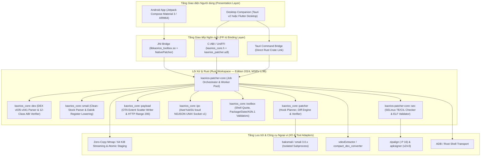
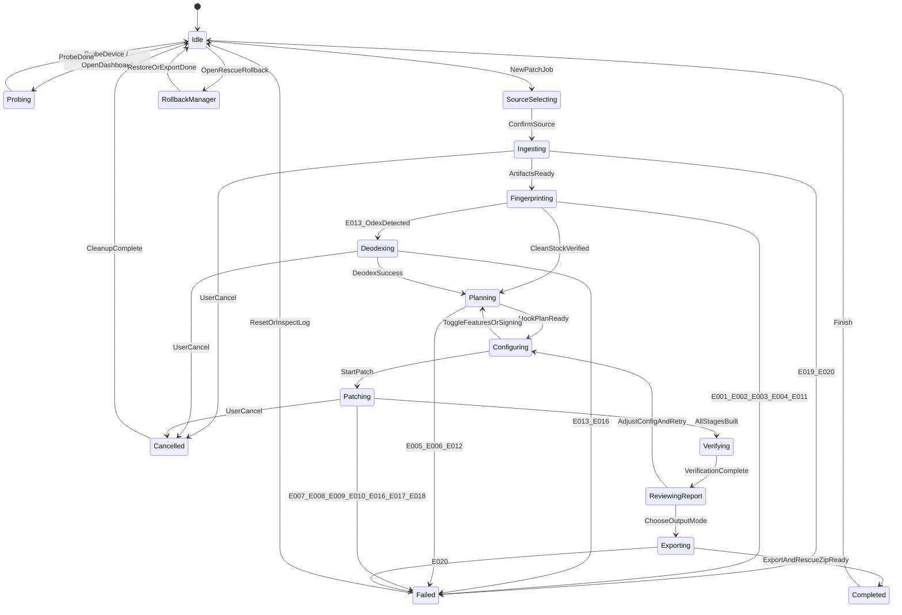

# Đặc tả Kỹ thuật & Bản thiết kế Phát triển: Ứng dụng Kaorios Patcher Độc lập

> **Phiên bản tài liệu:** `1.0` — đồng bộ hoàn toàn với **Kaorios Toolbox / Framework `v2.0.6.2`** (`kaorios_core` `v2.0.6`, `script/kaorios_hook_spec.py`, `framework/proguard-rules.pro`)
> **Phạm vi mục tiêu:** Android 13–17 (API 33–37) • Ứng dụng Android (Rooted On-Device ARM64) & Ứng dụng Desktop Đồng hành (Linux / Windows / macOS)
> **Lõi xử lý:** Rust Edition 2024 (MSRV `1.98`) • Hợp đồng ABI R8-kept 12 lớp • Nguyên tắc Fail-Closed & Clean-Stock

---

## Mục lục

1. [Phạm vi Sản phẩm & Chân dung Người dùng Mục tiêu](#1-phạm-vi-sản-phẩm--chân-dung-người-dùng-mục-tiêu)
2. [Kiến trúc Tổng thể & Thiết kế Rust Core FFI](#2-kiến-trúc-tổng-thể--thiết-kế-rust-core-ffi)
3. [Nhận diện ROM OEM (Fingerprinting) & Quy trình Nạp Tiền kiểm (Pre-Flight)](#3-nhận-diện-rom-oem-fingerprinting--quy-trình-nạp-tiền-kiểm-pre-flight)
4. [Đặc tả Bộ máy DEX Nhị phân & Vá Smali (Binary DEX & Smali Patching Engine)](#4-đặc-tả-bộ-máy-dex-nhị-phân--vá-smali-binary-dex--smali-patching-engine)
5. [Quy trình SELinux, Thư viện Native & Ký lại APK (Re-Signing)](#5-quy-trình-selinux-thư-viện-native--ký-lại-apk-re-signing)
6. [Mô hình Dữ liệu Đầy đủ, Hợp đồng Rust API & JSON Job Manifest](#6-mô-hình-dữ-liệu-đầy-đủ-hợp-đồng-rust-api--json-job-manifest)
7. [Bản thiết kế UI/UX Theo Từng Màn hình & Máy Trạng thái (State Machine)](#7-bản-thiết-kế-uiux-theo-từng-màn-hình--máy-trạng-thái-state-machine)
8. [Phân loại Lỗi (`E001`–`E020`), Hàng rào An toàn & Khôi phục Bootloop](#8-phân-loại-lỗi-e001e020-hàng-rào-an-toàn--khôi-phục-bootloop)
9. [Ma trận Kiểm thử, Fuzzing & Kỹ nghệ Phát hành (Release Engineering)](#9-ma-trận-kiểm-thử-fuzzing--kỹ-nghệ-phát-hành-release-engineering)

---

## 1. Phạm vi Sản phẩm & Chân dung Người dùng Mục tiêu

### 1.1 Tầm nhìn Sản phẩm & Bài toán Giải quyết

Việc tích hợp **Kaorios Framework (`v2.0.6.2`)** vào các bản ROM Android 13–17 hiện tại đòi hỏi người vận hành thao tác thủ công trên nhiều thành phần nhạy cảm: trích xuất `framework.jar`, `services.jar` và tùy chọn `SettingsProvider.apk`, xử lý phân mảnh odex/vdex/cdex, nạp đúng payload `classes.dex` đã tối ưu R8, chèn chính xác các hook Smali (F1–F7, S1–S6, SP1) mà không vượt giới hạn toán hạng 4-bit `v0..v15` của Dalvik, đồng bộ chính sách SELinux Enforcing cho dịch vụ Binder `kaorios_advanced_policy`, và đóng gói thư viện native hai kiến trúc `libkaoripif.so` / `libkaoripif_diagnostic.so`.

**Kaorios Patcher App** là ứng dụng độc lập, đa nền tảng được thiết kế xoay quanh một lõi Rust an toàn bộ nhớ duy nhất (`kaorios_core` + `kaorios-patcher-core`), chuyển hóa toàn bộ quy trình trên thành một đường ống **tất định (deterministic), kiểm tra nguyên tử (atomic), thất bại an toàn (fail-closed)** và có thể kiểm chứng hoàn chỉnh trước khi flash.

### 1.2 Chân dung Người dùng Mục tiêu (Target Personas)

| Chân dung | Môi trường Vận hành | Nhu cầu Chính | Luồng Thao tác Điển hình |
| :--- | :--- | :--- | :--- |
| **P1 — Người dùng nâng cao trên thiết bị (On-Device Rooted User)** | Thiết bị Android 13–17 ARM64 đã root (Magisk / KernelSU / AweYukiSU / APatch) | Vá trực tiếp trên máy không cần PC; tự động tạo module systemless và gói cứu hộ bootloop | Mở app → Quét thiết bị → Tự động lấy JAR/APK + `ps -AZ` → Chọn tính năng → Vá & Kiểm chứng → Xuất/Cài Module ZIP |
| **P2 — Maintainer Custom ROM / Kỹ sư ROM Kitchen** | Máy trạm Desktop Linux / Windows / macOS | Vá hàng loạt từ bản dump firmware sạch hoặc OTA `payload.bin`; xuất báo cáo kiểm chứng JSON tích hợp CI | Chọn nguồn OTA `payload.bin` hoặc thư mục ROM Kitchen → Nhận diện OEM → Chạy đường ống vá tự động → Kiểm chứng SHA-256 & Xuất file kitchen / Recovery ZIP |
| **P3 — Kỹ sư Kiểm thử Firmware OEM (OEM Specialist)** | Desktop + thiết bị vật lý qua USB/Wireless ADB | Chẩn đoán khác biệt giữa HyperOS, One UI, ColorOS/OxygenOS/Realme UI, OriginOS và AOSP; xem diff Smali chi tiết và kiểm tra SELinux `neverallow` | Kết nối ADB → Fingerprinting + Đo domain `SettingsProvider` → Xem trước `HookPlan` & Cảnh báo OEM → Kiểm duyệt Smali Diff → Xuất & Chạy smoke-test trên máy thật |

### 1.3 Nền tảng Triển khai Được Hỗ trợ

1. **Ứng dụng Android Trên Thiết bị (On-Device Android App):**
   - Yêu cầu tối thiểu: Android 13 (API 33), hỗ trợ đầy đủ tới Android 17 (API 37).
   - Kiến trúc native: **ARM64-only (`arm64-v8a`)**, khớp với cổng phát hành `tools/verify-apk-native-abi.py` (không đóng gói thư viện 32-bit vào APK ứng dụng quản trị/vá).
   - Quyền truy cập hệ thống: Hỗ trợ kết nối trực tiếp daemon **AweYukiSU `ksud`** qua UNIX socket NDJSON (`/dev/socket/aweyuki_ipc`, giao thức `HELPER_API_CONTRACT.md` v1), đồng thời có nhánh dự phòng qua root shell (`su -c`) cho Magisk, KernelSU và APatch.
   - Chế độ không root (Unrooted File Mode): Vẫn cho phép chọn tệp JAR/APK/OTA cục bộ thông qua Android Storage Access Framework (SAF), thực hiện phân tích, vá và xuất gói ZIP mà không yêu cầu quyền root.
2. **Ứng dụng Desktop Đồng hành (Desktop Companion App):**
   - Hệ điều hành: **Windows 10/11 (`x86_64`)**, **Linux (`x86_64`, `aarch64`)**, **macOS (`arm64`, `x86_64`)**.
   - Điều phối thiết bị: Giao tiếp ADB qua USB/TCP (`adb pull`, `adb push`, `adb shell`), xử lý khối lượng tệp OTA lớn (4–12 GB) trực tiếp trên ổ đĩa NVMe/SSD với luồng zero-copy.

### 1.4 Ma trận Nguồn Đầu vào (4 Chế độ Nạp — Ingestion Modes)

| Mã chế độ | Tên nguồn đầu vào | Tệp / Kênh thu thập | Thành phần Rust Core phụ trách |
| :--- | :--- | :--- | :--- |
| `local_archives` | **Tệp JAR/APK Cục bộ** | `framework.jar`, `services.jar`, tùy chọn `SettingsProvider.apk`, payload `classes.dex` (trích từ `KaoriosFramework-release.apk`), tùy chọn cặp `.so` (`arm64-v8a` & `armeabi-v7a`) | `kaorios_core::dex`, `kaorios-patcher-core::ingest` |
| `live_device` | **Kéo Trực tiếp từ Thiết bị (ADB / Root / IPC)** | `/system/framework/framework.jar`, `/system/framework/services.jar`, `/system_ext/priv-app/SettingsProvider/SettingsProvider.apk` (hoặc `/system/priv-app/SettingsProvider/`), `/system/build.prop`, `/system_ext/etc/build.prop`, `/product/etc/build.prop`, `/system/etc/selinux/plat_service_contexts`, `/system/etc/selinux/plat_sepolicy.cil`, kết quả `ps -AZ` và `getenforce` | `kaorios_core::ipc`, `kaorios_core::toolbox::sh_quote`, `DeviceTransport` |
| `ota_payload` | **Trích xuất Trực tiếp OTA `payload.bin` (Cục bộ hoặc HTTP Range)** | Tệp `payload.bin` trực tiếp, tệp `ota.zip` chứa `payload.bin`, hoặc URL OTA từ xa hỗ trợ HTTP `206 Partial Content`. Trích xuất phân vùng `system`, `system_ext`, `product` rồi đọc thẳng cấu trúc ext4/EROFS để lấy JAR/APK/SELinux mà không cần giải nén toàn bộ ROM | `kaorios_core::validate_range`, `kaorios_core::validate_extents`, `kaorios_core::payload::write_extents`, `kaorios_core::payload::BoundedReader` |
| `rom_kitchen` | **Thư mục ROM Kitchen Đã Giải nén** | Thư mục gốc chứa `system/`, `system_ext/`, `product/`, `vendor/` đã mount/unpack sẵn | `kaorios-patcher-core::fingerprint`, `kaorios_core::dex` |

### 1.5 Chế độ Đóng gói Đầu ra (3 Output Modes)

1. **Systemless Root Module ZIP (`magisk_ksu_apatch`):**
   - Tương thích hoàn toàn với **Magisk**, **KernelSU**, **AweYukiSU** và **APatch**.
   - Cấu trúc gói xuất chuẩn:
     ```text
     kaorios-patch-<oem>-api<sdk>-<shortsha>.zip
     ├── module.prop
     ├── customize.sh
     ├── post-fs-data.sh              # Bind-mount service_contexts trước khi servicemanager khởi chạy
     ├── sepolicy.rule                # Quy tắc runtime theo đúng domain SettingsProvider đã đo
     ├── service.sh                   # Bộ giám sát boot-completed watchdog & báo cáo trạng thái
     ├── uninstall.sh                 # Dọn dẹp trạng thái khi gỡ module
     ├── kaorios-patch-manifest.json  # Báo cáo SHA-256 & kế hoạch hook đã áp dụng
     └── system/
         ├── framework/
         │   ├── framework.jar
         │   ├── services.jar
         │   └── oat/                 # Whiteout / vô hiệu hóa cache ART cũ
         ├── lib64/libkaoripif_diagnostic.so
         ├── lib/libkaoripif_diagnostic.so
         └── system_ext/
             ├── lib64/libkaoripif.so
             ├── lib/libkaoripif.so
             └── priv-app/SettingsProvider/SettingsProvider.apk   # Chỉ khi bật SP1
     ```
2. **Custom Recovery Flashable ZIP (`recovery_zip`):**
   - Hỗ trợ TWRP / OrangeFox với `META-INF/com/google/android/update-binary` (shell-based portable binary) và `updater-script`.
   - Trước khi ghi đè bất kỳ tệp hệ thống nào: tự động sao lưu nguyên trạng bản gốc kèm metadata (`uid:gid`, `mode`, `security.selinux`, `SHA-256`) vào `/data/kaorios_backup/<job_id>/`.
   - Áp đặt quyền `0644`, chủ sở hữu `0:0`, ngữ cảnh SELinux `u:object_r:system_file:s0`, xóa cache `oat`/`vdex`/`art` tương ứng.
   - Tự động sinh đồng thời tệp giải cứu **`kaorios-rescue-uninstall-<job_id>.zip`** ngay cạnh gói flash chính để khôi phục 100% nguyên bản trong Recovery nếu có sự cố.
3. **Thư mục ROM Kitchen / Source Tree Export (`rom_kitchen_files`):**
   - Xuất trực tiếp các tệp đã vá (`framework.jar`, `services.jar`, tùy chọn `SettingsProvider.apk`), phân mảnh SELinux chuẩn (`kaorios_advanced_policy.te`, `kaorios_advanced_policy.cil`, `service_contexts.fragment`), cây thư viện `.so` hai ABI, `SHA256SUMS`, `patch-manifest.json`, `verification-report.json` và tập lệnh POSIX `rollback.sh`.

### 1.6 Các Giới hạn Cố ý (Explicit Non-Goals)

- **Không bao giờ ghi đè tệp đầu vào tại chỗ (In-Place Mutation Prohibited):** Đường dẫn `--output` phải luôn khác `--input` sau khi chuẩn hóa (`canonicalize`).
- **Không bao giờ vá chồng lên ROM đã vá sẵn (Clean-Stock Only):** Mọi đầu vào chứa sẵn bất kỳ lớp nào thuộc `Landroid/security/kaorios/` hoặc `Lcom/kousei/framework/` đều bị từ chối cứng (`E004` — `E004NotCleanStock`).
- **Không bao giờ hạ SELinux về `Permissive`:** Mọi quy trình đều thiết kế cho chế độ `getenforce == Enforcing`.
- **Không chứa dữ liệu nhạy cảm:** Ứng dụng tuyệt đối không đính kèm, không ghi log và không nhúng keybox XML, khóa ký riêng, mật khẩu keystore hay mã định danh thiết bị thật.
- **Không can thiệp `boot.img` / kernel image:** Phạm vi vá giới hạn trong tầng framework Java/DEX, dịch vụ hệ thống, `SettingsProvider`, SELinux userspace và thư viện native userspace.

---

## 2. Kiến trúc Tổng thể & Thiết kế Rust Core FFI

### 2.1 Sơ đồ Kiến trúc Hệ thống



### 2.2 Cấu trúc Workspace & Phân tách Crate

Hệ thống tuân thủ nguyên tắc tách biệt nghiêm ngặt giữa **lõi thuần thuật toán không phụ thuộc ngoài (`kaorios_core`)** và **lớp điều phối I/O + đóng gói + FFI mở rộng (`kaorios-patcher-core`)**:

1. **`kaorios_core` (`rust_core/Cargo.toml` — giữ nguyên zero external dependencies, `std`-only):**
   - `edition = "2024"`, `rust-version = "1.98"`, `crate-type = ["cdylib", "rlib"]`.
   - Profile release tối ưu: `opt-level = 3`, `lto = "fat"`, `codegen-units = 1`, `strip = "symbols"`, `panic = "unwind"` *(giữ `unwind` để rào chắn `catch_unwind` tại FFI/JNI hoạt động đúng và `cargo test --release` chạy an toàn)*.
   - Chứa các mô-đun thuần logic và an toàn bộ nhớ:
     - `lib.rs`: `validate_range`, `validate_extents`, `enabled_value`, xuất C-ABI (`kaorios_core_abi_version`, `kaorios_validate_range`, `kaorios_validate_extents`, `kaorios_enabled_value`).
     - `payload.rs`: `write_extents` (ghi phân tán 64 KiB kèm checkpoint hủy), `BoundedReader` (chống đọc lẹm blob OTA).
     - `ipc.rs`: Client NDJSON qua UNIX socket tới `/dev/socket/aweyuki_ipc` (`API_VERSION_V1 = 1`, `MAX_FRAME_BYTES = 1 MiB`, `DEFAULT_TIMEOUT = 5_000 ms`).
     - `toolbox.rs`: `sh_quote`, `is_valid_package_name`, `format_security_patch`, `parse_attestation_data` (ASN.1 Tag `704` `[0xBF, 0x85, 0x40]`), `parse_setting_boolean`, `apply_all_mode`, `is_json_object`.
     - `dex.rs`: Bộ phân tích nhị phân DEX `v035`–`v041` không phụ thuộc Java (`parse_dex_header`, `inspect_dex`, `read_uleb128`, `api_hint_for_version`), kiểm chứng 12 lớp R8-kept (`evaluate_payload_abi`, `verify_payload_dex`, `PAYLOAD_REQUIRED_CLASSES`), phát hiện xung đột lớp (`detect_payload_collisions`, `find_dex_owners`) và cấp phát slot liên tục (`parse_dex_slot_number`, `format_dex_slot_name`, `sort_dex_entries`, `next_dex_slot`, `has_contiguous_dex_slots`).
     - `smali.rs`: Bộ phân tích Smali clean-stock (`ensure_clean_stock_smali`, `parse_method_header`, `find_methods`, `find_method_entry_insert_idx`), bộ hạ thanh ghi Dalvik 4-bit `v0..v15` (`effective_reg`, `set_min_locals`, `emit_move`, `emit_parallel_moves`, `lower_entry_args`), bộ bảo vệ liền kề (`verify_invoke_move_result_adjacency`, `verify_smali_hooks`) và toàn bộ 17 hàm chèn hook (`patch_framework_f1_instrumentation`..`patch_framework_f7_name_value_cache`, `patch_services_s1_system_server`..`patch_services_s4_fakegapps`, `patch_services_computer_engine`, `patch_services_s5_secure_flag`, `patch_settings_provider_call`, `patch_corepatch_*`).
     - `patcher.rs`: Sổ đăng ký hook khai báo (`FRAMEWORK_CORE_SPECS`, `SERVICES_CORE_SPECS`, `SERVICES_SECURE_FLAG_SPECS`, `SETTINGS_PROVIDER_SPECS`, `COREPATCH_FRAMEWORK_CLASSES`, `COREPATCH_SERVICES_CLASSES`, `SEPOLICY_SERVICE_NAME`/`TYPE`/`CONTEXT_LINE`), nhận diện ROM (`fingerprint_rom`), trình lập kế hoạch & thực thi (`plan_framework_patch`, `plan_services_patch`, `apply_hook_by_id`, `execute_planned_hooks`), bộ xuất JSON tất định camelCase (`to_json_string()`, `dex_index_to_json`, `payload_report_to_json`), cùng bề mặt C-ABI `kaorios_patcher_*`.
     - `jni.rs` (cờ `#[cfg(feature = "jni")]`): Cầu nối JNI tương thích ngược 100% cho `com.kousei.kaorios.nativebridge.NativeToolbox`.
2. **`kaorios-patcher-core` (Crate mặt tiền ứng dụng Patcher App):**
   - Phụ thuộc vào `kaorios_core` dưới dạng `rlib`.
   - Cung cấp tầng I/O thực thi: đọc/ghi ZIP giao dịch (tương đương `script/dex_packager.py`), đọc ảnh phân vùng OTA (ext4/EROFS read-only), kiểm chứng ELF `PT_DYNAMIC`/`.dynsym`, bộ xác thực SELinux `.te`/`.cil`/`service_contexts`, trình quản lý subprocess cô lập (`baksmali`/`smali`, `zipalign`, `apksigner`, `adb`), worker pool đa luồng, và các feature binding `cabi` / `uniffi` / `jni-patcher`.

```toml
# Cấu hình đề xuất cho facade crate kaorios-patcher-core/Cargo.toml
[package]
name = "kaorios-patcher-core"
version = "2.0.6"
edition = "2024"
rust-version = "1.98"
publish = false

[lib]
crate-type = ["cdylib", "staticlib", "rlib"]

[features]
default = ["cabi"]
cabi = []
uniffi = ["dep:uniffi"]
jni-patcher = ["kaorios_core/jni"]
cli = []

[dependencies]
kaorios_core = { path = "../rust_core", default-features = false }
# Chỉ bổ sung các crate tối giản, đã kiểm toán cho I/O & serialization ở tầng ứng dụng
serde = { version = "1", features = ["derive"] }
serde_json = "1"
sha2 = "0.10"
zip = { version = "2", default-features = false, features = ["deflate"] }
memmap2 = "0.9"
uniffi = { version = "0.28", optional = true }
```

### 2.3 Thiết kế Giao diện Ba lớp FFI (C-ABI, UniFFI & JNI)

Mọi ranh giới FFI đều tuân thủ 4 bất biến kỹ thuật bắt buộc:
1. **Rào chắn `catch_unwind`:** Không một `panic!` nào của Rust được phép truyền qua biên `extern "C"` hoặc JNI (tránh Undefined Behavior).
2. **Chú thích `// SAFETY:` bắt buộc:** Mọi khối `unsafe` đều phải chứng minh rõ ràng tính hợp lệ của con trỏ, căn chỉnh bộ nhớ (`align_of`), độ dài không vượt `isize::MAX` và vòng đời mượn (lifetime).
3. **Bản phiên bản ABI tường minh:** Hàm `kaorios_core_abi_version() -> u32` (hiện trả về `1`) và `kaorios_patcher_abi_version() -> u32` được kiểm tra ngay khi nạp thư viện; lệch phiên bản dừng ngay lập tức.
4. **Quyền sở hữu bộ nhớ rõ ràng (Explicit Ownership):** Mọi chuỗi JSON/buffer do Rust cấp phát qua C-ABI đều phải được giải phóng qua `kaorios_patcher_free_string(ptr: *mut c_char)` hoặc `kaorios_patcher_free_buffer(ptr: *mut u8, len: usize)`.

#### A. Giao diện C-ABI (`kaorios_patcher.h`)

```c
#pragma once
#include <stdint.h>
#include <stddef.h>

typedef struct KaoriosPatcherCtx KaoriosPatcherCtx;

typedef void (*KaoriosProgressCb)(
    const uint8_t* event_json_utf8,
    size_t event_json_len,
    void* user_data
);

/* Giữ nguyên các hàm sẵn có của kaorios_core (rust_core/src/lib.rs) */
uint32_t kaorios_core_abi_version(void);
int64_t  kaorios_validate_range(int32_t status, const uint8_t* data, size_t len,
                                int64_t start, int64_t end, int64_t total);
int64_t  kaorios_validate_extents(const int64_t* data, size_t len,
                                  int32_t block_size, int64_t output_size);
int32_t  kaorios_enabled_value(const uint8_t* data, size_t len);

/* Bề mặt C-ABI Patcher đã cài đặt sẵn trong kaorios_core (rust_core/src/patcher.rs)
 * Chuỗi JSON kết thúc bằng NUL trả về được giải phóng bằng kaorios_patcher_free_string. */
char*    kaorios_patcher_inspect_dex_json(const uint8_t* data, size_t length);
char*    kaorios_patcher_verify_payload_dex_json(const uint8_t* data, size_t length);
char*    kaorios_patcher_apply_hook_json(const char* hook_id, const char* smali_utf8);
void     kaorios_patcher_free_string(char* ptr);

/* API điều phối phiên vá mở rộng của facade crate kaorios-patcher-core */
uint32_t           kaorios_patcher_abi_version(void);
KaoriosPatcherCtx* kaorios_patcher_create(uint32_t max_workers);
void               kaorios_patcher_destroy(KaoriosPatcherCtx* ctx);

/* Thực thi đồng bộ trên worker thread; gọi callback tiến trình theo từng giai đoạn */
int32_t kaorios_patcher_fingerprint_json(
    KaoriosPatcherCtx* ctx,
    const uint8_t* request_json, size_t request_len,
    uint8_t** out_json, size_t* out_len
);

int32_t kaorios_patcher_plan_json(
    KaoriosPatcherCtx* ctx,
    const uint8_t* config_json, size_t config_len,
    uint8_t** out_json, size_t* out_len
);

int32_t kaorios_patcher_execute_json(
    KaoriosPatcherCtx* ctx,
    const uint8_t* config_json, size_t config_len,
    KaoriosProgressCb progress_cb,
    void* user_data,
    uint8_t** out_report_json, size_t* out_report_len
);

void kaorios_patcher_cancel(KaoriosPatcherCtx* ctx, const uint8_t* job_id, size_t job_id_len);
void kaorios_patcher_free_buffer(uint8_t* ptr, size_t len);
```

#### B. Giao diện UniFFI (Dành cho Swift / Kotlin Multiplatform / Flutter Bridge)

UniFFI ánh xạ trực tiếp các kiểu Rust (`PatchJobConfig`, `RomFingerprint`, `HookPlan`, `VerificationReport`, `ProgressEvent`, `PatcherError`) thành kiểu gốc (native typed objects) của Kotlin/Swift/Dart và hỗ trợ trait callback `ProgressSink` để đẩy sự kiện tiến trình bất đồng bộ mà không cần tự mã hóa JSON thủ công.

#### C. Giao diện Android JNI (`libkaorios_toolbox.so`)

- **Bảo toàn 100% ký hiệu hiện hữu** của `com.kousei.kaorios.nativebridge.NativeToolbox` (cả đăng ký động qua `JNI_OnLoad` và xuất tĩnh `Java_com_kousei_kaorios_nativebridge_NativeToolbox_*`):
  - `shQuote`, `isValidPackageName`, `formatSecurityPatch`, `parseAttestationData`, `parseSettingBoolean`, `needsSettingBooleanDefault`, `applyAllMode`, `isJsonObject`, `aweyukiIpcCall`, `aweyukiIpcProbe`, `aweyukiDefaultSocketPath`.
- **Bổ sung lớp cầu nối `com.kousei.kaorios.patcher.NativePatcher`:**
  - `external fun nativeCreateContext(maxWorkers: Int): Long`
  - `external fun nativeDestroyContext(handle: Long)`
  - `external fun nativeFingerprint(handle: Long, requestJson: String): String`
  - `external fun nativePlanJob(handle: Long, configJson: String): String`
  - `external fun nativeExecuteJob(handle: Long, configJson: String, callback: PatchProgressCallback): String`
  - `external fun nativeCancelJob(handle: Long, jobId: String)`
  - Trong `nativeExecuteJob`, Rust lưu `GlobalRef` tới `PatchProgressCallback`, gắn luồng worker vào JVM bằng `AttachCurrentThreadAsDaemon` khi phát sự kiện `onProgress(eventJson: String)`, và giải phóng `GlobalRef` trong khối đảm bảo `Drop` trước khi trả về.

### 2.4 So sánh & Lựa chọn Tầng UI: Android Compose vs Desktop (Tauri v2 / Flutter)

| Tiêu chí Kỹ thuật | Android: Jetpack Compose (Material 3) | Desktop: Tauri v2 (Rust + Web/TS) | Desktop: Flutter Desktop (`flutter_rust_bridge` / C-ABI) |
| :--- | :--- | :--- | :--- |
| **Liên kết với Rust Core** | Trực tiếp qua JNI (`libkaorios_toolbox.so`), tái sử dụng sẵn `NativeToolbox` & IPC `ksud` | Liên kết **trực tiếp mức crate Rust** (zero FFI serialization overhead, cùng không gian địa chỉ) | Qua C-ABI / `flutter_rust_bridge` (cần sinh mã Dart FFI) |
| **Dung lượng cài đặt** | ~8–12 MB (ARM64-only) | ~6–12 MB (dùng WebView hệ điều hành sẵn có) | ~25–35 MB (kèm Skia/Impeller runtime) |
| **Mức tiêu thụ RAM khi xem Diff lớn** | Thấp (~80–140 MB với `LazyColumn` ảo hóa dòng) | Trung bình (~120–200 MB với virtualized diff table) | Thấp (~90–150 MB, render 60/120 fps nhất quán) |
| **Tích hợp Hệ thống (SAF, Root, ADB)** | Nguyên bản 100% với Android SAF, `ForegroundService`, thông báo tiến trình | Nguyên bản trên Rust (`tokio::process` gọi `adb`, đọc disk/file dialog toàn quyền) | Cần plugin platform channel cho file dialog / USB |
| **Khuyến nghị Kiến trúc** | **Bắt buộc chọn cho Android** (đồng nhất hệ sinh thái Kaorios Toolbox hiện có) | **Khuyến nghị số 1 cho Desktop** khi ưu tiên liên kết Rust trực tiếp, gói gọn nhẹ và tốc độ phát triển | **Lựa chọn thay thế** nếu đội ngũ chỉ muốn duy trì 1 codebase UI duy nhất cho cả Desktop & Android |

### 2.5 Mô hình Đồng thời (Concurrency), Worker Pool & Kênh Tiến trình

- **Worker Thread Pool giới hạn tài nguyên:**
  - Số luồng tối đa mặc định: `workers = min(available_parallelism(), 4)` trên Android và `min(available_parallelism(), 8)` trên Desktop.
  - Mục đích: Song song hóa phân tích DEX (`inspect_dex` trên nhiều tệp `classes*.dex`) và lắp ráp lại từng DEX độc lập (`baksmali`/`smali`), nhưng vẫn giữ đỉnh RAM dưới `1.2 GiB` trên điện thoại Android 6–8 GB RAM (vì mỗi tiến trình JVM `smali` chiếm ~250–350 MB heap với `-Xmx384m`).
- **Kênh Tiến trình Streaming (Progress Channel):**
  - Mọi giai đoạn phát sự kiện `ProgressEvent` qua kênh bounded MPSC (dung lượng `256` khung).
  - Các sự kiện tiến trình theo byte (như đọc OTA `payload.bin` hoặc ghi ZIP) được điều tiết (coalesce/throttle) tối đa 20 lần/giây (mỗi `50 ms`) để không làm nghẽn luồng UI chính; các sự kiện chuyển pha (`PhaseChanged`, `HookApplied`, `Warning`, `Error`) được gửi ngay lập tức không bị drop.
- **Hủy Cộng tác (Cooperative Cancellation):**
  - Mỗi tác vụ sở hữu `Arc<AtomicBool>` (`cancel_flag`).
  - Được kiểm tra tại: (1) mỗi khối `64 KiB` trong `kaorios_core::payload::write_extents` qua closure `checkpoint`, (2) mỗi vòng lặp `class_defs` khi phân tích DEX, (3) trước và trong lúc chờ tiến trình con (`baksmali`/`smali`/`adb`) — nếu bị hủy, gửi `SIGTERM`/`Kill` tới tiến trình con và dọn sạch thư mục staging tạm.

### 2.6 Chiến lược Zero-Copy File I/O & Ghi Nguyên tử

- **Đọc Không Sao chép (Read-Only Memory Mapping & Streaming):**
  - Tệp `classes*.dex` và tệp ảnh phân vùng cục bộ lớn được ánh xạ chỉ-đọc (`mmap` với kiểm tra kích thước tệp không đổi) hoặc đọc từng khúc `64 KiB` (`[0_u8; 64 * 1024]`, khớp tuyệt đối kích thước buffer của `rust_core/src/payload.rs`).
  - Khi đóng gói lại JAR/APK, các mục ZIP không chỉnh sửa (resources, `META-INF`, các `classes*.dex` không chứa lớp mục tiêu) được chép theo luồng trực tiếp (streaming pass-through), không giải nén hay giữ toàn bộ bản sao dư thừa trên RAM.
- **Ghi Nguyên tử (Atomic Staging):**
  - Mọi tệp đầu ra đều được ghi vào tệp tạm cùng phân vùng (`.kaorios_stage_<uuid><ext>`), gọi `sync_all()`, chạy `testzip` + kiểm chứng DEX/SHA-256, rồi mới đổi tên nguyên tử (`rename` / `os.replace`). Nếu bất kỳ bước nào thất bại hoặc người dùng hủy, tệp tạm bị xóa sạch và đường dẫn đích không bao giờ bị hỏng nửa chừng.

---

## 3. Nhận diện ROM OEM (Fingerprinting) & Quy trình Nạp Tiền kiểm (Pre-Flight)

### 3.1 Bộ máy Nhận diện ROM Đa tín hiệu (Multi-Signal Fingerprinting)

Patcher App **không bao giờ** đoán bố cục ROM chỉ dựa vào tên thiết bị hay số phiên bản Android đơn lẻ. Thay vào đó, bộ máy tổng hợp **3 tầng tín hiệu độc lập** để xây dựng cấu trúc `RomFingerprint`:

#### Tầng 1: Tín hiệu `build.prop` (Hệ thống, `system_ext`, `product`, `vendor`)
Đọc và hợp nhất khóa theo thứ tự ưu tiên phân vùng (`system` → `system_ext` → `product` → `vendor`):
- Thông số Android lõi: `ro.build.version.sdk` (bắt buộc trong dải `33..=37`), `ro.build.version.release`, `ro.build.fingerprint`, `ro.build.version.security_patch`, `ro.product.cpu.abilist`, `ro.product.manufacturer`, `ro.product.brand`, `ro.product.model`.
- Tín hiệu nhận diện OEM Skin:
  - **Xiaomi HyperOS / MIUI:** `ro.mi.os.version.name` (ví dụ `OS1.0`, `OS2.0`, `OS3.0`), `ro.miui.ui.version.name` (`V140`), `ro.miui.ui.version.code`.
  - **Samsung One UI:** `ro.build.version.oneui` (ví dụ `60100`, `70000`, `80000`), `ro.config.knox`.
  - **OPPO ColorOS / OnePlus OxygenOS / Realme UI (OPlus):** `ro.build.version.oplusrom`, `ro.oplus.image.my_stock.type`, `ro.rom.version` (OxygenOS).
  - **vivo OriginOS / FuntouchOS:** `ro.vivo.os.build.display.id`, `ro.vivo.os.version`, `ro.vivo.product.version`.
  - **Custom AOSP:** `ro.lineage.version`, `ro.evolution.version`, `ro.crdroid.version`, `ro.pixelexperience.version`.

#### Tầng 2: Tín hiệu Cấu trúc Phân vùng & Companion JAR
Quét `/system/framework/`, `/system_ext/framework/` và biến môi trường `BOOTCLASSPATH` / `SYSTEMSERVERCLASSPATH`:
- Phát hiện các JAR mở rộng của OEM:
  - Xiaomi: `miui-framework.jar`, `miui-services.jar`, `xiaomi-framework.jar`.
  - OPlus: `oplus-framework.jar`, `oplus-services.jar`, `oplus-support-wrapper.jar`.
  - vivo: `vivo-framework.jar`, `vivo-services.jar`.
  - Samsung: `samsung-framework.jar`, `sem-services.jar`, `framework.jar` phân mảnh 5–7 DEX.
- Xác định chính xác đường dẫn thực tế của `SettingsProvider.apk`: kiểm tra tuần tự `/system_ext/priv-app/SettingsProvider/SettingsProvider.apk` → `/system/priv-app/SettingsProvider/SettingsProvider.apk` → `/product/priv-app/SettingsProvider/SettingsProvider.apk`.

#### Tầng 3: Phân tích Đồ thị Lớp DEX (DEX Class Graph Probing)
Phân tích trực tiếp bảng `class_defs` và `defined_methods` của `framework.jar` và `services.jar` bằng `kaorios_core::dex`:
- Xác định phiên bản DEX (`v035`–`v041`) và `api_hint` cho từng `classes*.dex`.
- Tự động dò đường nhánh rơi về (fallback resolution) **trước khi tháo lắp `baksmali`**:
  - Hook **S2** (`shouldFilterApplication*`): có trong `ComputerEngine` hay đã tách sang `AppsFilterBase`? Tham số mục tiêu là `PackageStateInternal` (`invoke-interface`) hay `PackageSetting` (`invoke-virtual`)?
  - Hook **S3** (`getInstallerPackageName`): nằm ở `ComputerEngine` hay `IPackageManagerBase`?
  - Hook **S4** (`generatePackageInfo`): tham số cờ (`flags`) là 64-bit `J` (Android 13+) hay 32-bit `I` (legacy)?
  - Hook **S1** (`startOtherServices`): có tham số `Lcom/android/server/utils/TimingsTraceAndSlog;` hay dạng 0 tham số?
  - Hook **F3** (`SystemProperties.get`): hàm 1 tham số `get(String)` có ủy quyền nội bộ sang hàm 2 tham số `get(String, String)` hay không?

### 3.2 Ma trận Phân loại & Đặc thù OEM (Android 13–17 / API 33–37)

| Họ ROM OEM | Phiên bản Hỗ trợ | Đặc thù Bố cục JAR / DEX | Đặc thù SELinux & `SettingsProvider` | Cảnh báo Bắt buộc Hiển thị trên UI |
| :--- | :--- | :--- | :--- | :--- |
| **Pixel / Stock AOSP / Custom AOSP** (LineageOS, Evolution-X, crDroid) | Android 13–17 (API 33–37) | Chuẩn AOSP; `framework.jar` 3–5 DEX, `services.jar` 2–4 DEX | `u:r:system_app:s0` (chuẩn) hoặc `u:r:settings_provider:s0` (ROM hardened); Android 17 bắt buộc overlay `plat_service_contexts` | Cảnh báo về chữ ký nền tảng nếu bật SP1 trên ROM chưa bật CorePatch S6 |
| **Xiaomi HyperOS (1/2/3) & MIUI 14** | API 33–37 | Tồn tại song song `miui-framework.jar` & `miui-services.jar` — **chỉ vá `framework.jar` và `services.jar` gốc**; số lượng thanh ghi cục bộ trong `ActivityThread` và `ComputerEngine` thường `> 15` | Thường dùng `u:r:system_app:s0`; một số bản HyperOS Trung Quốc khóa chặt chữ ký hệ thống và kiểm tra lại gói qua `miui-services` | **Bắt buộc xóa/whiteout thư mục `oat/`** của `services.jar` và `boot-framework.*`; khuyến nghị kiểm tra `CorePatch S6` trước khi đụng `SettingsProvider.apk` |
| **Samsung One UI (6 / 7 / 8)** | API 34–37 | `framework.jar` lớn (5–7 DEX, nhiều phương thức có `.locals > 20`); `WindowState.isSecureLocked` đôi khi đi kèm kiểm tra tại `WindowManagerService` | Thường `u:r:system_app:s0`; tích hợp Knox/TIMA bảo vệ keystore phần cứng (hook F5/F6 vẫn hoạt động ở tầng Java KeyStore2 SPI) | Bắt buộc dọn cả `*.odex`, `*.vdex`, `*.art` và `*.prof`; khuyến nghị bật cả S5 + S5b khi chọn Disable `FLAG_SECURE` |
| **OPPO ColorOS / OnePlus OxygenOS / Realme UI (OPlus)** | API 33–37 | Có `oplus-framework.jar` & `oplus-services.jar`; một số bản tách `shouldFilterApplication` giữa `ComputerEngine` và `AppsFilterBase` | `u:r:system_app:s0` hoặc `u:r:platform_app:s0` tùy nhánh; phân vùng `my_stock` có thể chứa file ghi đè | Nhắc người dùng kiểm tra `ps -AZ` thực tế và quét cả `system_ext` lẫn `my_stock` khi xuất gói |
| **vivo OriginOS / FuntouchOS** | API 33–37 | Có `vivo-framework.jar` & `vivo-services.jar`; lớp `AndroidKeyStoreSpi` có thể có wrapper mở rộng | Cần đo `ps -AZ` thực tế cho `com.android.providers.settings` | Không vá `vivo-*.jar`; xác minh kỹ F5/F6 trên báo cáo Diff trước khi đóng gói |

### 3.3 Phát hiện Odex / Vdex / Cdex / APEX & Đường ống Deodex

Trước khi chạy giai đoạn lập kế hoạch hook, bộ máy kiểm tra mọi tệp đích (`framework.jar`, `services.jar`, `SettingsProvider.apk`):

1. **Kiểm tra ZIP Entries:** Tìm danh sách mục khớp biểu thức `^classes(\d*)\.dex$`.
2. **Nhánh A — Đã Deodex (có sẵn `classes*.dex`):** Đọc thẳng vào `kaorios_core::dex::inspect_dex`, ghi `is_odexed = false`.
3. **Nhánh B — Bị Odex (thiếu `classes*.dex`, tìm thấy cặp `oat/<abi>/*.odex` + `*.vdex` hoặc `/system/framework/<abi>/boot-framework.vdex`):**
   - Đọc 8 byte đầu tệp `.vdex` để xác nhận magic `vdex` và phiên bản (`019`, `021`, `027`).
   - Chạy công cụ tách **`vdexExtractor`** trong thư mục tạm cô lập để rút trích các tệp `.dex` hoặc Compact DEX (`.cdex`, magic `cdex001\0`).
   - Nếu phát hiện `.cdex`, tự động chuyển qua **`compact_dex_converter`** để chuyển đổi về Standard DEX (`dex\n039\0`–`dex\n041\0`).
   - Dùng `kaorios_core::dex::inspect_dex` xác nhận mọi tệp DEX sau chuyển đổi đều có header hợp lệ, kích thước khớp `file_size`, `endian_tag == 0x12345678` và chứa đủ các lớp đích dự kiến.
   - Đóng gói tạm vào bản sao staging của JAR/APK (tuyệt đối không sửa bản gốc), đánh dấu `deodexed_by_patcher = true` trong `RomFingerprint` và bật tự động cờ **xóa/whiteout `oat/`** ở bước xuất gói.
   - Nếu công cụ deodex không khả dụng trên máy hoặc giải mã thất bại → dừng cứng với mã lỗi `E013` (`E013EmptyArchiveDexes` — thiếu `classes*.dex`, cần deodex) hoặc `E016` (`E016ToolingOrDeodexFailed` — lỗi công cụ deodex).
4. **Nhánh C — Tệp APEX & Bootclasspath Phân tách:**
   - Phát hiện khi các lớp hệ thống nằm trong module APEX (`/apex/com.android.art`, `/apex/com.android.conscrypt`, v.v.); cảnh báo rõ phạm vi và kiểm tra xem 7 lớp lõi của `framework.jar` có tồn tại đầy đủ trong `framework.jar` hay không trước khi cho phép tiếp tục.

### 3.4 Tiền kiểm Clean-Stock & Tạo Baseline Manifest SHA-256

Đây là **cổng an toàn bất khả xâm phạm** (chạy trước khi tháo lắp Smali):

1. **Kiểm tra Clean-Stock:**
   - Quét toàn bộ `defined_classes` và `referenced_methods` của mọi `classes*.dex` trong `framework.jar`, `services.jar` và `SettingsProvider.apk`.
   - Nếu phát hiện bất kỳ lớp hoặc lời gọi nào có tiền tố:
     - `Landroid/security/kaorios/`
     - `Lcom/kousei/framework/`
     → **Từ chối ngay lập tức với lỗi `E004` (`E004NotCleanStock`)**, báo chính xác tên tệp, slot `classes*.dex` và lớp vi phạm.
2. **Kiểm tra Tính hợp lệ của Payload DEX:**
   - Xác thực payload `classes.dex` bằng trình kiểm tra 12 lớp R8-kept (`kaorios_core::dex::evaluate_payload_abi`, xem Mục 4.2). Nếu thiếu bất kỳ lớp hoặc phương thức bắt buộc nào → dừng cứng `E002` (`E002PayloadAbiMismatch`).
   - Kiểm tra giao tập lớp giữa stock `framework.jar` và payload `classes.dex` (`detect_payload_collisions`) phải bằng rỗng (`∅`); nếu trùng → dừng cứng `E003` (`E003PayloadClassCollision`).
3. **Ghi Nhận `baseline-manifest.json`:**
   - Tính toán và lưu trữ bất biến cho mọi tệp đầu vào: đường dẫn gốc, kích thước byte, mã băm `SHA-256`, danh sách slot `classes*.dex`, phiên bản DEX, `api_hint`, cùng metadata POSIX nguyên bản (`uid`, `gid`, `mode`, `selinux_context`) nếu lấy từ thiết bị/ROM root.

---

## 4. Đặc tả Bộ máy DEX Nhị phân & Vá Smali (Binary DEX & Smali Patching Engine)

### 4.1 Bố cục Nhị phân DEX `v035`–`v041` & Bộ phân tích Thuần Rust

Bộ phân tích `kaorios_core::dex` đọc trực tiếp tệp nhị phân DEX mà **không cần khởi chạy JVM**, giúp quét toàn bộ 6 tệp DEX của `framework.jar` (~45 MB) chỉ trong vài chục mili-giây.

#### Cấu trúc Header 112 Byte (`0x70`)

| Offset | Kích thước | Kiểu (Little-Endian) | Trường | Quy tắc Xác thực Nghiêm ngặt |
| :--- | :--- | :--- | :--- | :--- |
| `0x00` | `8` | `[u8; 8]` | `magic` | Khớp `^dex\n(035\|037\|038\|039\|040\|041)\x00$` |
| `0x08` | `4` | `u32` | `checksum` | Adler-32 của toàn bộ byte từ `0x0C..file_size` |
| `0x0C` | `20` | `[u8; 20]` | `signature` | SHA-1 của toàn bộ byte từ `0x20..file_size` |
| `0x20` | `4` | `u32` | `file_size` | Phải thỏa `0x70 <= file_size <= data.len()` |
| `0x24` | `4` | `u32` | `header_size` | Bắt buộc bằng `0x70` (`112`) |
| `0x28` | `4` | `u32` | `endian_tag` | Bắt buộc bằng `0x12345678` (`ENDIAN_CONSTANT`) |
| `0x2C` | `12` | `3 × u32` | `link_size`, `link_off`, `map_off` | Kiểm tra biên nếu khác `0` |
| `0x38` | `8` | `2 × u32` | `string_ids_size`, `string_ids_off` | `string_ids_off + string_ids_size * 4 <= file_size` |
| `0x40` | `8` | `2 × u32` | `type_ids_size`, `type_ids_off` | `type_ids_off + type_ids_size * 4 <= file_size` |
| `0x48` | `8` | `2 × u32` | `proto_ids_size`, `proto_ids_off` | `proto_ids_off + proto_ids_size * 12 <= file_size` |
| `0x50` | `8` | `2 × u32` | `field_ids_size`, `field_ids_off` | `field_ids_off + field_ids_size * 8 <= file_size` |
| `0x58` | `8` | `2 × u32` | `method_ids_size`, `method_ids_off` | `method_ids_off + method_ids_size * 8 <= file_size` |
| `0x60` | `8` | `2 × u32` | `class_defs_size`, `class_defs_off` | `class_defs_off + class_defs_size * 32 <= file_size` |
| `0x68` | `8` | `2 × u32` | `data_size`, `data_off` | `data_off + data_size <= file_size` |

#### Bảng Ánh xạ Phiên bản DEX → `api_hint`

| Phiên bản DEX | `api_hint` mặc định | Ghi chú Tương thích |
| :--- | :--- | :--- |
| `035` | `23` | DEX cơ bản |
| `037` | `25` | Default/static interface methods |
| `038` | `26` | `invoke-polymorphic` |
| `039` | `28` | `const-method-handle` / `const-method-type` |
| `040` | `34` | Android 14 (cho phép khoảng trắng trong định danh đơn giản) |
| `041` | `35` | Android 15–17 (hỗ trợ multi-DEX container & opcode mở rộng; cho phép ghi đè `--api 36`/`37`) |

#### Thuật toán Giải mã MUTF-8, `proto_ids`, `method_ids` & ULEB128 `class_data_item`

1. **Giải mã ULEB128 an toàn (chống tràn bit & vòng lặp vô hạn):**
   - Hàm `kaorios_core::dex::read_uleb128` đọc tối đa **5 byte** (`shift` tăng bước `7`, tối đa `28`, ở byte thứ 5 chỉ cho phép bit thấp `0..=3` để không tràn `u32`). Nếu vượt biên buffer hoặc quá 5 byte mà bit cao `0x80` vẫn bật → trả `Err(DexError)` ánh xạ về `E001` (`E001InvalidDex`).
2. **Bảng Chuỗi (`string_ids`) & Kiểu (`type_ids`):**
   - Mỗi `string_id_item` (`u32 string_data_off`) trỏ tới một chuỗi MUTF-8 có tiền tố ULEB128 (số đơn vị UTF-16) theo sau bởi mảng byte kết thúc bằng `0x00`.
   - Mỗi `type_id_item` (`u32 descriptor_idx`) ánh xạ chỉ số vào `strings[descriptor_idx]`.
3. **Bảng Nguyên mẫu (`proto_ids`) & Phương thức (`method_ids`):**
   - Mỗi `proto_id_item` (12 byte: `shorty_idx`, `return_type_idx`, `parameters_off`): nếu `parameters_off == 0` thì danh sách tham số rỗng `()`; ngược lại đọc `type_list` gồm `u32 plen` theo sau bởi `plen` phần tử `u16 type_idx`, ghép thành chuỗi `(<params>)<return_type>`.
   - Mỗi `method_id_item` (8 byte: `u16 class_idx`, `u16 proto_idx`, `u32 name_idx`) tạo thành bộ ba chuẩn `(class_desc, method_name, proto_desc)` đưa vào `referenced_methods`.
4. **Giải mã `class_data_item` cho từng `class_def_item` (32 byte):**
   - Ghi nhận `types[class_idx]` vào `defined_classes`.
   - Nếu `class_data_off != 0`:
     - Đọc 4 số nguyên ULEB128: `static_fields_size`, `instance_fields_size`, `direct_methods_size`, `virtual_methods_size`.
     - Bỏ qua `static_fields_size + instance_fields_size` cặp `(field_idx_diff, access_flags)`.
     - Với cả hai nhóm `direct_methods` và `virtual_methods`: khởi tạo bộ tích lũy `method_idx = 0`; ở mỗi mục đọc 3 số ULEB128 `(method_idx_diff, access_flags, code_off)`, cập nhật `method_idx = method_idx.checked_add(method_idx_diff)?`, kiểm tra `method_idx < methods.len()`, rồi chèn `methods[method_idx]` vào `defined_methods`.

### 4.2 Hợp đồng Xác thực Payload 12 Lớp R8-Kept

Payload `classes.dex` (trích từ `KaoriosFramework-release.apk`, bắt buộc là single-DEX) phải chứa đầy đủ **12 lớp gốc được giữ lại bởi `framework/proguard-rules.pro`** và toàn bộ các chữ ký phương thức bắt buộc khớp 1:1 với `PAYLOAD_REQUIRED_CLASSES` trong `script/kaorios_hook_spec.py`:

| STT | Lớp Dalvik R8-Kept | Các Phương thức Bắt buộc Tồn tại trong `defined_methods` | Vai trò Runtime |
| :-: | :--- | :--- | :--- |
| 1 | `Landroid/security/kaorios/KaoriosHook;` | 13 phương thức `public static`:<br>• `initContext(Landroid/content/Context;)V`<br>• `initActivityThread(Ljava/lang/Object;)V`<br>• `initActivityThread(Ljava/lang/String;Ljava/lang/String;)V`<br>• `getSpoofedProperty(Ljava/lang/String;Ljava/lang/String;)Ljava/lang/String;`<br>• `hasSystemFeature(Ljava/lang/String;I)Ljava/lang/Boolean;`<br>• `initGenerateSoftwareKeyPair(Ljava/lang/Object;)Ljava/security/KeyPair;`<br>• `CertificateChainIfNeeded(Ljava/lang/Object;Ljava/lang/String;[Ljava/security/cert/Certificate;)[Ljava/security/cert/Certificate;`<br>• `shouldHideDevStatusFromNameValueCache(Landroid/content/ContentResolver;Ljava/lang/String;I)Ljava/lang/String;`<br>• `initSystemServer()V`<br>• `shouldHideAppListForCaller(ILjava/lang/String;I)Z`<br>• `filterInstallerPackageName(Landroid/content/ContentResolver;IILjava/lang/String;Ljava/lang/String;)Ljava/lang/String;`<br>• `spoofFakeGAppsPackageInfo(Landroid/content/pm/PackageInfo;J)Landroid/content/pm/PackageInfo;`<br>• `isSecureFlag()Z` | Cổng vào chính cho mọi hook F1–F7 và S1–S5b |
| 2 | `Landroid/security/kaorios/settings/AdvancedPolicyService;` | • `initSystemServer(Landroid/content/ContentResolver;)V`<br>• `filterSettingsCall(Ljava/lang/String;Ljava/lang/String;)Landroid/os/Bundle;` | Dịch vụ Binder `kaorios_advanced_policy` trong `system_server` & cổng lọc cho `SettingsProvider` (SP1) |
| 3 | `Lcom/kousei/framework/KaoriosFramework;` | • `getFrameworkVersion()Ljava/lang/String;`<br>• `obtainContentResolver()Landroid/content/ContentResolver;`<br>*(Giữ kèm lớp lồng: `$InstalledAppEntry`, `$InstalledAppsSnapshot`, `$HideConfig`)* | Facade boot API mà ứng dụng Kaorios Toolbox gọi qua ranh giới bootclasspath |
| 4 | `Landroid/security/kaorios/settings/AdvancedPolicyClient;` | • `getService()Landroid/security/kaorios/settings/IAdvancedPolicyService;`<br>• `getRuntimeStatus()Landroid/security/kaorios/settings/AdvancedPolicyRuntimeStatus;` | Client Binder có `DeathRecipient` cho `SettingsProvider` & Toolbox |
| 5 | `Landroid/security/kaorios/settings/AdvancedPolicyRuntimeStatus;` | *(Xác nhận định nghĩa lớp)* | Parcelable báo cáo trạng thái snapshot/enabled/generation |
| 6 | `Landroid/security/kaorios/settings/AdvancedPolicySnapshot;` | *(Xác nhận định nghĩa lớp)* | Ảnh chụp bất biến (atomic snapshot) chính sách HMA & HideApp |
| 7 | `Landroid/security/kaorios/settings/IAdvancedPolicyService;` | *(Xác nhận định nghĩa giao diện Binder + `$Stub`)* | Hợp đồng AIDL/Binder IPC giữa `SettingsProvider` và `system_server` |
| 8 | `Landroid/security/kaorios/settings/SettingDecisionParcel;` | *(Xác nhận định nghĩa lớp: `TYPE_STOCK=0`, `TYPE_VALUE=1`, `TYPE_REMOVE=2`)* | Kết quả đánh giá quyết định cài đặt qua Binder |
| 9 | `Landroid/security/kaorios/settings/ServiceManagerBridge;` | *(Xác nhận định nghĩa lớp: `ADVANCED_POLICY_SERVICE = "kaorios_advanced_policy"`)* | Cầu nối đăng ký/tra cứu `ServiceManager` |
| 10 | `Landroid/security/kaorios/KaoriosPifInstaller;` | • `setContext(Landroid/content/Context;)V`<br>• `installNativePif([Ljava/lang/String;[Ljava/lang/String;)I`<br>• `nativeInstallPif([Ljava/lang/String;[Ljava/lang/String;)I` | Trình nạp PIF native (`libkaoripif.so`); giữ nguyên tên lớp JVM để khớp ký hiệu JNI `Java_android_security_kaorios_KaoriosPifInstaller_nativeInstallPif` |
| 11 | `Landroid/security/kaorios/PifNative;` | • `initialize()Landroid/security/kaorios/PifNativeStatus;`<br>• `nativeResolve(Ljava/lang/String;)Ljava/lang/String;` | API chẩn đoán opt-in nạp `libkaoripif_diagnostic.so` |
| 12 | `Landroid/security/kaorios/PifNativeStatus;` | *(Xác nhận định nghĩa lớp & enum `State`)* | Báo cáo trạng thái nạp ABI/API cho UI chẩn đoán |

**Quy tắc Kiểm duyệt Danh sách Trắng (Allowlist Gate) Sau Khi Vá:**
Mọi tham chiếu phương thức (`referenced_methods`) trong bất kỳ tệp DEX nào đã vá (ngoại trừ bản thân slot payload DEX) có tiền tố `Landroid/security/kaorios/` hoặc `Lcom/kousei/framework/` **bắt buộc phải nằm trong danh sách các chữ ký hook công khai R8-kept** được liệt kê ở Mục 4.5. Bất kỳ tham chiếu nào khớp `kaorios_core::smali::FORBIDDEN_HOOK_TOKENS` (lớp nội bộ đã bị R8 tái đóng gói hoặc phương thức cũ không còn hoạt động) đều bị từ chối tức thì với mã lỗi `E010` (`E010ForbiddenHookToken`).

### 4.3 Phát hiện Xung đột Lớp & Bộ Cấp phát Slot `classesN.dex` Liên tục

1. **Phát hiện Xung đột (Collision Detection):**
   - Tính hợp tập lớp của tất cả `classes*.dex` trong `framework.jar` gốc: $S_{\text{stock}} = \bigcup_i \text{defined\_classes}(D_i)$.
   - Kiểm tra $S_{\text{stock}} \cap \text{defined\_classes}(D_{\text{payload}}) = \emptyset$ qua `detect_payload_collisions`. Nếu khác rỗng → dừng cứng với `E003` (`E003PayloadClassCollision`).
2. **Bộ Cấp phát Slot `classesN.dex` Liên tục:**
   - Liệt kê tất cả mục khớp `^classes(\d*)\.dex$` theo thứ tự số học (`classes.dex` → `1`, `classes2.dex` → `2`, ..., `classesK.dex` → `K`).
   - Kiểm tra tính liên tục: không có slot trùng lặp và không có khoảng trống (ví dụ nếu có `classes.dex` và `classes3.dex` thiếu `classes2.dex`, ART trên một số OEM sẽ ngừng nạp từ `classes2.dex` trở đi → cảnh báo/chuẩn hóa).
   - Cấp phát chính xác slot kế tiếp `classes{max + 1}.dex` (ví dụ `framework.jar` gốc có `classes.dex..classes5.dex` → payload được nạp vào `classes6.dex`).
3. **Tối ưu Tháo lắp Chọn lọc (Selective Disassembly):**
   - Dùng `find_dex_owners(archive_indexes, target_classes)` để xác định đúng những tệp `classes*.dex` thực sự chứa lớp cần vá.
   - Chỉ gọi `baksmali`/`smali` trên tập con tối thiểu này (thường chỉ 2–3 trong tổng số 5–7 DEX của `framework.jar`), giữ nguyên vẹn từng byte (bit-exact) mọi tệp DEX không liên quan.

### 4.4 Bộ Phân tích Smali & Thuật toán Hạ Thanh ghi Dalvik 4-Bit (`v0..v15`)

Các bản ROM OEM hiện đại (đặc biệt HyperOS, One UI và Android 15–17) thường biên dịch các phương thức như `ActivityThread.handleBindApplication`, `ComputerEngine.shouldFilterApplication*`, `ComputerEngine.generatePackageInfo` hay `Settings$NameValueCache.getStringForUser` với `.locals 16` đến `.locals 40`. Trong kiến trúc Dalvik bytecode:
- Lệnh `invoke-static {rA, rB, ...}` (định dạng **35c**) chỉ mã hóa mỗi thanh ghi bằng **4 bit (`0..15`)**, tức chỉ chấp nhận thanh ghi ảo `v0..v15`.
- Tham số `pK` được ánh xạ sang chỉ số thanh ghi ảo thực tế là:
  $$\text{eff}(v_K) = K, \qquad \text{eff}(p_K) = \text{locals\_count} + K$$
- Nếu `.locals 18`, thì `p0` có chỉ số hiệu dụng là `v18` (`> 15`) → lắp ráp trực tiếp `invoke-static {p0}, ...` sẽ gây lỗi `smali` hoặc `VerifyError` khi boot!

Bộ máy Smali của Patcher App giải quyết triệt để vấn đề này bằng quy trình 6 bước chính quy:

#### Bước 1: Phân tích Header `.method` & Bảng Bù Tham số Rộng (`J`/`D`)
- Phân tách bộ từ khóa (`static`, `abstract`, `native`), tên phương thức, chuỗi tham số JVM (`Z B S C I J F D`, `L...;`, `[...`) và kiểu trả về.
- Tính độ rộng thanh ghi:
  - Kiểu rộng (**wide**): `J` (`long`) và `D` (`double`) chiếm **2 thanh ghi liên tiếp** (`pK`, `p(K+1)`).
  - Mọi kiểu khác (`object`, `scalar`): chiếm **1 thanh ghi**.
- Tính `param_reg_offsets`: bắt đầu từ `0` nếu `static`, hoặc `1` nếu là phương thức thể hiện (vì `p0 = this`), cộng dồn `reg_width_for_type(t)` cho từng tham số để thu được `total_param_regs`.

#### Bước 2: Chuẩn hóa `.locals` / `.registers` & Nâng Mức Tối thiểu An toàn
- Với `.locals N`: `locals_count = N`.
- Với `.registers M`: `locals_count = M - total_param_regs` (kiểm tra `locals_count >= 0`).
- Khi cần nâng `locals_count` lên `new_locals = max(locals_count, min_locals)`:
  - Nếu phương thức dùng `.locals`: cập nhật trực tiếp `.locals {new_locals}` (giữ nguyên toàn bộ ký hiệu `pK`, không cần viết lại thân hàm; lưu ý cần kiểm tra xem khi `locals_count` tăng, các câu lệnh gốc có dùng `pK` trong toán hạng 4-bit bị đẩy vượt `v15` hay không — chỉ nâng khi `locals_count < min_locals`, vốn chỉ xảy ra ở phương thức nhỏ có `locals_count <= 4`, còn ở phương thức lớn đã có sẵn `>= 16` thanh ghi cục bộ để mượn tạm!).
  - Nếu phương thức dùng `.registers`: cập nhật `.registers {new_locals + total_param_regs}` và chuẩn hóa mọi bí danh `v(R - P + k)` thành `p{k}` trước khi tăng, đồng thời từ chối nếu có lệnh `/range` cắt ngang ranh giới `local`/`param`.

#### Bước 3: Chèn An toàn Phần Mở đầu (`.param`, `.annotation`, `.catch` Safety)
Thuật toán `find_method_entry_insert_idx(lines, start, end)` đảm bảo đoạn mã chèn **không bao giờ phá vỡ cấu trúc siêu dữ liệu Smali**:
1. Bỏ qua dòng trống, comment `#`, `.locals`, `.registers`, `.prologue`, `.line`.
2. Gặp `.annotation ` → tăng trạng thái lồng cho đến khi qua dòng `.end annotation`.
3. Gặp `.param ` → nhìn trước (lookahead) bỏ qua dòng trống/comment: theo quy ước `baksmali`, khối `.param` **chỉ có `.end param` khi và chỉ khi ngay sau nó là `.annotation`**. Bộ phân tích xử lý chính xác cả hai dạng `.param` đơn dòng và `.param ... .annotation ... .end param`.
4. Dừng ngay trước câu lệnh thực thi đầu tiên (hoặc nhãn đầu tiên) để hook đầu hàm luôn nằm **trước mọi khối `.try_start_*` / `.catch` / `.catchall`**, đảm bảo bảng ngoại lệ (try-catch table) nguyên vẹn 100%.

#### Bước 4: Lựa chọn Lệnh Di chuyển Thanh ghi Theo Độ rộng Toán hạng
Hàm `_move_op(kind, dst_eff, src_eff)` với `kind ∈ {scalar, object, wide}` chọn đúng tiền tố (`move`, `move-object`, `move-wide`):
- `dst_eff < 16 && src_eff < 16` → `<prefix>` (định dạng `12x`, 16-bit)
- `dst_eff < 256 && src_eff <= 65535` → `<prefix>/from16` (định dạng `22x`, 32-bit)
- Ngược lại → `<prefix>/16` (định dạng `32x`, 48-bit)

> **Ví dụ số cụ thể (Hook F2 trên HyperOS với `.locals 22`):**
> `ActivityThread.handleBindApplication(Landroid/app/ActivityThread$AppBindData;)V` là phương thức thể hiện có `p0 = this` (`v22`), `p1 = data` (`v23 > 15`).
> Bộ hạ thanh ghi tự động sinh:
> ```smali
>     move-object/from16 v0, p1
>     invoke-static {v0}, Landroid/security/kaorios/KaoriosHook;->initActivityThread(Ljava/lang/Object;)V
> ```
> Toàn bộ toán hạng của `invoke-static` là `v0` (`<= 15`), và thanh ghi `v0` ở đầu hàm chưa mang giá trị sống (dead-at-entry) nên hoàn toàn an toàn.

#### Bước 5: Bộ Giải Di chuyển Song song Không Chu trình (`emit_parallel_moves`)
Khi một hook tiền-trả-về (pre-return) cần gom nhiều thanh ghi về vùng thấp `v0..vK` (ví dụ Hook F6 cần `v0 ← p0`, `v1 ← p1`, `v2 ← vRet`; hoặc Hook S4 cần `v0 ← vRet`, `(v1, v2) ← (p_flags, p_flags+1)` cho kiểu `J` 64-bit), có thể xảy ra đụng độ hoặc chu trình hoán vị (ví dụ `vRet` chính là `v0` trong khi cần chép `p0` vào `v0`, hoặc cặp wide `(v1, v2)` giao với `vRet = v2`):

1. Loại bỏ các phép gán đồng nhất (`eff(dst) == eff(src)`).
2. Khai triển tập slot thực tế của mỗi toán hạng:
   - `scalar` / `object` tại `r` → `{eff(r)}`
   - `wide` (`J`/`D`) tại `r` → `{eff(r), eff(r) + 1}`
3. Vòng lặp giải đồ thị phụ thuộc (`while !pending.is_empty()`):
   - Tìm phép gán $i = (\text{dst}_i, \text{src}_i, \text{kind}_i)$ mà tập slot đích của nó **không giao** với tập slot nguồn của bất kỳ phép gán nào khác $j \neq i$ đang chờ.
   - Nếu tìm thấy: phát lệnh di chuyển `emit_move(dst_i, src_i, kind_i)`, loại $i$ khỏi `pending` và tiếp tục.
   - Nếu **không** tìm thấy (tồn tại chu trình kín như `v0 ← v1, v1 ← v0` hoặc chồng lấn wide pair):
     - Tính tập tất cả slot đang bận `all_busy = (⋃ src_slots) ∪ (⋃ dst_slots)`.
     - Cấp phát một thanh ghi tạm rảnh `vS` (độ rộng `1` hoặc `2` liên tiếp nếu `kind0 == wide`) trong `[0, locals_count)` không giao với `all_busy`.
     - Phát lệnh lưu tạm `emit_move(vS, src0, kind0)` và viết lại `pending[0] = (dst0, vS, kind0)`, phá vỡ chu trình ngay lập tức.
4. Nếu không có thanh ghi tạm rảnh (ví dụ `locals_count` không đủ) → dừng cứng bằng `E008` (`E008RegisterLoweringFailed`), tuyệt đối không phát bytecode sai.

#### Bước 6: Bảo vệ Tính liền kề `invoke-*` + `move-result*` & Viết lại Từ dưới lên
- **Bảo vệ `invoke-*` / `move-result*` (`verify_invoke_move_result_adjacency`):**
  - Tại mọi vị trí chèn tiền-trả-về (`return-object vRet`), quét ngược qua câu lệnh thực thi liền trước (bỏ qua dòng trống, comment, directive `.line`/`.local`, nhãn `:cond_*`) và từ chối ngay (`E009` — `E009AdjacencyGuardFailed`) nếu câu lệnh thực thi liền trước là một lệnh `invoke-*` chưa có `move-result*`.
  - Mọi đoạn mã do Patcher sinh ra luôn đặt `move-result` / `move-result-object` **ngay dòng kế tiếp** sau `invoke-static` / `invoke-virtual` / `invoke-interface` mà không chèn bất kỳ nhãn hay lệnh nào xen giữa.
- **Viết lại từ dưới lên (Bottom-Up Rewriting):**
  - Mọi phương thức khớp trong cùng một tệp Smali và mọi lệnh `return-object` trong cùng một phương thức đều được xử lý theo thứ tự **chỉ số dòng giảm dần** (`reversed`), đảm bảo chỉ số dòng của các vị trí đứng trước không bao giờ bị lệch.

### 4.5 Bảng Đăng ký Hook Đầy đủ & Chuẩn xác (F1–F7, S1–S6, SP1)

Toàn bộ danh sách dưới đây đồng bộ 100% với `script/kaorios_hook_spec.py`, `script/smali_engine.py`, `KaoriosHook.java` và `AdvancedPolicyService.java`:

| Hook ID | Container | Nhóm | Lớp Mục tiêu (& Lớp Dự phòng) | Phương thức Mục tiêu | Vị trí Chèn | Lời gọi R8-Kept Chính xác | Yêu cầu Thanh ghi / Ghi chú Kỹ thuật |
| :--- | :--- | :--- | :--- | :--- | :--- | :--- | :--- |
| **F1** | `framework.jar` | `core` | `Landroid/app/Instrumentation;` | Cả 2 overload:<br>• `newApplication(ClassLoader, String, Context)Application`<br>• `newApplication(Class, Context)Application` | Pre-return (trước mọi `return-object vRet`) | `Landroid/security/kaorios/KaoriosHook;->initContext(Landroid/content/Context;)V` | Nạp `ctx` (`p3` ở bản 3-arg, `p1` ở bản 2-arg). Nếu `eff(ctx) > 15`, hạ về `v0` hoặc `v1` **khác `vRet`** (`min_locals >= 2`) để không phá giá trị trả về `Application`. |
| **F2** | `framework.jar` | `core` | `Landroid/app/ActivityThread;` | `handleBindApplication(Landroid/app/ActivityThread$AppBindData;)V` | Entry | `Landroid/security/kaorios/KaoriosHook;->initActivityThread(Ljava/lang/Object;)V` | `min_locals >= 1`; hạ `p1` (`bindData`) bằng `move-object/from16 v0, p1` nếu `eff(p1) > 15`. *(Lưu ý: `KaoriosHook` cũng giữ sẵn overload `initActivityThread(String, String)V`)* |
| **F3** | `framework.jar` | `core` | `Landroid/os/SystemProperties;` | `get(String, String)String`<br>*(và `get(String)String` chỉ khi không tự gọi sang bản 2-arg)* | Pre-return (biến đổi `vRet`) | `Landroid/security/kaorios/KaoriosHook;->getSpoofedProperty(Ljava/lang/String;Ljava/lang/String;)Ljava/lang/String;` | Truyền `(key, stockRet)`. Khi cần hạ (`> v15`), dùng `emit_parallel_moves([(v0, key), (v1, vRet)])` với `min_locals >= 3` (`v2` dự phòng phá chu trình), trả về `v0`. |
| **F4** | `framework.jar` | `core` | `Landroid/app/ApplicationPackageManager;` | `hasSystemFeature(String, int)Z` | Entry (early return nếu `Boolean != null`) | `Landroid/security/kaorios/KaoriosHook;->hasSystemFeature(Ljava/lang/String;I)Ljava/lang/Boolean;` | `min_locals >= 2`; truyền `(p1: object, p2: scalar)`. Nếu kết quả `v0 != null` thì gọi `Boolean;->booleanValue()Z` và `return v0`; nếu `null` thì rơi về code gốc. |
| **F5** | `framework.jar` | `core` | `Landroid/security/keystore2/AndroidKeyStoreKeyPairGeneratorSpi;` | `generateKeyPair()Ljava/security/KeyPair;` | Entry (early return nếu `KeyPair != null`) | `Landroid/security/kaorios/KaoriosHook;->initGenerateSoftwareKeyPair(Ljava/lang/Object;)Ljava/security/KeyPair;` | `min_locals >= 1`; truyền `p0` (`this`). Nếu `eff(p0) > 15`, hạ về `v0`. Nếu trả về `!= null`, `return-object v0`; nếu `null` thì rơi về Keystore2 gốc. |
| **F6** | `framework.jar` | `core` | `Landroid/security/keystore2/AndroidKeyStoreSpi;` | `engineGetCertificateChain(String)[Ljava/security/cert/Certificate;` | Pre-return (biến đổi mảng `Certificate[]`) | `Landroid/security/kaorios/KaoriosHook;->CertificateChainIfNeeded(Ljava/lang/Object;Ljava/lang/String;[Ljava/security/cert/Certificate;)[Ljava/security/cert/Certificate;` | Truyền 3 đối số `(p0, alias, chain)`. Nếu có thanh ghi `> 15`, dùng `emit_parallel_moves` về `(v0, v1, v2)` với `min_locals >= 4` (`v3` dự phòng chu trình). |
| **F7** | `framework.jar` | `core` | `Landroid/provider/Settings$NameValueCache;` | `getStringForUser(ContentResolver, String, int)String` | Entry (early return nếu `String != null`) | `Landroid/security/kaorios/KaoriosHook;->shouldHideDevStatusFromNameValueCache(Landroid/content/ContentResolver;Ljava/lang/String;I)Ljava/lang/String;` | `min_locals >= 3`; truyền `(p1: ContentResolver, p2: name, p3: userId)`. Nếu kết quả `!= null`, `return-object v0`. |
| **S1** | `services.jar` | `core` | `Lcom/android/server/SystemServer;` | `startOtherServices(TimingsTraceAndSlog)V`<br>*(fallback: `startOtherServices()V`)* | Entry | `Landroid/security/kaorios/KaoriosHook;->initSystemServer()V` | `min_locals >= 0`, `invoke-static {}`. Khởi tạo nền trên luồng `KaoriosSystemInit` (không chặn `Looper.loop()`), tự động nạp `KAORIOS_TIME` và gọi `AdvancedPolicyService.initSystemServer(cr)`. |
| **S2** | `services.jar` | `core` | `Lcom/android/server/pm/ComputerEngine;`<br>*(fallback: `Lcom/android/server/pm/AppsFilterBase;`)* | `shouldFilterApplicationIncludingUninstalled(...)Z` và/hoặc `shouldFilterApplication(...)Z` | Entry (early return `true` nếu cần ẩn) | `Landroid/security/kaorios/KaoriosHook;->shouldHideAppListForCaller(ILjava/lang/String;I)Z` | `min_locals >= 3`. Tự phân loại tham số `(targetPs, first I = callingUid, last I = userId)`. Kiểm tra `targetPs != null`, lấy tên gói qua `invoke-interface` (`PackageStateInternal`) hoặc `invoke-virtual` (`PackageSetting`), gọi hook và trả `const/4 v0, 0x1; return v0` khi `true`. |
| **S3** | `services.jar` | `core` | `Lcom/android/server/pm/ComputerEngine;`<br>*(fallback: `Lcom/android/server/pm/IPackageManagerBase;`)* | `getInstallerPackageName(String, int)String` và/hoặc `getInstallerPackageName(String)String` | Pre-return (biến đổi `vRet`) | `Landroid/security/kaorios/KaoriosHook;->filterInstallerPackageName(Landroid/content/ContentResolver;IILjava/lang/String;Ljava/lang/String;)Ljava/lang/String;` | Bắt buộc hạ (`force_lower = true`, `min_locals >= 5`): `v0 = null`, `v1 = Binder.getCallingUid()`, `v2 = -1`, `v3 = targetPkg`, `v4 = stockRet` (gom qua `emit_parallel_moves`). |
| **S4** | `services.jar` | `core` | `Lcom/android/server/pm/ComputerEngine;` | `generatePackageInfo(..., J/I flags, ...)PackageInfo` | Pre-return (biến đổi `PackageInfo`) | `Landroid/security/kaorios/KaoriosHook;->spoofFakeGAppsPackageInfo(Landroid/content/pm/PackageInfo;J)Landroid/content/pm/PackageInfo;` | `min_locals >= 4`. Hỗ trợ cả cờ 64-bit `J` (cặp wide `(v1, v2)` qua `emit_parallel_moves`) lẫn cờ 32-bit `I` (tự động mở rộng bằng `int-to-long v1, v1` trước khi gọi). |
| **S5 / S5b** | `services.jar` | `secure_flag` *(tùy chọn)* | `Lcom/android/server/wm/WindowState;` *(S5)*<br>`Lcom/android/server/wm/WindowManagerService;` *(S5b, tùy chọn)* | `isSecureLocked(*)Z` | Entry (trả `false` khi cờ tắt bảo mật bật) | `Landroid/security/kaorios/KaoriosHook;->isSecureFlag()Z` | `min_locals >= 1`. Nếu `isSecureFlag()` trả về `1`, trả ngay `const/4 v0, 0x0; return v0`. `WindowState` là bắt buộc khi bật `--enable-secure-flag`, còn `WindowManagerService` được vá nếu tìm thấy. |
| **S6 (`CP1`–`CP3`)** | `framework.jar` + `services.jar` | `corepatch` *(tùy chọn)* | • `Landroid/content/pm/SigningDetails;` (`CP1_signing_details`)<br>• `Landroid/util/apk/ApkSignatureVerifier;` (`CP2_apk_signature_verifier`)<br>• `Lcom/android/server/pm/PackageManagerServiceUtils;` (`CP3_pms_utils`) | • `checkCapability*(...)Z`, `hasAncestorOrSelf(...)Z` → `true`<br>• `getMinimumSignatureSchemeVersionForTargetSdk(I)I` → `1`<br>• `checkDowngrade(...)V` → `return-void`<br>• `compareSignatures([Signature,[Signature)I` → `0` | Thay thân phương thức (constant return) | *(Không gọi ngoài — pure bytecode return)* | Bỏ qua kiểm tra hạ phiên bản và lệch chữ ký; **điều kiện tiên quyết bắt buộc** nếu người dùng ký lại `SettingsProvider.apk` bằng khóa test trên ROM OEM không có platform key gốc. |
| **SP1** | `SettingsProvider.apk` | `advanced_settings` *(tùy chọn)* | `Lcom/android/providers/settings/SettingsProvider;` | `call(String, String, Bundle)Bundle` | Entry (early return nếu `Bundle != null`) | `Landroid/security/kaorios/settings/AdvancedPolicyService;->filterSettingsCall(Ljava/lang/String;Ljava/lang/String;)Landroid/os/Bundle;` | `min_locals >= 2`; truyền `(method, arg)` (`p1`, `p2`). Trả `null` tức thì khi dịch vụ Binder chưa sẵn sàng (fail-closed về nhánh stock, không gây treo boot). Yêu cầu kèm chính sách SELinux Mục 5. |

---

## 5. Quy trình SELinux, Thư viện Native & Ký lại APK (Re-Signing)

### 5.1 Đo lường Domain SELinux Thực tế của `SettingsProvider`

`AdvancedPolicyService` chạy trong tiến trình `system_server` (`u:r:system_server:s0`), đăng ký dịch vụ Binder tên `kaorios_advanced_policy` với loại SELinux `kaorios_advanced_policy_service` (`service_manager_type`, `system_server_service`). Khi bật **SP1 (`SettingsProvider.apk`)**, `SettingsProvider` gọi qua Binder tới `kaorios_advanced_policy`.

- **Bất biến Bảo mật Hai lớp:**
  1. **Tầng ủy quyền chính thức (SELinux MAC):** `ServiceManager` kiểm soát quyền `service_manager { add find }` dựa trên domain SELinux của tiến trình gọi. Chế độ `getenforce == Enforcing` là **bắt buộc tuyệt đối** — ứng dụng không bao giờ đề xuất hay thực thi `setenforce 0`.
  2. **Tầng phòng thủ chiều sâu (Binder UID):** `AdvancedPolicyService.isTrustedCaller(int ipcCallerUid)` chỉ chấp nhận `Process.SYSTEM_UID (1000)`, `Process.ROOT_UID (0)` hoặc gói `com.android.providers.settings` / `android`; mọi ứng dụng bên thứ ba (`uid % 100000 >= 10000`) đều nhận `SettingDecisionParcel.STOCK`. Tuy nhiên, vì nhiều dịch vụ hệ thống dùng chung `UID 1000`, sự cô lập chặt chẽ giữa các tiến trình phụ thuộc hoàn toàn vào SELinux MAC.

- **Giao thức Đo Domain Bắt buộc:**
  Trước khi sinh quy tắc SELinux, Patcher App thực thi (trên máy root/ADB) hoặc yêu cầu người dùng nhập kết quả lệnh:
  ```bash
  ps -AZ | grep com.android.providers.settings
  ```
  Bộ phân tích tách domain bằng biểu thức chính quy `^u:r:([^:]+):.*` và kiểm tra tính hợp lệ định danh `[a-zA-Z_][a-zA-Z_0-9]*`. Các biến thể domain ghi nhận trên Android 13–17:

  | Ngữ cảnh SELinux đo được | Domain trích xuất | Phân bố ROM điển hình |
  | :--- | :--- | :--- |
  | `u:r:system_app:s0` | `system_app` | Chuẩn AOSP, Pixel, HyperOS, One UI, đa số Custom AOSP |
  | `u:r:settings_provider:s0` | `settings_provider` | Một số Custom ROM tăng cường bảo mật cô lập riêng tiến trình `SettingsProvider` |
  | `u:r:system_server:s0` | `system_server` | Nền tảng chạy `SettingsProvider` đồng tiến trình trong `system_server` (`android:process="system"`) |
  | `u:r:platform_app:s0` | `platform_app` | Một số bản ROM ký `SettingsProvider` bằng khóa platform không chia sẻ `SYSTEM_UID` |

### 5.2 Quy trình Vá Chính sách SELinux & Tạo Phân mảnh (3 Chế độ)

#### Chế độ A — Tích hợp ROM Source Tree / ROM Kitchen (`.te` + `service_contexts`)
Sinh hai tệp khớp chuẩn `deployment/android17-sepolicy/kaorios_advanced_policy.te` và `service_contexts.fragment` (với `<MEASURED_DOMAIN>` thay bằng domain thực tế, ví dụ `system_app`):

```te
# kaorios_advanced_policy.te
type kaorios_advanced_policy_service, service_manager_type, system_server_service;

allow system_server kaorios_advanced_policy_service:service_manager { add find };
allow <MEASURED_DOMAIN> kaorios_advanced_policy_service:service_manager find;
binder_call(<MEASURED_DOMAIN>, system_server)
binder_call(system_server, <MEASURED_DOMAIN>)

neverallow untrusted_app_all kaorios_advanced_policy_service:service_manager { add find };
```

```text
# service_contexts.fragment
kaorios_advanced_policy u:object_r:kaorios_advanced_policy_service:s0
```

#### Chế độ B — Vá Trực tiếp `plat_sepolicy.cil` & `plat_service_contexts`
Dành cho ảnh ROM đã biên dịch dùng split SELinux CIL (`/system/etc/selinux/plat_sepolicy.cil` và `/system/etc/selinux/plat_service_contexts`). Patcher kiểm tra trùng lặp trước khi nối khối S-expression chuẩn (`deployment/android17-sepolicy/kaorios_advanced_policy.cil`):

```lisp
(type kaorios_advanced_policy_service)
(roletype object_r kaorios_advanced_policy_service)
(typeattributeset service_manager_type (kaorios_advanced_policy_service))
(typeattributeset system_server_service (kaorios_advanced_policy_service))

(allow system_server kaorios_advanced_policy_service (service_manager (add find)))
(allow <MEASURED_DOMAIN> kaorios_advanced_policy_service (service_manager (find)))
(allow <MEASURED_DOMAIN> system_server (binder (call transfer)))
(allow system_server <MEASURED_DOMAIN> (binder (call transfer)))
```
*(Nếu `<MEASURED_DOMAIN> == "system_server"`, tự động lược bỏ hai dòng `binder` tự gọi thừa.)*

#### Chế độ C — Module Systemless Magisk / KernelSU / AweYukiSU / APatch
> **Ràng buộc Kiến trúc Quan trọng:** `sepolicy.rule` và `magiskpolicy --live` chỉ vá cơ sở dữ liệu luật SELinux trong bộ nhớ nhân — chúng **không thể sửa tệp tĩnh `service_contexts`**. Trong khi đó, `servicemanager` chỉ phân giải tên dịch vụ thông qua các tệp `*service_contexts` đọc ngay lúc khởi động sớm!

Do đó, khi xuất chế độ Systemless Module kèm SP1, Patcher App bắt buộc sinh đồng thời **hai thành phần**:
1. **`sepolicy.rule`** (được Magisk/KSU/APatch nạp trước `init` thứ cấp):
   ```text
   type kaorios_advanced_policy_service
   typeattribute kaorios_advanced_policy_service service_manager_type
   typeattribute kaorios_advanced_policy_service system_server_service
   allow system_server kaorios_advanced_policy_service service_manager { add find }
   allow <MEASURED_DOMAIN> kaorios_advanced_policy_service service_manager find
   allow <MEASURED_DOMAIN> system_server binder { call transfer }
   allow system_server <MEASURED_DOMAIN> binder { call transfer }
   ```
2. **`post-fs-data.sh`** (chạy trước khi `servicemanager` và `system_server` khởi tạo):
   - Tìm tệp `service_contexts` đang hoạt động (ưu tiên `/system/etc/selinux/plat_service_contexts`, kiểm tra thêm `system_ext`/`product`/`vendor`).
   - Sao chép ra tệp tạm trong `$MODDIR/runtime_plat_service_contexts`, kiểm tra chưa tồn tại dòng `kaorios_advanced_policy`, nối dòng `kaorios_advanced_policy u:object_r:kaorios_advanced_policy_service:s0`.
   - Khôi phục chính xác quyền `0644`, `0:0` và nhãn SELinux gốc (`chcon --reference=...`), sau đó `mount -o bind,ro` đè lên đường dẫn gốc trước khi `servicemanager` khởi động.

#### Bộ Kiểm chứng Tĩnh `neverallow untrusted_app_all` (Static Policy Validator)
Đồng bộ 100% với `tools/check-advanced-policy-sepolicy.py` và `script/kaorios_patcher.py check-sepolicy`, bộ xác thực SELinux của Patcher App phải:
1. Tước bỏ toàn bộ chú thích (`#` với `.te` / `service_contexts`, `;` với `.cil`) trước khi khớp quy tắc — đảm bảo quy tắc bị comment không bao giờ vượt qua kiểm tra.
2. Xác nhận `service_contexts` chứa đúng duy nhất một ánh xạ `kaorios_advanced_policy u:object_r:kaorios_advanced_policy_service:s0` (báo lỗi `CONFLICT` nếu có từ 2 ánh xạ khác nhau).
3. Xác nhận đầy đủ 5 tiêu chí cho `.te` (hoặc 4 tiêu chí + cấm `allow` trên `untrusted_app` cho `.cil`):
   - `POLICY_TYPE_DEFINED`: khai báo `type kaorios_advanced_policy_service` kèm thuộc tính `service_manager_type`.
   - `SYSTEM_SERVER_ADD_ALLOWED`: `system_server` có quyền `service_manager add`.
   - `SETTINGS_DOMAIN_FIND_ALLOWED`: `<MEASURED_DOMAIN>` có quyền `service_manager find`.
   - `BINDER_CALL_PATH_ALLOWED`: `<MEASURED_DOMAIN>` có quyền `binder call` tới `system_server`.
   - `NEVERALLOW_UNTRUSTED_APP`: có quy tắc `neverallow untrusted_app_all kaorios_advanced_policy_service:service_manager ...` (với `.te`) và **không có bất kỳ dòng `allow` hoạt động nào** chứa cả `untrusted_app` và `kaorios_advanced_policy_service`. Vi phạm → dừng cứng `E017` (`E017SepolicyOrElfFailed`).

### 5.3 Đóng gói Thư viện Native Hai ABI (`libkaoripif.so` & `libkaoripif_diagnostic.so`)

#### Kiểm chứng Nhị phân ELF Nghiêm ngặt (Trước khi Đóng gói)
Khớp hoàn toàn hợp đồng của `tools/package-native-diagnostic.py`, mọi tệp `.so` nạp vào Patcher App đều phải qua bộ kiểm tra ELF thuần Rust:
1. **Header ELF:** Magic `\x7fELF`, Little-Endian (`EI_DATA = 1`), kiểu thư viện chia sẻ (`e_type == ET_DYN = 3`).
2. **Khớp kiến trúc ABI:**
   - 64-bit (`arm64-v8a`): `EI_CLASS == ELFCLASS64 (2)` và `e_machine == EM_AARCH64 (183)`.
   - 32-bit (`armeabi-v7a`): `EI_CLASS == ELFCLASS32 (1)` và `e_machine == EM_ARM (40)`.
3. **Kiểm tra chéo `PT_DYNAMIC` và `.dynamic` / `.dynstr`:** Đọc danh sách `DT_NEEDED` từ cả Program Header `PT_DYNAMIC` (những gì linker Bionic thực sự nạp) lẫn Section Header `.dynamic`, xác nhận trùng khớp 100% và mọi thư viện phụ thuộc đều nằm trong danh sách trắng ROM nghiêm ngặt:
   ```text
   STRICT_ROM_DT_NEEDED = { "libc.so", "libm.so", "libdl.so", "liblog.so", "libc++.so" }
   ```
4. **Kiểm tra Ký hiệu JNI Xuất (`.dynsym` với `STB_GLOBAL`/`STB_WEAK`, `st_shndx != SHN_UNDEF`):**
   - Với **`libkaoripif.so`**: bắt buộc có `Java_android_security_kaorios_KaoriosPifInstaller_nativeInstallPif` (và khuyến nghị `JNI_OnLoad`).
   - Với **`libkaoripif_diagnostic.so`**: bắt buộc đủ 6 ký hiệu:
     - `JNI_OnLoad`
     - `Java_android_security_kaorios_PifNative_nativeApiVersion`
     - `Java_android_security_kaorios_PifNative_nativeInitialize`
     - `Java_android_security_kaorios_PifNative_nativeReplace`
     - `Java_android_security_kaorios_PifNative_nativeResolve`
     - `Java_android_security_kaorios_PifNative_nativeReadAndroidProperty`

#### Vị trí Đặt Tệp, Quyền Truy cập & Cổng Bảo mật Runtime

| Thư viện Native | Đường dẫn 64-bit (`arm64-v8a`) | Đường dẫn 32-bit (`armeabi-v7a`) | Quyền / Chủ / SELinux | Thứ tự Tìm kiếm trong Framework |
| :--- | :--- | :--- | :--- | :--- |
| **`libkaoripif.so`** *(PIF Native `prop_area`)* | `/system_ext/lib64/libkaoripif.so` *(ưu tiên)* hoặc `/system/lib64/libkaoripif.so` | `/system_ext/lib/libkaoripif.so` *(ưu tiên)* hoặc `/system/lib/libkaoripif.so` | `0644` / `0:0` / `u:object_r:system_file:s0` | `KaoriosPifInstaller.loadNativeLibrary()` thử `/system_ext/{lib64\|lib}/libkaoripif.so` trước, sau đó `/system/{lib64\|lib}/libkaoripif.so`, cuối cùng `System.loadLibrary("kaoripif")` |
| **`libkaoripif_diagnostic.so`** *(Opt-in Chẩn đoán)* | `/system/lib64/libkaoripif_diagnostic.so` | `/system/lib/libkaoripif_diagnostic.so` | `0644` / `0:0` / `u:object_r:system_file:s0` | `PifNative.initialize()` gọi `System.loadLibrary("kaoripif_diagnostic")` khi người dùng mở màn hình chẩn đoán |

- **5 Cổng An toàn Thực thi của `KaoriosPifInstaller`** (hiện trạng cần giải thích rõ trong UI):
  1. Chỉ chạy khi `Context != null` và đúng mục tiêu `com.google.android.gms` (tiến trình `com.google.android.gms.unstable`) hoặc `com.android.vending` (`com.android.vending`).
  2. Non-system UID (`uid % 100000 >= 10000`).
  3. `ApplicationInfo.uid == Process.myUid()`.
  4. ClassLoader bắt buộc là `java.lang.BootClassLoader` (chống nạp trái phép từ app ngoài).
  5. Kill-switch hệ thống `persist.sys.projectryu.pif_native != "0"` (nếu bằng `"0"` → trả mã `ERROR_KILL_SWITCH = -21` và tự hạ cấp về Java fallback `installPropertyOverrides`).

### 5.4 Nén Archive, Căn chỉnh (`zipalign`) & Chính sách Ký lại `SettingsProvider.apk`

1. **Đóng gói `framework.jar` & `services.jar`:**
   - Giữ nguyên thuộc tính `external_attr`, `create_system`, xóa cờ data-descriptor mơ hồ (`flag_bits & ~0x08`), kiểm tra `testzip()` trước `rename`.
   - Hai tệp JAR trên `BOOTCLASSPATH` / `SYSTEMSERVERCLASSPATH` **không ký APK v2/v3**.
2. **Căn chỉnh `SettingsProvider.apk` (`zipalign` 4-byte & 16 KiB):**
   - Toàn bộ `classes*.dex` trong `SettingsProvider.apk` bắt buộc lưu ở chế độ **không nén (`ZIP_STORED`, `store_dex_uncompressed = true`)** để ART có thể `mmap` trực tiếp.
   - Thực thi `zipalign` trước khi ký:
     - **Android 13–14 (trang 4 KiB):** `zipalign -p -f -v 4 staged_sp.apk aligned_sp.apk` (căn biên 4 byte cho DEX/tài nguyên không nén và biên 4 KiB `-p` cho `.so` nếu có).
     - **Android 15–17 (thiết bị hỗ trợ trang bộ nhớ 16 KiB):** `zipalign -P 16 -f -v 4 staged_sp.apk aligned_sp.apk` (đảm bảo mọi thư viện native không nén căn biên 16 KiB và mọi tệp không nén khác căn biên 4 byte).
3. **Ma trận Quyết định Ký lại APK v2/v3 cho `SettingsProvider.apk`:**
   Vì `SettingsProvider.apk` khai báo `android:sharedUserId="android.uid.system"` và được ký bằng khóa `platform` của bản build ROM, việc thay đổi `classes.dex` sẽ làm vô hiệu hóa khối ký APK Signature Scheme v2/v3 gốc:

   | Chiến lược Ký `SettingsProvider.apk` | Điều kiện Áp dụng | Quy trình Thực thi | Ràng buộc An toàn trong Patcher App |
   | :--- | :--- | :--- | :--- |
   | **S1 — Ký bằng Khóa `platform` của ROM (`PlatformKey`)** *(Khuyến nghị chuẩn sản xuất)* | Người dùng có `platform.pk8` + `platform.x509.pem` hoặc keystore JKS của bản build ROM | Chạy `apksigner sign --v1-signing-enabled true --v2-signing-enabled true --v3-signing-enabled true` sau `zipalign`, sau đó `apksigner verify --verbose` | Không yêu cầu CorePatch S6; hoạt động hoàn hảo dưới mọi chế độ bảo mật |
   | **S2 — Ký bằng Khóa Test Cục bộ (`TestKeyWithCorePatch`)** | ROM OEM đóng (HyperOS, One UI, ColorOS, OriginOS) không có khóa `platform` gốc | Sinh/dùng khóa tạm trên máy để ký v1+v2+v3 hợp lệ, kiểm tra `apksigner verify` | **Bắt buộc bật kèm CorePatch S6** (`SigningDetails` + `ApkSignatureVerifier` + `PackageManagerServiceUtils`); nếu tắt S6, Patcher **từ chối build** với cảnh báo rõ ràng (tránh `PackageManagerService` từ chối nạp `SettingsProvider` dẫn đến bootloop) |
   | **S3 — Không vá `SettingsProvider.apk` (`SkipAdvancedSettings`)** | Người dùng không muốn bật CorePatch S6 và không có khóa `platform` | Bỏ qua SP1 & SELinux; giữ trọn bộ F1–F7 + S1–S5 + `libkaoripif.so` | An toàn cao nhất cho ROM OEM đóng; toàn bộ Play Integrity, Keybox, Spoof, HideApp, HideDev, FakeGApps, Disable `FLAG_SECURE` vẫn hoạt động đầy đủ |

---

## 6. Mô hình Dữ liệu Đầy đủ, Hợp đồng Rust API & JSON Job Manifest

Kiến trúc dữ liệu được phân làm hai tầng khớp 1:1 với mã nguồn Rust thực tế:
- **Tầng 1 — `kaorios_core::patcher` (`rust_core/src/patcher.rs`, thuần `std`, 0 dependency ngoài):** Cung cấp trực tiếp các kiểu dữ liệu `Send + Sync + 'static`, bộ xuất JSON tất định camelCase (`to_json_string()`), mã lỗi cốt lõi `E001`–`E015` và hàm thực thi thuần bộ nhớ.
- **Tầng 2 — `kaorios-patcher-core` (App Orchestration Facade):** Kế thừa/bao bọc các kiểu của `kaorios_core::patcher`, bổ sung cấu hình nguồn nạp (ADB/Root/OTA `payload.bin`), chính sách SELinux/APK signing/ELF, và mở rộng mã lỗi ứng dụng `E016`–`E020`.

### 6.1 Các Kiểu & Hợp đồng Chuẩn của `kaorios_core::patcher` (Khớp 1:1 `rust_core/src/patcher.rs`)

```rust
use std::collections::{BTreeMap, BTreeSet};

/// Container ROM mục tiêu (rust_core/src/patcher.rs).
#[derive(Debug, Clone, Copy, PartialEq, Eq, PartialOrd, Ord, Hash)]
pub enum ContainerKind {
    Framework,        // wire: "framework"
    Services,         // wire: "services"
    SettingsProvider, // wire: "settings_provider"
}

/// Phân nhóm tính năng hook.
#[derive(Debug, Clone, Copy, PartialEq, Eq, PartialOrd, Ord, Hash)]
pub enum FeatureGroup {
    Core,             // wire: "core"
    SecureFlag,       // wire: "secure_flag"
    CorePatch,        // wire: "corepatch"
    AdvancedSettings, // wire: "advanced_settings"
}

/// Họ ROM OEM nhận diện từ đồ thị DEX và build.prop.
#[derive(Debug, Clone, Copy, PartialEq, Eq, Hash)]
pub enum OemVendor {
    Aosp,             // wire: "aosp"
    XiaomiHyperOs,    // wire: "xiaomi_hyperos"
    SamsungOneUi,     // wire: "samsung_oneui"
    OplusColorOs,     // wire: "oplus_coloros"
    VivoOriginOs,     // wire: "vivo_originos"
    Unknown,          // wire: "unknown"
}

/// Chế độ đóng gói đầu ra.
#[derive(Debug, Clone, Copy, PartialEq, Eq, Hash, Default)]
pub enum OutputMode {
    #[default]
    MagiskModuleZip,      // wire: "magisk_module_zip"
    RecoveryFlashableZip, // wire: "recovery_flashable_zip"
    ExtractedFiles,       // wire: "extracted_files"
}

/// Đặc tả khai báo cho một điểm chèn hook Smali clean-stock.
#[derive(Debug, Clone, Copy, PartialEq, Eq)]
pub struct HookTargetSpec {
    pub hook_id: &'static str,
    pub container: ContainerKind,
    pub target_class: &'static str,
    pub fallback_classes: &'static [&'static str],
    pub callee: &'static str,
    pub optional: bool,
    pub feature_group: FeatureGroup,
}

/// Mã lỗi cốt lõi E001–E015 của kaorios_core::patcher (mở rộng E016–E020 ở Mục 6.2 & 8.1).
#[derive(Debug, Clone, Copy, PartialEq, Eq, Hash)]
pub enum PatcherErrorCode {
    E001InvalidDex,
    E002PayloadAbiMismatch,
    E003PayloadClassCollision,
    E004NotCleanStock,
    E005TargetClassMissing,
    E006InvalidDescriptor,
    E007TargetMethodMissing,
    E008RegisterLoweringFailed,
    E009AdjacencyGuardFailed,
    E010ForbiddenHookToken,
    E011NonContiguousDexSlots,
    E012UnsupportedHookId,
    E013EmptyArchiveDexes,
    E014InvalidFfiInput,
    E015InternalError,
}

#[derive(Debug, Clone, PartialEq, Eq)]
pub struct PatcherError {
    pub code: PatcherErrorCode,
    pub message: String,
}

/// Cấu hình phiên vá lõi (to_json_string() -> camelCase).
#[derive(Debug, Clone, PartialEq, Eq, Default)]
pub struct PatchJobConfig {
    pub enable_secure_flag: bool,
    pub enable_corepatch: bool,
    pub enable_advanced_settings: bool,
    pub store_dex_uncompressed: bool,
    pub output_mode: OutputMode,
    pub target_api_override: Option<u32>,
}

/// Dấu vân tay ROM cốt lõi sinh bởi kaorios_core::patcher::fingerprint_rom().
#[derive(Debug, Clone, PartialEq, Eq)]
pub struct RomFingerprint {
    pub android_api: u32,
    pub dex_version: u16,
    pub oem_vendor: OemVendor,
    pub framework_dex_slots: Vec<String>,
    pub services_dex_slots: Vec<String>,
    pub clean_stock: bool,
    pub detected_oem_markers: Vec<String>,
}

#[derive(Debug, Clone, PartialEq, Eq)]
pub struct HookPlanEntry {
    pub hook_id: String,
    pub container: ContainerKind,
    pub target_class: String,
    pub resolved_class: String,
    pub dex_entry: String,
    pub callee: String,
    pub optional: bool,
    pub used_fallback: bool,
}

/// Kế hoạch tiền kiểm sinh bởi plan_framework_patch() / plan_services_patch().
#[derive(Debug, Clone, PartialEq, Eq)]
pub struct HookPlan {
    pub container: ContainerKind,
    pub payload_slot: Option<String>,
    pub dex_entries_to_disassemble: Vec<String>,
    pub entries: Vec<HookPlanEntry>,
    pub warnings: Vec<String>,
}

#[derive(Debug, Clone, Copy, PartialEq, Eq, Hash)]
pub enum HookStatus {
    Applied,         // wire: "applied"
    AppliedFallback, // wire: "applied_fallback"
    SkippedOptional, // wire: "skipped_optional"
    Failed,          // wire: "failed"
}

#[derive(Debug, Clone, PartialEq, Eq)]
pub struct HookOutcome {
    pub hook_id: String,
    pub container: ContainerKind,
    pub target_class: String,
    pub resolved_class: String,
    pub callee: String,
    pub status: HookStatus,
    pub edits: usize,
    pub message: String,
}

#[derive(Debug, Clone, Copy, PartialEq, Eq, Hash)]
pub enum ProgressPhase {
    Preflight,     // wire: "preflight"
    DexInspection, // wire: "dex_inspection"
    SmaliPatching, // wire: "smali_patching"
    Verification,  // wire: "verification"
    Complete,      // wire: "complete"
}

#[derive(Debug, Clone, PartialEq, Eq)]
pub struct ProgressEvent {
    pub phase: ProgressPhase,
    pub step: usize,
    pub total_steps: usize,
    pub percent: u8,
    pub hook_id: Option<String>,
    pub message: String,
}

/// Báo cáo kiểm chứng sau khi execute_planned_hooks() hoàn tất.
#[derive(Debug, Clone, PartialEq, Eq)]
pub struct VerificationReport {
    pub ok: bool,
    pub payload_valid: bool,
    pub clean_stock_verified: bool,
    pub collisions: Vec<String>,
    pub payload_slot: Option<String>,
    pub hooks_applied: usize,
    pub hooks_failed: usize,
    pub outcomes: Vec<HookOutcome>,
    pub errors: Vec<String>,
    pub warnings: Vec<String>,
}

/* Chữ ký hàm công khai cốt lõi của kaorios_core::dex, smali, patcher:
 * - dex::inspect_dex(&[u8]) -> Result<DexIndex, DexError>
 * - dex::evaluate_payload_abi(&DexIndex) -> PayloadVerificationReport
 * - dex::verify_payload_dex(&[u8]) -> Result<DexIndex, DexError>
 * - dex::detect_payload_collisions(&BTreeMap<String, DexIndex>, &DexIndex) -> Vec<String>
 * - dex::find_dex_owners(&BTreeMap<String, DexIndex>, &[S]) -> BTreeMap<String, Vec<String>>
 * - dex::next_dex_slot(&[S]) -> String
 * - patcher::fingerprint_rom(&BTreeMap<String, DexIndex>, &BTreeMap<String, DexIndex>, Option<&str>) -> RomFingerprint
 * - patcher::plan_framework_patch(&BTreeMap<String, DexIndex>, &DexIndex, &PatchJobConfig) -> Result<HookPlan, PatcherError>
 * - patcher::plan_services_patch(&BTreeMap<String, DexIndex>, &PatchJobConfig) -> Result<HookPlan, PatcherError>
 * - patcher::apply_hook_by_id(&str, &str, &str) -> Result<(String, usize), PatcherError>
 * - patcher::execute_planned_hooks(&HookPlan, &mut BTreeMap<String, String>, impl FnMut(ProgressEvent)) -> VerificationReport
 */
```

### 6.2 Mô hình Mở rộng Tầng Ứng dụng (`kaorios-patcher-core`) & Trait Hợp đồng

Crate mặt tiền `kaorios-patcher-core` bao bọc các kiểu chuẩn trên để phục vụ I/O thiết bị, trích xuất OTA `payload.bin`, SELinux, ELF và APK signing mà không phá vỡ tính thuần `std` của `kaorios_core`:

```rust
use std::path::{Path, PathBuf};
use kaorios_core::dex::PayloadVerificationReport;
use kaorios_core::patcher::{
    HookPlan, PatchJobConfig, PatcherError, PatcherErrorCode, ProgressEvent,
    RomFingerprint, VerificationReport,
};

#[derive(Debug, Clone, PartialEq, Eq)]
pub enum InputSource {
    LocalArchives {
        framework_jar: PathBuf,
        services_jar: PathBuf,
        settings_provider_apk: Option<PathBuf>,
        build_props: Vec<PathBuf>,
    },
    LiveDevice {
        transport: DeviceTransportKind,
        serial: Option<String>,
        socket_path: Option<PathBuf>, // Mặc định: /dev/socket/aweyuki_ipc
        pull_settings_provider: bool,
    },
    OtaPayload {
        location: String,             // payload.bin / ota.zip hoặc URL HTTP 206
        is_remote_url: bool,
        partitions: Vec<String>,      // ["system", "system_ext", "product"]
    },
    RomKitchen {
        rom_root: PathBuf,
    },
}

#[derive(Debug, Clone, Copy, PartialEq, Eq)]
pub enum DeviceTransportKind { AweYukiIpc, RootShell, Adb }

#[derive(Debug, Clone, Copy, PartialEq, Eq)]
pub enum SepolicyMode { Disabled, SourceTreeTe, DirectCilPatch, SystemlessRuleAndOverlay }

#[derive(Debug, Clone, PartialEq, Eq)]
pub enum ApkSigningPolicy {
    SkipSettingsProvider,
    PlatformKey {
        keystore_path: PathBuf,
        key_alias: String,
        /// Truyền qua biến môi trường/bộ nhớ; TUYỆT ĐỐI không lưu vào JSON manifest.
        pass_env_var: String,
    },
    TestKeyWithCorePatch,
}

#[derive(Debug, Clone, PartialEq, Eq)]
pub struct NativeLibBundle {
    pub pif_arm64: Option<PathBuf>,
    pub pif_arm32: Option<PathBuf>,
    pub diagnostic_arm64: Option<PathBuf>,
    pub diagnostic_arm32: Option<PathBuf>,
}

/// Yêu cầu tác vụ đầy đủ từ UI gửi xuống kaorios-patcher-core.
#[derive(Debug, Clone, PartialEq, Eq)]
pub struct AppJobRequest {
    pub job_id: String,
    pub core: PatchJobConfig,
    pub source: InputSource,
    pub payload_dex: PathBuf,
    pub native_libs: Option<NativeLibBundle>,
    pub sepolicy_mode: SepolicyMode,
    pub settings_provider_domain: String, // Đo từ `ps -AZ | grep com.android.providers.settings`
    pub apk_signing: ApkSigningPolicy,
    pub output_path: PathBuf,
    pub align_16kb_pages: bool,           // zipalign -P 16 cho Android 15-17
    pub generate_rescue_zip: bool,
    pub dry_run: bool,
}

/// Mã lỗi mở rộng tầng điều phối ứng dụng (E001–E015 kế thừa từ kaorios_core + E016–E020).
#[derive(Debug, Clone, PartialEq, Eq)]
pub enum AppPatcherError {
    Core(PatcherError),                   // E001–E015 từ kaorios_core::patcher::PatcherErrorCode
    E016ToolingOrDeodexFailed(String),
    E017SepolicyOrElfFailed(String),
    E018ApkAlignOrSignFailed(String),
    E019OtaOrTransportFailed(String),
    E020StagingIoMetadataOrCancelled(String),
}

pub trait ProgressSink: Send + Sync {
    fn emit(&self, event: ProgressEvent);
}

pub trait PatcherEngine: Send + Sync {
    fn validate_payload(&self, payload_dex: &Path) -> Result<PayloadVerificationReport, AppPatcherError>;
    fn fingerprint(&self, source: &InputSource) -> Result<RomFingerprint, AppPatcherError>;
    fn build_plans(
        &self,
        req: &AppJobRequest,
        fp: &RomFingerprint,
    ) -> Result<Vec<HookPlan>, AppPatcherError>;
    fn execute(
        &self,
        req: &AppJobRequest,
        plans: &[HookPlan],
        sink: &dyn ProgressSink,
    ) -> Result<Vec<VerificationReport>, AppPatcherError>;
    fn cancel(&self, job_id: &str);
}
```

### 6.3 Ví dụ Chuẩn JSON Job Manifest (`kaorios-patch-manifest.json`)

Các đối tượng lồng `jobConfig`, `romFingerprint`, `hookPlan` và `verificationReport` giữ nguyên **100% định dạng khóa camelCase** do `kaorios_core::patcher::*::to_json_string()` xuất ra:

```json
{
  "schemaVersion": 1,
  "frameworkVersion": "2.0.6.2",
  "jobId": "job-20261128-094500-a1b2c3",
  "jobConfig": {
    "enableSecureFlag": true,
    "enableCorepatch": false,
    "enableAdvancedSettings": true,
    "storeDexUncompressed": false,
    "outputMode": "magisk_module_zip",
    "targetApiOverride": 37
  },
  "romFingerprint": {
    "androidApi": 37,
    "dexVersion": 41,
    "oemVendor": "aosp",
    "frameworkDexSlots": ["classes.dex", "classes2.dex", "classes3.dex", "classes4.dex", "classes5.dex"],
    "servicesDexSlots": ["classes.dex", "classes2.dex", "classes3.dex"],
    "cleanStock": true,
    "detectedOemMarkers": []
  },
  "appExtensions": {
    "sepolicyMode": "systemless_rule_and_overlay",
    "settingsProviderDomain": "system_app",
    "align16kbPages": true,
    "includeNativePif": true,
    "rescueZipGenerated": true
  },
  "frameworkPlan": {
    "container": "framework",
    "payloadSlot": "classes6.dex",
    "dexEntriesToDisassemble": ["classes.dex", "classes2.dex", "classes3.dex"],
    "entries": [
      {
        "hookId": "F1_instrumentation_new_application",
        "container": "framework",
        "targetClass": "Landroid/app/Instrumentation;",
        "resolvedClass": "Landroid/app/Instrumentation;",
        "dexEntry": "classes.dex",
        "callee": "Landroid/security/kaorios/KaoriosHook;->initContext(Landroid/content/Context;)V",
        "optional": false,
        "usedFallback": false
      }
    ],
    "warnings": []
  },
  "verificationReport": {
    "ok": true,
    "payloadValid": true,
    "cleanStockVerified": true,
    "collisions": [],
    "payloadSlot": "classes6.dex",
    "hooksApplied": 13,
    "hooksFailed": 0,
    "outcomes": [
      {
        "hookId": "F1_instrumentation_new_application",
        "container": "framework",
        "targetClass": "Landroid/app/Instrumentation;",
        "resolvedClass": "Landroid/app/Instrumentation;",
        "callee": "Landroid/security/kaorios/KaoriosHook;->initContext(Landroid/content/Context;)V",
        "status": "applied",
        "edits": 2,
        "message": "ok"
      },
      {
        "hookId": "SP1_settings_provider_call",
        "container": "settings_provider",
        "targetClass": "Lcom/android/providers/settings/SettingsProvider;",
        "resolvedClass": "Lcom/android/providers/settings/SettingsProvider;",
        "callee": "Landroid/security/kaorios/settings/AdvancedPolicyService;->filterSettingsCall(Ljava/lang/String;Ljava/lang/String;)Landroid/os/Bundle;",
        "status": "applied",
        "edits": 1,
        "message": "ok"
      }
    ],
    "errors": [],
    "warnings": []
  },
  "sepolicyVerification": {
    "checked": true,
    "ok": true,
    "settingsDomain": "system_app",
    "serviceContextFound": true,
    "typeDefined": true,
    "systemServerAdd": true,
    "settingsDomainFind": true,
    "binderCallAllowed": true,
    "untrustedAppNeverallowOk": true
  }
}
```

---

## 7. Bản thiết kế UI/UX Theo Từng Màn hình & Máy Trạng thái (State Machine)

### 7.1 Máy Trạng thái Ứng dụng (Application State Machine)



### 7.2 Đặc tả Chi tiết Từng Màn hình (6 Màn hình Chính)

#### Màn hình 1: Dashboard & Kiểm tra Thiết bị (`DashboardProbeScreen`)
- **Mục đích:** Điểm khởi đầu cung cấp cái nhìn tức thì về trạng thái môi trường, thiết bị kết nối và trạng thái runtime của Kaorios Framework.
- **Thành phần giao diện:**
  - **Thẻ Trạng thái Kết nối:** Hiển thị phương thức hoạt động (`AweYukiSU IPC /dev/socket/aweyuki_ipc` / `Root Shell` / `ADB USB-TCP` / `Chế độ Tệp Cục bộ`), trạng thái `SELinux: Enforcing`, phiên bản Android & API (`33–37`), nhãn họ OEM và domain `SettingsProvider` đo được từ `ps -AZ`.
  - **Thẻ Chẩn đoán Runtime (khi chạy trên thiết bị):**
    - `KaoriosFramework.getFrameworkVersion()` (`2.0.6.2` hoặc `Chưa cài đặt`).
    - `AdvancedPolicyClient.getRuntimeStatus()` (`snapshotLoaded`, `enabled`, `generationToken`).
    - `KaoriosPifInstaller.isInstalled()` & trạng thái kill-switch `persist.sys.projectryu.pif_native`.
    - `PifNative.getStatus()` (`READY` / `DISABLED` / `MISSING_LIBRARY` / `UNSUPPORTED_ABI` / `VERSION_MISMATCH`).
  - **Hành động nhanh:** `Bắt đầu Phiên Vá Mới`, `Kiểm chứng Tệp Đã Vá (Verify Only)`, `Quản lý Cứu hộ & Khôi phục (Rollback Manager)`.

#### Màn hình 2: Bộ Chọn Nguồn & Trình Nạp (`SourceSelectorScreen`)
- **Mục đích:** Nạp đầy đủ tài nguyên đầu vào sạch và chạy Pre-Flight Fingerprinting.
- **Bố cục 4 Tab Nguồn:**
  1. **Tệp Cục bộ:** Kéo-thả (Desktop) hoặc SAF Picker (Android) cho `framework.jar`, `services.jar`, tùy chọn `SettingsProvider.apk`, payload `classes.dex` và gói `.so`. Hiển thị tức thì kích thước, số lượng `classes*.dex`, phiên bản DEX (`v035`–`v041`) và huy hiệu `Clean Stock ✓` / `Đã Vá ✗ (E004)`.
  2. **Kéo Trực tiếp từ Thiết bị:** Tự động dò đường dẫn phân vùng thực tế (`/system/framework/`, `/system_ext/priv-app/SettingsProvider/`, `/system/etc/selinux/`) và hiển thị bảng chọn tệp cần kéo kèm thanh tiến trình SHA-256.
  3. **OTA `payload.bin` / URL từ xa:** Nhập tệp `payload.bin`/`ota.zip` hoặc dán URL OTA HTTPS (kiểm tra hỗ trợ `HTTP 206 Range` qua `kaorios_core::validate_range`). Hiển thị danh sách phân vùng (`system`, `system_ext`, `product`), cho phép trích chọn lọc đúng tệp đích mà không giải nén thừa, có nút `Hủy` phản hồi ở ranh giới từng khối `64 KiB`.
  4. **Thư mục ROM Kitchen:** Chọn thư mục gốc chứa cấu trúc phân vùng đã unpack.
- **Thanh Tiền kiểm Nội tuyến:** Nếu phát hiện ROM bị odex (`E013`), hiển thị hộp thoại tùy chọn chạy tự động đường ống `vdexExtractor` + `compact_dex_converter` ngay trên bản sao staging trước khi bước sang Màn hình 3.

#### Màn hình 3: Ma trận Tính năng, Hook & Cảnh báo OEM (`FeatureHookMatrixScreen`)
- **Mục đích:** Cấu hình chính xác các nhóm hook, SELinux và chữ ký APK với phản hồi tức thời từ `HookPlan`.
- **Thành phần giao diện:**
  - **Cột Trái — Công tắc Tính năng:**
    - `Core Framework & Services (F1–F7, S1–S4)`: mặc định bật, hiển thị rõ nhánh thực thi đã dò (ví dụ `S2 → ComputerEngine` hoặc `S2 → AppsFilterBase [Fallback]`, `S4 → 64-bit J flags`).
    - `Disable FLAG_SECURE (S5 / S5b)`: bật/tắt tùy chọn.
    - `CorePatch (S6 — Bỏ qua kiểm tra chữ ký & hạ cấp)`: bật/tắt tùy chọn kèm cảnh báo bảo mật.
    - `Advanced Settings Interception (SP1 + SELinux)`: khi bật, mở rộng vùng chọn **Chế độ SELinux** (`Source Tree .te` / `Direct CIL` / `Systemless Rule + Overlay`), ô nhập/xác nhận `SettingsProvider Domain` (mặc định điền giá trị đo từ `ps -AZ`), và **Chính sách Ký `SettingsProvider.apk`** (`Platform Key` / `Test Key + Tự bật CorePatch S6`).
    - `Thư viện Native PIF Hai ABI`: chọn `libkaoripif.so` (`arm64-v8a` + `armeabi-v7a`) và tùy chọn `libkaoripif_diagnostic.so`.
  - **Cột Phải — Thẻ Cảnh báo OEM & Xem trước `HookPlan`:**
    - Cảnh báo ngữ cảnh đặc thù theo `RomFingerprint.oem_vendor` (HyperOS `oat/` purge, One UI Knox/multi-DEX, OPlus `my_stock`, Android 17 `plat_service_contexts` bind-mount).
    - Bảng `HookPlan`: liệt kê từng `Hook ID`, `Owner DEX`, số phương thức khớp, trạng thái cần hạ thanh ghi `> v15` (`Requires Lowering`), và slot payload dự kiến (`classes6.dex`).
  - Nút hành động chính: `Thực thi Vá` (chỉ bật khi toàn bộ xung đột phụ thuộc như `SP1 + Signing Policy` đã hợp lệ) và `Chạy Thử (Dry Run)`.

#### Màn hình 4: Thực thi Vá, Nhật ký Trực tiếp & Trình Xem Smali Diff (`PatchExecutionScreen`)
- **Mục đích:** Minh bạch hóa từng bước xử lý bytecode để kỹ sư có thể quan sát và kiểm duyệt trực tiếp.
- **Thành phần giao diện:**
  - **Thanh Bước Pipeline (8 Giai đoạn):** `Payload ABI` → `Index DEX` → `Disassemble` → `Inject Smali` → `Assemble` → `Repack & Align` → `SELinux & ELF` → `Verify`.
  - **Bảng Nhật ký Cấu trúc (Live Log Console):** Phát trực tiếp từ `ProgressEvent`, có bộ lọc cấp độ (`DEBUG`, `INFO`, `WARN`, `ERROR`), thanh tìm kiếm và nút `Xuất Log`.
  - **Trình Xem Smali Diff Tương tác (Smali Diff Viewer):** Chọn từng hook (F1–F7, S1–S6, SP1) ở danh sách bên trái để xem unified/side-by-side diff tô sáng cú pháp Smali, hiển thị rõ số lượng lệnh `move*/from16`, số lần phá chu trình hoán vị và thay đổi `.locals`/`.registers`.
  - **Nút Hủy An toàn:** Gửi `cancel(job_id)` — dừng sạch mọi tiến trình con và xóa thư mục tạm staging.

#### Màn hình 5: Báo cáo Kiểm chứng Sau Khi Vá (`VerificationReportScreen`)
- **Mục đích:** Xác nhận bằng chứng kiểm chứng ở phía Host trước khi cho phép người dùng xuất tệp flash.
- **Thành phần giao diện:**
  - **Tổng quan Trạng thái:** Huy hiệu lớn `VERIFIED PASS` hoặc `VERIFICATION FAILED` (chặn xuất gói nếu có bất kỳ lỗi bắt buộc nào).
  - **Thẻ Chi tiết Từng Container:**
    - `framework.jar`: Xác nhận slot `classesN.dex`, khớp từng byte payload `classes.dex`, đủ 12 lớp R8-kept, đủ F1–F7, `0` vi phạm danh sách trắng.
    - `services.jar`: Đủ S1–S4 (+ S5/S6 nếu bật), `0` vi phạm danh sách trắng.
    - `SettingsProvider.apk`: Xác nhận SP1, `ZIP_STORED` cho `classes*.dex`, `zipalign` (4B / 16 KiB) và `apksigner` v2/v3.
  - **Thẻ SELinux & ELF Native:** 6 dấu tích kiểm tra SELinux (bao gồm `neverallow untrusted_app_all`) và bảng xác nhận `ET_DYN` / `AArch64` / `ARM` / `DT_NEEDED` / JNI exports cho từng tệp `.so`.
  - **Biểu ngữ Ranh giới Kiểm chứng Bắt buộc:** Thông báo rõ *"Kiểm chứng Host đã đạt 100% — Vẫn cần kiểm chứng khởi động & SELinux Enforcing trên thiết bị vật lý"* kèm khối lệnh `adb shell` sao chép một chạm (`getenforce`, `ps -AZ`, `service check kaorios_advanced_policy`, `dmesg | grep -i avc`).

#### Màn hình 6: Trình Xuất Gói & Quản lý Cứu hộ / Khôi phục (`ExporterRescueScreen`)
- **Mục đích:** Đóng gói sản phẩm cuối cùng một cách tất định và đảm bảo người dùng luôn có đường lùi an toàn.
- **Thành phần giao diện:**
  - **Chọn Định dạng Xuất:** Module Magisk/KSU/APatch ZIP (kèm tùy chọn `Cài trực tiếp qua AweYukiSU IPC NativeToolbox.moduleInstall`), Recovery Flashable ZIP (luôn kèm công tắc bật sẵn `Tạo gói cứu hộ kaorios-rescue-uninstall.zip`), hoặc Thư mục ROM Kitchen.
  - **Bảng `SHA256SUMS` & Xuất Báo cáo JSON:** Sao chép/lưu `kaorios-patch-manifest.json` và `verification-report.json`.
  - **Trình Quản lý Sao lưu & Khôi phục (Rollback Manager):** Liệt kê lịch sử các bản backup tại `/data/kaorios_backup/` hoặc thư mục Desktop, kiểm tra lại mã băm SHA-256 của bản sao lưu, thực thi khôi phục nguyên bản hoặc chạy lệnh bật kill-switch khẩn cấp `persist.sys.projectryu.pif_native=0`.

### 7.3 Nguyên tắc Khả dụng & Thiết kế Thích ứng

- **Bố cục Thích ứng:** Android dùng Single-Column + Bottom Navigation / Navigation Rail cho màn hình gập/tablet; Desktop dùng Master-Detail 2 cột (Sidebar điều hướng + vùng xem Diff/Log rộng).
- **Chủ đề & Hiệu năng:** Material 3 Dark/Light (hỗ trợ Dynamic Color trên Android 13+), font chữ đơn cách (monospace) cho Smali Diff và `SHA-256`, ảo hóa danh sách (virtualized scrolling) cho Diff vượt 10.000 dòng, và **tuyệt đối không thực hiện bất kỳ thao tác I/O hay giải mã nào trên luồng UI chính**.

---

## 8. Phân loại Lỗi (`E001`–`E020`), Hàng rào An toàn & Khôi phục Bootloop

### 8.1 Bảng Phân loại Lỗi Đầy đủ (`E001`–`E020`)

Mã lỗi `E001`–`E015` ánh xạ **1:1** với `kaorios_core::patcher::PatcherErrorCode`; mã lỗi `E016`–`E020` mở rộng cho tầng điều phối I/O, công cụ ngoại vi, SELinux, ELF và ký APK trong `kaorios-patcher-core`:

| Mã lỗi | Biến thể Rust | Tầng / Giai đoạn | Điều kiện Kích hoạt | Khôi phục được? | Hướng Khắc phục Cho Người dùng / Kỹ sư | Mã thoát CLI |
| :--- | :--- | :--- | :--- | :-: | :--- | :-: |
| **`E001`** | `E001InvalidDex` | `kaorios_core::dex` | Magic không thuộc `dex\n(035..041)\0`, sai endian (`!= 0x12345678`), header/ULEB128 bị cắt cụt hoặc tràn biên | Không | Kiểm tra tính toàn vẹn tệp DEX hoặc cập nhật bộ phân tích nếu Android vượt `v041` | `10` |
| **`E002`** | `E002PayloadAbiMismatch` | `kaorios_core::dex` | Payload `classes.dex` thiếu bất kỳ lớp hoặc phương thức nào trong hợp đồng 12 lớp R8-kept | Có | Build/tải lại `KaoriosFramework-release.apk` từ `framework/proguard-rules.pro` đúng bản `v2.0.6.2` | `11` |
| **`E003`** | `E003PayloadClassCollision` | `kaorios_core::patcher` | Tập lớp của payload `classes.dex` giao khác rỗng với lớp có sẵn trong `framework.jar` | Không | Xác minh `framework.jar` là bản stock nguyên bản và đúng phiên bản payload | `12` |
| **`E004`** | `E004NotCleanStock` | `kaorios_core::smali` / `patcher` | Tệp đầu vào đã chứa lớp hoặc lời gọi thuộc `Landroid/security/kaorios/` hoặc `Lcom/kousei/framework/` | Không *(bắt buộc đầu vào sạch)* | Luôn bắt đầu từ tệp ROM stock gốc chưa từng vá | `13` |
| **`E005`** | `E005TargetClassMissing` | `kaorios_core::patcher` | Không tìm thấy lớp stock mục tiêu bắt buộc (kể cả sau khi thử lớp dự phòng `AppsFilterBase`, `IPackageManagerBase`) | Một phần | Kiểm tra ROM có bị odex/chuyển lớp sang companion JAR hay không; tắt hook tùy chọn nếu không cần | `14` |
| **`E006`** | `E006InvalidDescriptor` | `kaorios_core::smali` / `patcher` | Chuỗi mô tả lớp/kiểu Dalvik không hợp lệ (không đúng dạng `L...;` hoặc thiếu ký tự kiểu) | Không | Kiểm tra cấu hình hook tùy chỉnh hoặc tính toàn vẹn tệp Smali giải mã | `15` |
| **`E007`** | `E007TargetMethodMissing` | `kaorios_core::smali` | Không tìm thấy chữ ký phương thức stock hoặc câu lệnh `return-object` mong đợi trong lớp đích | Một phần | Xem báo cáo OEM để kiểm tra chữ ký phương thức biến thể và gửi fixture bổ sung | `16` |
| **`E008`** | `E008RegisterLoweringFailed` | `kaorios_core::smali` | Vượt ngưỡng thanh ghi 4-bit/16-bit, lệnh `/range` cắt ranh giới local/param, hoặc không còn thanh ghi scratch để phá chu trình | Không | Xem Smali gốc của phương thức báo lỗi và bổ sung trường hợp kiểm thử hạ thanh ghi | `17` |
| **`E009`** | `E009AdjacencyGuardFailed` | `kaorios_core::smali` | Phát hiện lệnh `invoke-*` đứng ngay trước `return-object` hoặc phá vỡ tính liền kề `invoke-*` + `move-result*` | Không | Kiểm tra mã gốc bất thường tại điểm chèn tiền-trả-về; tuyệt đối không phát bytecode sai | `18` |
| **`E010`** | `E010ForbiddenHookToken` | `kaorios_core::smali` / `patcher` | Mã Smali/DEX sau khi vá chứa tham chiếu khớp `FORBIDDEN_HOOK_TOKENS` (lớp nội bộ R8 hoặc hàm cũ không hoạt động) | Không | Bản staging tự động bị hủy; kiểm tra lại mẫu hook và sổ đăng ký `kaorios_hook_spec` | `19` |
| **`E011`** | `E011NonContiguousDexSlots` | `kaorios_core::dex` / `patcher` | Các slot `classesN.dex` trong kho lưu trữ bị trống quãng hoặc trùng lặp (`has_contiguous_dex_slots == false`) | Có | Chuẩn hóa lại thứ tự slot `classes.dex`, `classes2.dex`, ... liên tục trước khi đóng gói | `20` |
| **`E012`** | `E012UnsupportedHookId` | `kaorios_core::patcher` | `hook_id` không tồn tại trong sổ đăng ký khi gọi `apply_hook_by_id` / `kaorios_patcher_apply_hook_json` | Có | Dùng đúng mã hook từ `all_hook_specs()` (F1–F7, S1–S5b, S6, SP1) | `21` |
| **`E013`** | `E013EmptyArchiveDexes` | `kaorios_core::patcher` | Không tìm thấy bất kỳ `classes*.dex` nào trong JAR/APK (điển hình ở ROM bị odex/vdex) | Có | Chạy đường ống Deodex tích hợp (`vdexExtractor` + `compact_dex_converter`) hoặc nạp ROM đã deodex | `22` |
| **`E014`** | `E014InvalidFfiInput` | `kaorios_core::patcher` (FFI) | Con trỏ null, độ dài `0` hoặc `> isize::MAX`, hoặc chuỗi C không phải UTF-8 hợp lệ qua C-ABI/JNI | Có | Kiểm tra lại phía gọi FFI (Kotlin/C/Dart) đảm bảo buffer hợp lệ trước khi gọi | `23` |
| **`E015`** | `E015InternalError` | `kaorios_core::patcher` | Lỗi nội bộ không mong muốn trong bộ phân tích hoặc rào chắn `catch_unwind` bắt được lỗi | Không | Thu thập nhật ký JSON và báo lỗi kèm tệp fixture tối giản | `24` |
| **`E016`** | `E016ToolingOrDeodexFailed` | `kaorios-patcher-core` | Thiếu `baksmali`/`smali` 3.0.x, thiếu Java 17+, lỗi lắp ráp `smali`, hoặc `vdexExtractor`/`compact_dex_converter` thất bại | Có | Thiết lập `KAORIOS_SMALI_CLASSPATH` / `BAKSMALI_JAR`+`SMALI_JAR`, cài Java 17+, hoặc điều chỉnh `--api` | `25` |
| **`E017`** | `E017SepolicyOrElfFailed` | `kaorios-patcher-core` | Chính sách SELinux thiếu `service_contexts`/`type`/`add`/`find`/`binder`, vi phạm `untrusted_app`, hoặc `.so` sai ELF/ABI/`DT_NEEDED`/JNI exports | Có | Đo lại domain qua `ps -AZ` theo `deployment/android17-sepolicy/` và kiểm tra cặp `.so` release NDK | `26` |
| **`E018`** | `E018ApkAlignOrSignFailed` | `kaorios-patcher-core` | Lỗi `zipalign` (4B / 16 KiB), lỗi `apksigner` v2/v3, hoặc bật SP1 mà không có khóa platform lẫn không bật CorePatch S6 | Có | Cung cấp khóa platform hợp lệ, hoặc bật CorePatch S6 kèm TestKey, hoặc bỏ qua SP1 | `27` |
| **`E019`** | `E019OtaOrTransportFailed` | `kaorios-patcher-core` | Lỗi OTA `payload.bin` (HTTP 206, extent vượt biên/tràn `i64`, blob cụt), mất kết nối ADB, bị từ chối root hoặc timeout socket AweYukiSU IPC | Có | Tải tệp OTA cục bộ, kiểm tra cáp/ủy quyền ADB, cấp quyền root hoặc chuyển chế độ Tệp Cục bộ | `28` |
| **`E020`** | `E020StagingIoMetadataOrCancelled` | `kaorios-patcher-core` | Thiếu tệp đầu vào / ZIP hỏng CRC, hết dung lượng staging, chặn symlink traversal, không áp được `0644`/`0:0`/`u:object_r:system_file:s0`, hoặc người dùng nhấn Hủy | Có | Kiểm tra tệp/dung lượng ổ đĩa, tránh đường dẫn symlink, hoặc triển khai qua Module/Recovery | `29` *(Hủy: `130`)* |

### 8.2 Bảo đảm Staging Nguyên tử, Chống Symlink Traversal & Khôi phục

1. **Nguyên tắc Bất biến Đầu vào:** Kiểm tra `input.canonicalize() != output.canonicalize()` ngay trước khi ghi; từ chối ghi đè tại chỗ.
2. **Staging Cùng Phân vùng & Kiểm tra Nguyên vẹn:** Ghi ra tệp tạm `.kaorios_stage_<id>` nằm ngay trong thư mục cha của đích, chạy kiểm tra giải nén CRC toàn bộ mục ZIP (`testzip`), chạy bộ xác thực DEX/ELF/SELinux trên bản staging rồi mới gọi `rename` nguyên tử.
3. **Chống Symlink Traversal:** Kiểm tra mọi thành phần thư mục cha từ đích lên tới thư mục gốc (`check_path`, khớp thiết kế của `tools/package-native-diagnostic.py`) — từ chối tức thì nếu phát hiện symlink trước khi ghi và trước khi khôi phục.
4. **Tập lệnh Rollback Kiểm chứng SHA-256:** Mọi hành động ghi đè trực tiếp hoặc Recovery ZIP đều lưu `original_sha256`, `uid`, `gid`, `mode`, `selinux_context`; khi khôi phục, đối chiếu lại `sha256sum`, `stat -c '%u:%g:%a'` và `stat -c '%C'` sau khi chép xong rồi mới xóa bản sao lưu.

### 8.3 Quy tắc Vô hiệu hóa Cache ART / OAT / VDEX / PROF

Khi thay thế `framework.jar`, `services.jar` hoặc `SettingsProvider.apk`, nếu các tệp biên dịch sẵn (AOT) cũ vẫn còn trên phân vùng, ART có thể nạp bytecode cũ thay vì DEX mới hoặc văng `VerifyError` / `ClassNotFoundException` trong `zygote` dẫn tới bootloop.

| Tệp Đã Vá | Đường dẫn Cache ART/OAT Bắt buộc Vô hiệu hóa | Cách Xử lý trong Systemless Module | Cách Xử lý trong Recovery ZIP |
| :--- | :--- | :--- | :--- |
| **`framework.jar`** | `/system/framework/arm64/boot-framework.{art,oat,vdex}`<br>`/system/framework/arm/boot-framework.{art,oat,vdex}`<br>`/system/framework/oat/<abi>/framework.{odex,vdex,art}`<br>`/data/dalvik-cache/*/*framework*` | Dùng danh sách `REPLACE` hoặc tệp whiteout (`mknod ... c 0 0` / `.replace`) trên các thư mục `oat/` tương ứng + xóa mục `/data/dalvik-cache` trong `post-fs-data.sh` | Sao lưu trước rồi `rm -f` các tệp `boot-framework.*`, `oat/` và xóa `/data/dalvik-cache/*` |
| **`services.jar`** | `/system/framework/oat/<abi>/services.{odex,vdex,art}`<br>`/system/framework/services.jar.prof`<br>`/system/framework/services.jar.bprof` | Whiteout `system/framework/oat/arm64/services.*` (và `arm` nếu có) + `.prof`/`.bprof` | Sao lưu rồi xóa toàn bộ `services.{odex,vdex,art,prof,bprof}` |
| **`SettingsProvider.apk`** | `/system_ext/priv-app/SettingsProvider/oat/<abi>/*` *(hoặc `/system/priv-app/...`)* | Whiteout thư mục `oat/` nằm cạnh `SettingsProvider.apk` | Sao lưu rồi xóa thư mục `oat/` nằm cạnh APK |

*(Ghi chú UX: Lần khởi động đầu tiên sau khi xóa cache ART sẽ lâu hơn bình thường từ 45–120 giây để `dex2oat` biên dịch lại; UI bắt buộc thông báo trước cho người dùng tránh tắt nguồn nóng giữa chừng.)*

### 8.4 Cơ chế Cứu hộ Bootloop & Công tắc Ngắt Khẩn cấp (Kill-Switches)

1. **Tự động Tắt Module Khi Bootloop (Systemless Watchdog):**
   - Trong `post-fs-data.sh`: tăng bộ đếm `/data/adb/modules/kaorios_patcher/.boot_attempts`. Nếu bộ đếm đạt `>= 2` (tức thiết bị đã khởi động lại liên tiếp mà chưa hoàn tất boot), tự động tạo tệp cờ `disable` trong thư mục module, đặt lại bộ đếm về `0` và để hệ thống boot sạch về ROM gốc.
   - Trong `service.sh`: chờ `while [ "$(getprop sys.boot_completed)" != "1" ]; do sleep 2; done` (giới hạn 120 giây); khi boot thành công, xóa `.boot_attempts` và ghi dấu thời gian xác nhận khởi động khỏe mạnh.
2. **Gói Giải cứu Recovery Tự động (`kaorios-rescue-uninstall-<job_id>.zip`):**
   - Được tạo đồng thời mỗi khi người dùng xuất Recovery ZIP; flash trong TWRP/OrangeFox sẽ tự động khôi phục nguyên bản từ `/data/kaorios_backup/<job_id>/` (có đối chiếu SHA-256) và xóa các tệp `.so` mới thêm.
3. **Công tắc Ngắt Khẩn cấp Native PIF (`persist.sys.projectryu.pif_native`):**
   - Trong trường hợp `libkaoripif.so` gặp xung đột Bionic `prop_area` trên một bản ROM đặc thù, chỉ cần chạy qua ADB/Recovery:
     ```bash
     adb shell setprop persist.sys.projectryu.pif_native 0
     ```
   - `KaoriosPifInstaller.installNativePif()` ngay lập tức trả về `ERROR_KILL_SWITCH (-21)` trước khi gọi `System.load()`, tự động hạ cấp êm ái sang cơ chế hook Java mà **không cần flash lại ROM hay gỡ module**.
4. **Cơ chế Fail-Closed của `AdvancedPolicyService`:**
   - Nếu dịch vụ `kaorios_advanced_policy` không đăng ký được vào `ServiceManager` (ví dụ do lỗi SELinux), `AdvancedPolicyService.filterSettingsCall()` lập tức trả về `null` và nhường toàn bộ yêu cầu cho nhánh `SettingsProvider` gốc — tuyệt đối không ném ngoại lệ hay gây sập hệ thống.

---

## 9. Ma trận Kiểm thử, Fuzzing & Kỹ nghệ Phát hành (Release Engineering)

### 9.1 Chiến lược Kiểm thử Đa tầng

| Tầng kiểm thử | Công cụ / Môi trường | Phạm vi Bao phủ Bắt buộc | Tiêu chí Đạt (Gate) |
| :--- | :--- | :--- | :--- |
| **Tầng 1: Unit Test Thuần Rust** | `cargo test --manifest-path rust_core/Cargo.toml --locked` & `kaorios-patcher-core` | • Parser DEX `v035`–`v041` trên bộ nhị phân tổng hợp & DEX hỏng<br>• ULEB128 5-byte overflow & cắt cụt<br>• Kiểm chứng 12 lớp R8-kept & phát hiện xung đột<br>• Bộ hạ thanh ghi `v0..v15`, cặp wide `J`/`D`, phá chu trình hoán vị, bảo vệ `.param`/`.annotation`/`.catch`, bảo vệ `invoke-*`+`move-result*`<br>• `payload::write_extents`, `BoundedReader`, `validate_range`, `validate_extents`<br>• Bộ kiểm tra SELinux `.te`/`.cil` & ELF `PT_DYNAMIC`/`.dynsym` | 100% pass, `0` warning dưới `cargo clippy --all-targets -- -D warnings`, `cargo fmt --check` sạch |
| **Tầng 2: Kiểm thử Tích hợp `smali-3.0.8` / `baksmali` Thật** | Host CI (Java 17+ & `smali-3.0.8` classpath) | • Chạy vòng tròn đầy đủ: Stock Smali Fixture → `smali` → Stock JAR → Patcher App Engine → Patched JAR → `baksmali` + `kaorios_core::dex` Verify<br>• Bao phủ đủ 100% các hook F1–F7, S1–S6, SP1 và các tình huống `.locals 24` (`> v15`), 32-bit vs 64-bit `generatePackageInfo`, `AppsFilterBase` & `IPackageManagerBase` fallback<br>• Xác nhận đầu ra `kaorios-patcher-core` tương đương ngữ nghĩa 100% với `script/kaorios_patcher.py` | 100% lắp ráp không lỗi Dalvik; tất cả báo cáo `VerificationReport.ok == true` |
| **Tầng 3: Fuzzing Liên tục (`cargo-fuzz` / `libFuzzer`)** | Linux CI nightly (tối thiểu 10 triệu iteration/target) | 4 mục tiêu fuzz chuyên biệt:<br>1. `fuzz_dex_parser`: byte tùy ý → cấm panic/OOM, giới hạn cấp phát bộ nhớ<br>2. `fuzz_smali_lowering`: phương thức ngẫu nhiên 0..512 locals, wide args, chu trình, `.param`/`.annotation`<br>3. `fuzz_sepolicy_parser`: `.te`/`.cil`/`service_contexts` ngoặc lồng sâu & chú thích dị dạng<br>4. `fuzz_elf_and_ota_extents`: ELF32/64 sai lệch offset, extent chồng lấn & tràn `i64::MAX` | `0` crash, `0` UB dưới AddressSanitizer / LeakSanitizer |

### 9.2 Ma trận Bộ Mẫu Chuẩn ROM OEM (Golden Fixture Regression Matrix)

Bộ mẫu chuẩn (sử dụng các fixture Smali/DEX tối giản đã ẩn danh, **không chứa mã độc quyền nguyên bản hay định danh thiết bị thật**) kiểm thử chéo 5 họ OEM × 5 thế hệ Android:

| Họ OEM Fixture | API 33 (A13) | API 34 (A14) | API 35 (A15) | API 36 (A16) | API 37 (A17) | Biến thể Trọng tâm Được Kiểm chứng |
| :--- | :-: | :-: | :-: | :-: | :-: | :--- |
| **Pixel / Stock AOSP** | ✓ | ✓ | ✓ | ✓ | ✓ | Baseline F1–F7, S1–S5b, SP1, Android 17 `plat_sepolicy.cil` + `service_contexts` |
| **Xiaomi HyperOS / MIUI** | ✓ *(MIUI 14)* | ✓ *(OS1)* | ✓ *(OS2)* | ✓ *(OS2/3)* | ✓ *(OS3)* | `.locals > 20` trên F2/S2/S4, đồng tồn tại `miui-framework.jar`, cảnh báo `oat/` |
| **Samsung One UI** | ✓ *(5.1/6)* | ✓ *(6.1)* | ✓ *(7)* | ✓ *(8)* | ✓ *(8+)* | Multi-DEX 6–7 slot (`classes7.dex` / `classes8.dex`), S5 + S5b, `.prof` whiteout |
| **OPPO / OnePlus / Realme (OPlus)** | ✓ | ✓ | ✓ | ✓ | ✓ | Fallback `AppsFilterBase` (S2) & `IPackageManagerBase` (S3), domain `platform_app` |
| **vivo OriginOS / FuntouchOS** | ✓ | ✓ | ✓ | ✓ | ✓ | Biến thể `AndroidKeyStoreSpi` (F6 nhiều `return-object`), kiểm tra SELinux domain |

### 9.3 Đóng gói Tất định (Deterministic Build) & Cổng Phát hành CI

1. **Quy chuẩn Đóng gói ZIP Tất định** (đồng bộ với `script/package_patcher.py`):
   - Mọi mục trong gói xuất chuẩn (khi chạy cùng đầu vào và cấu hình) đều được sắp xếp từ điển theo đường dẫn chuẩn hóa, ấn định dấu thời gian cố định `(1980, 1, 1, 0, 0, 0)`, đặt `create_system = 3` (Unix), quyền tệp chuẩn `0644` (và `0755` cho tập lệnh shell `*.sh` / `update-binary`).
   - Kết quả: hai lần build độc lập trên hai máy khác nhau sinh ra mã băm `SHA-256` **giống nhau tuyệt đối**.
2. **Cổng Kiểm soát Phát hành (CI Release Gates):**
   - Rust Toolchain khóa cứng (`rustup toolchain install 1.98.0`, `--locked`).
   - `cargo fmt --check`, `cargo clippy --all-targets --locked -- -D warnings`, `cargo test --locked`.
   - Android Patcher APK: kiểm tra bắt buộc qua `tools/verify-apk-native-abi.py` (chỉ chấp nhận `lib/arm64-v8a/*.so`, từ chối mọi thư viện 32-bit), `zipalign -P 16`, `apksigner verify --verbose`.
   - Desktop Builds: biên dịch chéo và ký phát hành cho `x86_64-unknown-linux-gnu`, `aarch64-unknown-linux-gnu`, `x86_64-pc-windows-msvc`, `aarch64-apple-darwin`, xuất kèm tệp `SHA256SUMS`.

### 9.4 Ranh giới Tường minh: Kiểm chứng Trên Host vs Kiểm chứng Trên Thiết bị Vật lý

Để tuyệt đối tránh nhầm lẫn giữa "lắp ráp thành công trên máy tính" và "hoạt động đúng trên điện thoại thật", cả tài liệu phát hành lẫn Màn hình 5 của ứng dụng đều phân định rõ hai ranh giới này:

| Hạng mục Kiểm chứng | Có thể Chứng minh trên Host CI? | Bắt buộc Kiểm chứng trên Thiết bị Vật lý? | Lệnh / Bằng chứng Xác nhận Tương ứng |
| :--- | :-: | :-: | :--- |
| Cấu trúc DEX `v035`–`v041`, 12 lớp R8-kept & khớp byte payload `classesN.dex` | **Có (100%)** | Không cần lặp lại | `kaorios_core::dex` + `VerificationReport` |
| Cú pháp Smali, hạ thanh ghi `v0..v15`, lắp ráp `smali-3.0.8` & danh sách trắng hook | **Có (100%)** | Không cần lặp lại | Tầng 2 CI + `VerificationReport.forbidden_token_hits == []` |
| Kiểm tra tĩnh SELinux `.te`/`.cil`/`service_contexts` & `neverallow untrusted_app_all` | **Có (100%)** | Cần kiểm chứng thêm lúc chạy | `check-sepolicy` / `check-advanced-policy-sepolicy.py` |
| Kiểm tra ELF `ET_DYN`, `AArch64`/`ARM`, `DT_NEEDED` và ký hiệu JNI xuất | **Có (100%)** | Cần kiểm chứng nạp `dlopen` thực tế | ELF Validator (`tools/package-native-diagnostic.py`) |
| `zipalign` (4B / 16 KiB), `apksigner` v2/v3 & tính tất định `SHA256SUMS` | **Có (100%)** | Không cần lặp lại | `zipalign -c` & `apksigner verify --verbose` |
| Khởi động ART / `zygote`, biên dịch `dex2oat` sạch & không bootloop | **Không** | **Bắt buộc** | `adb shell getprop sys.boot_completed` == `1`; `logcat` không có `VerifyError` / `ClassNotFoundException` |
| Chế độ SELinux `Enforcing`, domain `ps -AZ` thực tế & đăng ký `kaorios_advanced_policy` | **Không** | **Bắt buộc** | `getenforce` == `Enforcing`; `service check kaorios_advanced_policy` → `found`; `dmesg \| grep -i "avc:.*kaorios"` trả rỗng |
| Ghi đè `prop_area` của Bionic bằng `libkaoripif.so` trong `com.google.android.gms.unstable` | **Không** | **Bắt buộc** | `KaoriosPifInstaller.isInstalled() == true`; thử nghiệm kill-switch `persist.sys.projectryu.pif_native=0` hạ cấp về Java êm ái |
| Chẩn đoán `PifNative.initialize()` & Kiểm tra Play Integrity / Keybox Attestation | **Không** | **Bắt buộc** | `PifNative.getStatus().getState() == READY`; kiểm thử chứng thực thực tế trên thiết bị mục tiêu |
